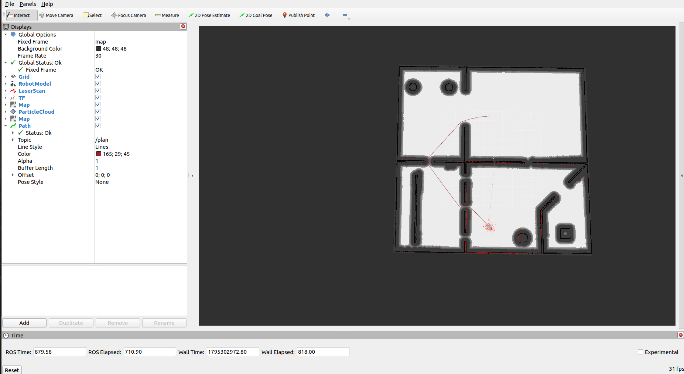
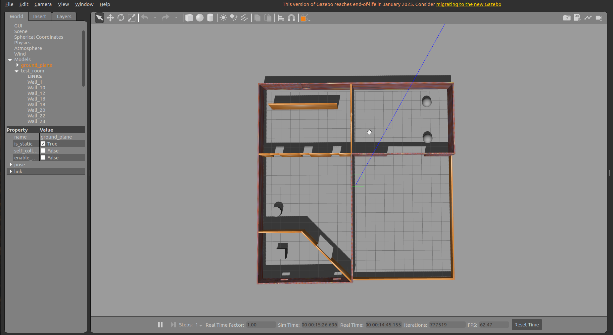

# Level 1: ROS 2 Navigation Assignment: Vedant Anant Kulkarni

ERIC Robotics Level 01 assignment. The starter code for the **Testbed-T1.0.0** robot has its bugs fixed, and a new package, **`testbed_navigation`**, builds the Nav2 workflow by hand: map server, AMCL, planner, controller, behavior server, BT navigator, waypoint follower, velocity smoother and collision monitor, each started individually instead of through `nav2_bringup`.

**Demo video:** [Watch on YouTube](https://youtu.be/d_YL__skTAc)
**Package README:** [`testbed_navigation/README.md`](testbed_navigation/README.md) | **Bug list:** [`BUGS.md`](BUGS.md)

**Environment:** Ubuntu 22.04, ROS 2 Humble, Gazebo Classic 11, workspace `~/assignment_ws`

---

## Repository structure

```
level01_ros_assignment/
├── BUGS.md                  # Starter bugs: how each was found and fixed
├── README.md                # This file
├── help.md                  # Assignment guidelines and FAQs
├── testbed_description/     # STARTER: robot URDF/xacro, meshes, RViz configs
├── testbed_gazebo/          # STARTER: Gazebo worlds, models, spawn launch files
├── testbed_bringup/         # STARTER: map and full-simulation bringup
└── testbed_navigation/      # ADDED: navigation package
    ├── config/              #   map_server, amcl and nav2 parameter files
    ├── launch/              #   map_loader, localization, navigation, bringup_all
    ├── rviz/                #   navigation.rviz
    ├── scripts/             #   patrol.py
    └── docs/                #   images/ (screenshots used in the READMEs)
```

## Approach

1. Built the workspace and fixed the starter build error.
2. Fixed 8 starter bugs, one commit each, and checked 4 suspicious items that turned out not to be bugs (see [`BUGS.md`](BUGS.md)).
3. Created `testbed_navigation` and tested each part alone: map loading, then AMCL localization, then the Nav2 servers.
4. Combined everything in `bringup_all.launch.py`, which starts the environment first, then localization (10 s), navigation (17 s) and RViz (20 s).
5. Tested with RViz goals, a waypoint patrol, and repeated-goal trials.

## What was added

| Feature | Implementation |
|---|---|
| Map loading | `map_server` on `testbed_world.yaml` (405 × 400 cells, 0.05 m) |
| Localization | `amcl`, likelihood-field model, 500-2000 particles, initial pose (0, 5) |
| Planning and control | `NavfnPlanner` + `DWBLocalPlanner`, max 0.26 m/s and 1.0 rad/s |
| Costmaps | Global: static + obstacle + inflation. Local: 3 m rolling window. Robot radius 0.3 m, inflation 0.55 m |
| Behaviors | Default Nav2 behavior trees; `spin`, `backup`, `drive_on_heading`, `wait` recoveries |
| Velocity smoothing | `velocity_smoother` limits acceleration |
| Collision detection | `collision_monitor` stop zone around the robot, fed by the lidar |
| Waypoints | `waypoint_follower` and `scripts/patrol.py` |

**Command path:** controller → `/cmd_vel_nav` → velocity smoother → `/cmd_vel_smoothed` → collision monitor → `/cmd_vel` → robot.

## Starter bugs fixed

Short summary below. Each bug's cause, fix and check is explained in [`BUGS.md`](BUGS.md).

| # | Bug | File |
|---|---|---|
| 1 | `ament_package` missing `()` | `testbed_description/CMakeLists.txt` |
| 2 | Map yaml pointed to a non-existent image | `testbed_bringup/maps/testbed_world.yaml` |
| 3 | `maps/` never installed | `testbed_bringup/CMakeLists.txt` |
| 4 | Lidar max range 1.5 m, raised to 12 m | `testbed_description/urdf/testbed.gazebo` |
| 5 | Stray `>` in IMU plugin XML | `testbed_description/urdf/testbed.gazebo` |
| 6 | `robot_state_publisher` without `use_sim_time` | `robot_description.launch.py` |
| 7 | CRLF line endings in a launch script | `robot_description.launch.py` |
| 8 | Missing `exec_depend` entries | three `package.xml` files |

## Build and run

```bash
cd ~/assignment_ws
rosdep install --from-paths src --ignore-src -r -y
colcon build --symlink-install
source install/setup.bash

ros2 launch testbed_navigation bringup_all.launch.py
```

Wait about 20 s, then set goals with **2D Goal Pose** in RViz. Each part also runs alone (`map_loader`, `localization`, `navigation`); see the package README.

## Challenges

- **Startup order:** Nav2 nodes failed when started before Gazebo, the clock and TF were ready, so `bringup_all` uses staggered timers.
- **Argument collision:** a launch argument named `params_file` clashed with `gazebo_ros`, so each launch file uses its own argument name.
- **Map in RViz:** the map display needed transient-local durability to receive the latched `/map`.
- **Lidar range:** the 1.5 m starter limit would have starved AMCL and the costmaps on a 20 m map.

## Trial results

Five scenarios were tested: same room, doorway, other room, goal on a wall, and obstacle replan. Temporary scripts were written to run the repeated trials and record the numbers; they were used for testing only and are not part of the final repo. Metrics were recorded for the first three goals (5 trials each, same start pose).

| Metric | Goal 1 (same room) | Goal 2 (doorway) | Goal 3 (other room) |
|---|---|---|---|
| Goal X (m) | 6.626 | -6.738 | -4.364 |
| Goal Y (m) | 4.253 | 2.837 | -5.114 |
| Goal Yaw (rad) | -1.560 | -1.598 | -0.017 |
| Successful trials | 5 / 5 | 5 / 5 | 5 / 5 |
| Success rate (%) | 100 | 100 | 100 |
| Avg. navigation time (s) | 28.22 | 33.12 | 68.76 |
| Avg. final error (m) | 0.215 | 0.252 | 0.245 |
| Avg. path length (m) | 6.808 | 7.316 | 16.285 |
| Avg. velocity (m/s) | 0.241 | 0.221 | 0.235 |

Speed stays around 0.22-0.24 m/s, just under the 0.26 m/s limit, so time grows almost linearly with path length. Final error sits near the 0.25 m goal tolerance because the robot stops as soon as it is inside it. The wall-goal and obstacle-replan scenarios also completed successfully.

## Demo video and screenshots

**Demo video:** [Watch on YouTube](https://youtu.be/d_YL__skTAc)

**RViz: system view.** Map with inflated costmap, AMCL particle cloud, laser scan and the planned path (`/plan`) to a goal.



**Gazebo: simulation world.** Top view of the test room the robot navigates.



## Deliverables

- [x] `testbed_navigation` with parameter files and a launch file for each component
- [x] Starter bugs fixed and listed in `BUGS.md`
- [x] READMEs describing the approach and challenges
- [x] Demo video and screenshots added
- [ ] Pull request to `main`

## Possible further changes

- Tighten `xy_goal_tolerance` (for example 0.10 m) and re-measure final error.
- Raise the velocity limits, since travel time is capped by speed.
- Collect metrics for the wall-goal and replan scenarios.
- Try other planners and controllers (Smac, MPPI, Regulated Pure Pursuit).
- Run on a real robot and retune for real sensor noise.

## Contact

**Vedant Anant Kulkarni**, BVCOE | vedantkulkarni252@gmail.com | 9665706770 | GitHub: vedant710