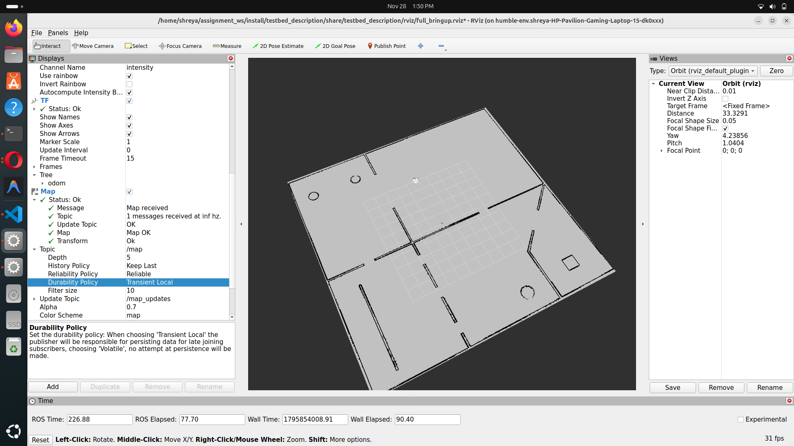
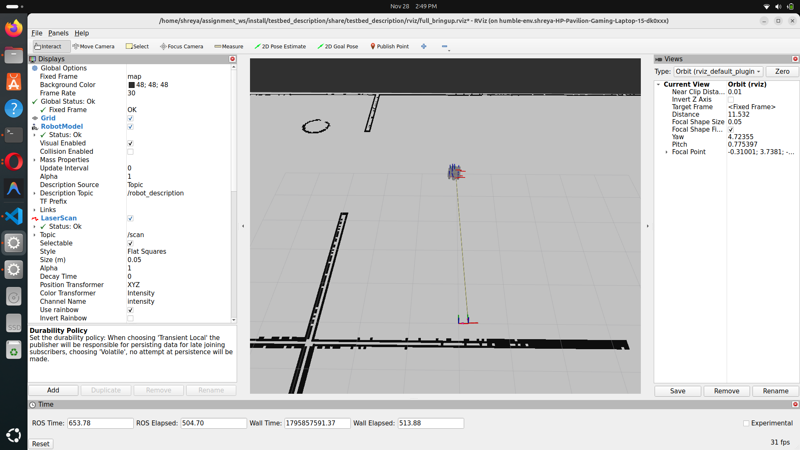
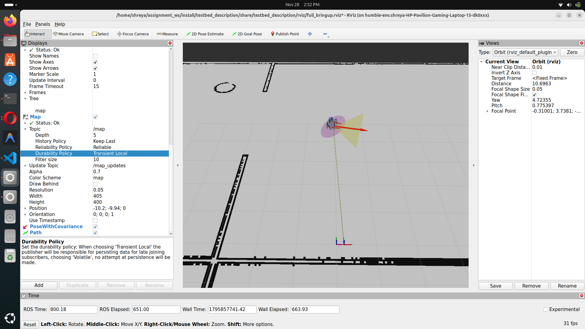

# Level 1: ROS2 Navigation Assignment - Shreya Shibu

## Overview
This repository implements modular autonomous 2D mapping, localization, and navigation for the **Testbed-T1.0.0** differential-drive robot in Gazebo and RViz2 using **ROS 2 Humble** and the **Nav2** navigation stack.

Instead of relying on `nav2_bringup`, the custom `testbed_navigation` package builds each stage independently using individual Nav2 plugin nodes (`nav2_map_server`, `nav2_amcl`, `nav2_planner`, `nav2_controller`, `nav2_behaviors`, `nav2_bt_navigator`, and `nav2_velocity_smoother`) managed via dedicated `nav2_lifecycle_manager` instances.

---

## Repository Structure

```text
EricR_task_ShreyaShibu/
├── bugs.txt                                  # Log of intentional starter code bugs identified and fixed
├── media/                                    # Verification screenshots & navigation demo video
│   ├── assignment-map-loader.png
│   ├── assignment-localization2.png
│   ├── assignment-navigation.png
│   └── assignment.webm
├── testbed_bringup/                          # Full simulation bringup & 2D floorplan map files
├── testbed_description/                      # Robot URDF/Xacro, meshes, and Gazebo sensor plugins
├── testbed_gazebo/                           # Gazebo world and robot spawn launch configuration
├── testbed_navigation/                       # Custom modular Nav2 navigation package
│   ├── CMakeLists.txt
│   ├── package.xml
│   ├── config/
│   │   ├── amcl_params.yaml                  # AMCL localization parameters tuned for Testbed-T1.0.0
│   │   └── nav2_params.yaml                  # Nav2 planner, controller, costmap, BT & smoother configs
│   ├── launch/
│   │   ├── map_loader.launch.py              # Launches nav2_map_server + lifecycle manager
│   │   ├── localization.launch.py            # Launches nav2_amcl + lifecycle manager
│   │   └── navigation.launch.py              # Launches full Nav2 navigation stack + lifecycle manager
│   └── scripts/
├── help.md
└── README.md
```

---

## Starter Bugs Identified & Resolved
All intentional starter repository issues encountered during setup and testing were resolved and logged in [`bugs.txt`](bugs.txt):

1. **Missing URDF & Launch Directories in `testbed_description/CMakeLists.txt`:**
   - Only `meshes` was listed inside `install(DIRECTORY ...)`, preventing `urdf/` and `launch/` from being copied into the `install/` directory during `colcon build`. Added `urdf` and `launch` to `install(DIRECTORY ...)`.
2. **Incorrect Map Image Filename in `testbed_bringup/maps/testbed_world.yaml`:**
   - The `image` parameter pointed to `testbed_world.png` instead of the existing `testbed_world.pgm` occupancy grid file. Updated `image: testbed_world.pgm`.
3. **Missing `maps` Directory in `testbed_bringup/CMakeLists.txt`:**
   - The `maps` folder was omitted from `install(DIRECTORY ...)`, preventing `map_server` from locating `testbed_world.yaml` via `get_package_share_directory('testbed_bringup')`. Added `maps` to `install(DIRECTORY ...)`.

---

## Approach, Challenges & Solutions

### Design Approach
- **Modular Nav2 Architecture:** Following a modular, plugin-based design, each navigation stage was separated into independent parameter files and launch files (`map_loader.launch.py`, `localization.launch.py`, and `navigation.launch.py`), each managed by its own `nav2_lifecycle_manager` (`use_sim_time: True`, `autostart: True`) so map loading, localization, and path planning can be launched and verified incrementally.

### Challenges & Solutions
1. **Localization Stability with Short-Range LiDAR (`1.5 m`):**
   - **Challenge:** The robot spawns in the middle of a large room (`~6 m × 6 m`), while its simulated LiDAR only reaches `1.5 m`. Because the laser cannot reach the walls from the center of the room, AMCL had very few wall readings and its estimated position jumped around when the robot moved.
   - **Solution:** Set the robot's exact starting coordinates (`x: 0.0, y: 5.0`) and `1.5 m` laser range in `amcl_params.yaml`, and lowered the wheel odometry noise parameters (`alpha1..5: 0.01`) so AMCL relies smoothly on wheel odometry until the robot gets close enough to a wall for LiDAR updates.

2. **Doorway Clearance & Smooth Driving:**
   - **Challenge:** With a `0.35 m` wheelbase (`robot_radius: 0.22 m`), larger costmap inflation radii made narrow doorways restrictive and occasionally caused stalls when entering at an angle.
   - **Solution:** Configured `NavfnPlanner` (global planner) and `DWBLocalPlanner` (local controller), tuned `inflation_radius` to `0.26` on both costmaps for reliable doorway passage, and added `nav2_velocity_smoother` (`cmd_vel_nav` → `cmd_vel`) for smooth acceleration and turning.

3. **Cross-Terminal Node Discovery:**
   - **Challenge:** Nodes launched across separate terminal sessions initially failed to discover `/map` and lifecycle services over default shared-memory DDS.
   - **Solution:** Switched the RMW middleware to Eclipse Cyclone DDS (`RMW_IMPLEMENTATION=rmw_cyclonedds_cpp`), ensuring reliable communication between Gazebo, RViz2, and all Nav2 nodes.


---

## Build & Execution Workflow

### 1. Build the Workspace
```bash
cd ~/assignment_ws
colcon build
source install/setup.bash
```

### 2. Execution & Verification Workflow
Source `install/setup.bash` in each terminal and launch in sequence:

1. **Launch Simulation:** `ros2 launch testbed_bringup testbed_full_bringup.launch.py`
2. **Load Map:** `ros2 launch testbed_navigation map_loader.launch.py`
3. **Start Localization:** `ros2 launch testbed_navigation localization.launch.py`
4. **Start Navigation:** `ros2 launch testbed_navigation navigation.launch.py`
5. **RViz Visualization:** Set `Fixed Frame` to `map`, add the `/map` display (`Durability Policy: Transient Local`) along with `/amcl_pose`, `/local_costmap/costmap`, `/plan`, and `/local_plan` topics, and send target poses using the `2D Goal Pose` tool.

---

## Demonstration & Results

- **Autonomous Navigation Video Demo:** [Watch Full Navigation Demo (`assignment.webm`)](media/assignment.webm)

### 1. Map Loading (`map_loader.launch.py`)


### 2. AMCL Localization (`localization.launch.py`)


### 3. Autonomous Doorway Navigation (`navigation.launch.py`)


---

## Contact Info
 - Name: Shreya Shibu
 - Contact number: 9495583135
 - Email Address: shreyabtech27@gmail.com
