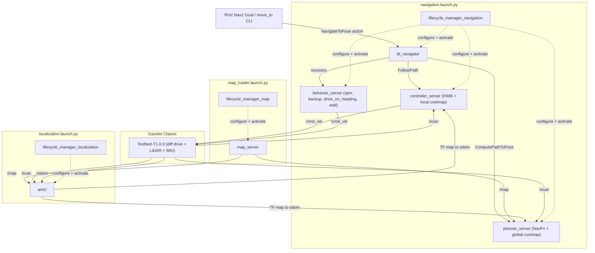
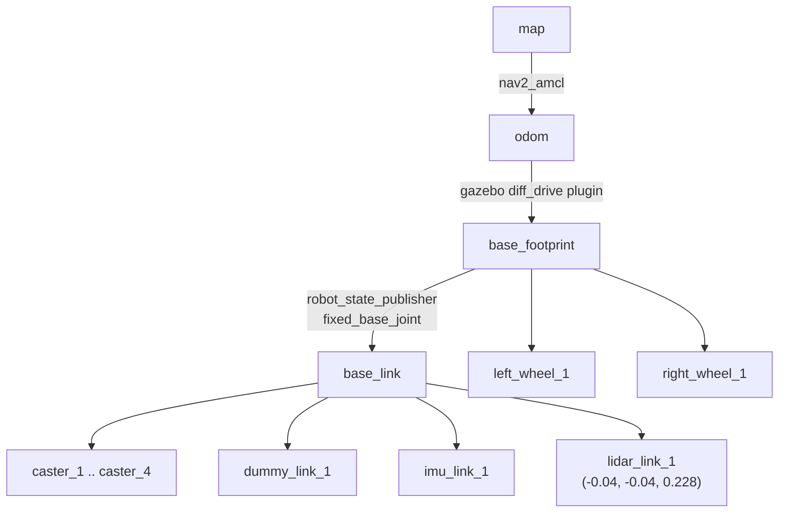
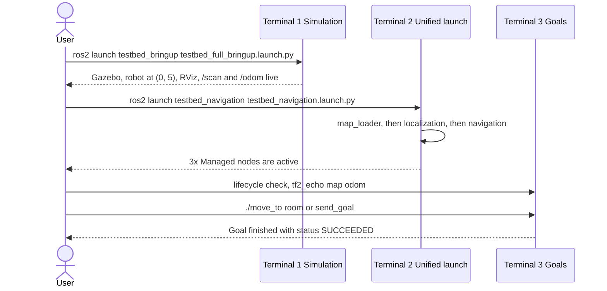
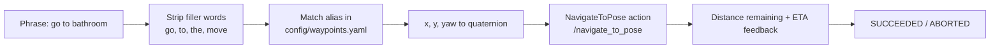
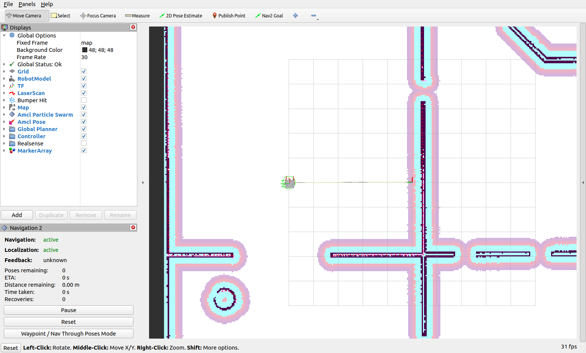
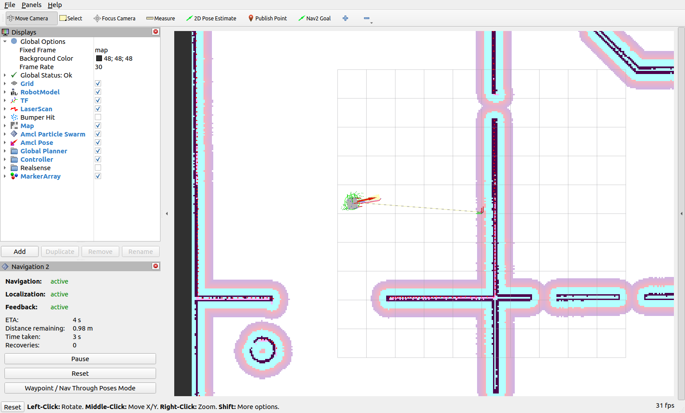

# Level 1: ROS 2 Navigation Assignment ERIC Robotics - Ayush Tandon


**Environment:** ROS 2 Humble | Gazebo Classic 11.10.2 | Ubuntu 22.04 LTS
## Demo


https://github.com/user-attachments/assets/9f2450d5-42eb-43c0-bf56-31dc2381a3b5


---

## 1. Summary

Implementation of the ERIC Robotics Level 1 ROS 2 Navigation Assignment for the **Testbed-T1.0.0** differential-drive robot.

1. **Starter-code audit:** 9 defects found and fixed (build config, URDF, sensor range, map path, kinematics, clock sync). Details in [BUGS_FIXED.txt](./BUGS_FIXED.txt).
2. **Modular Nav2 stack (`testbed_navigation`):** `ament_cmake` package, no `nav2_bringup`. Three independent, lifecycle-managed launch files:
   - `map_loader.launch.py`: `nav2_map_server` + lifecycle manager
   - `localization.launch.py`: `nav2_amcl` + lifecycle manager, config in `amcl_params.yaml`
   - `navigation.launch.py`: planner (NavFn), controller (DWB), behavior server, BT navigator + costmaps, config in `nav2_params.yaml`
3. **Extra:** `testbed_navigation.launch.py` (unified launch) and `move_to` (send a goal by waypoint name).
4. **Verified in simulation:** all 6 lifecycle nodes active, `map -> odom` TF live, goals end with `SUCCEEDED`.

---

## 2. Architecture

### 2.1 System overview



### 2.2 TF tree



### 2.3 Startup sequence



### 2.4 Named waypoint navigation (`move_to`)



Waypoints are named goal poses in free space of the provided map, not modeled rooms. Run `./move_to --list` for the exact coordinates.

### 2.5 Interfaces

| Subsystem | Topic | Type | Notes |
| :--- | :--- | :--- | :--- |
| LaserScan | `/scan` | `sensor_msgs/msg/LaserScan` | 360 deg, 30 Hz, 0.1 to 10.0 m |
| Odometry | `/odom` | `nav_msgs/msg/Odometry` | 100 Hz, diff-drive plugin |
| Velocity | `/cmd_vel` | `geometry_msgs/msg/Twist` | Controller to wheels |
| Map | `/map` | `nav_msgs/msg/OccupancyGrid` | 405 x 400 @ 0.05 m/cell |
| AMCL pose | `/amcl_pose` | `geometry_msgs/msg/PoseWithCovarianceStamped` | map frame |
| Goal action | `/navigate_to_pose` | `nav2_msgs/action/NavigateToPose` | BT navigator |

Full specs: [docs/ROBOT_ARCHITECTURE.md](./docs/ROBOT_ARCHITECTURE.md).

---

## 3. Starter-Code Defects Fixed

Full write-up in [BUGS_FIXED.txt](./BUGS_FIXED.txt).

| # | File | Fix |
| :-: | :--- | :--- |
| 1 | `testbed_description/CMakeLists.txt` | `ament_package` -> `ament_package()` |
| 2 | `testbed_bringup/maps/testbed_world.yaml` | `wrong_path_testbed_world.pgm` -> `testbed_world.pgm` |
| 3 | `testbed_bringup/CMakeLists.txt` | Install `maps` directory |
| 4 | `testbed_gazebo/CMakeLists.txt` | Install `models` directory |
| 5 | `testbed_description/urdf/testbed.gazebo` | Removed duplicate `>` in IMU tag |
| 6 | `testbed_description/urdf/testbed.gazebo` | Removed ROS 1 `libgazebo_ros_control.so` plugin |
| 7 | `testbed_description/urdf/testbed.gazebo` | LiDAR `<max>` 1.5 m -> 10.0 m |
| 8 | `testbed_description/launch/robot_description.launch.py` | Added `use_sim_time` to `robot_state_publisher` |
| 9 | `testbed_description/urdf/testbed.gazebo` | `<wheel_separation>` 0.35 -> 0.346 m (matches joint origins) |

---

## 4. Repository Structure

```text
level01_ros_assignment/
├── testbed_bringup/               # Bringup launch + maps
├── testbed_description/           # URDF/Xacro, meshes, RViz configs
├── testbed_gazebo/                # Worlds, models, spawn launch
├── testbed_navigation/            # [NEW] Nav2 package
│   ├── config/
│   │   ├── amcl_params.yaml
│   │   ├── nav2_params.yaml
│   │   └── waypoints.yaml         # Named waypoints + aliases
│   ├── launch/
│   │   ├── map_loader.launch.py
│   │   ├── localization.launch.py
│   │   ├── navigation.launch.py
│   │   └── testbed_navigation.launch.py   # Unified launch
│   ├── rviz/
│   ├── scripts/move_to.py         # Named-waypoint goal client
│   ├── CMakeLists.txt
│   ├── package.xml
│   └── README.md
├── docs/
│   ├── media/                     # Screenshots
│   └── ROBOT_ARCHITECTURE.md
├── move_to                        # CLI wrapper for scripts/move_to.py
├── BUGS_FIXED.txt
├── help.md
└── README.md
```

---

## 5. Build

Prerequisites: Ubuntu 22.04, ROS 2 Humble Desktop, Gazebo Classic 11.10.2, Nav2 binaries:

```bash
sudo apt update
sudo apt install ros-humble-navigation2 ros-humble-nav2-bringup
```

(`nav2_bringup` is installed only for its dependencies. No launch file in this package uses it.)

```bash
cd ~/Robotics/level01_ros_assignment
source /opt/ros/humble/setup.bash
colcon build --symlink-install
source install/setup.bash
```

---

## 6. Run and Verify (Unified Launch, 4 Terminals)

Every terminal needs the workspace sourced:

```bash
cd ~/Robotics/level01_ros_assignment
source /opt/ros/humble/setup.bash
source install/setup.bash
```

### Terminal 0: clean up and build

```bash
pkill -9 -f gzserver; pkill -9 -f gzclient; pkill -9 -f rviz2; pkill -9 -f robot_state_publisher; pkill -9 -f nav2_
sleep 2
ros2 daemon stop; ros2 daemon start
cd ~/Robotics/level01_ros_assignment
source /opt/ros/humble/setup.bash
colcon build --symlink-install
source install/setup.bash
ros2 pkg prefix testbed_navigation
ros2 run testbed_navigation move_to --list
```

The last command should list the rooms. If it errors, the install step in `CMakeLists.txt` is wrong.

### Terminal 1: simulation

Wait for Gazebo, the robot and RViz.

```bash
unset GAZEBO_MASTER_URI GAZEBO_MODEL_DATABASE_URI
source /usr/share/gazebo/setup.sh
cd ~/Robotics/level01_ros_assignment
source /opt/ros/humble/setup.bash
source install/setup.bash
ros2 launch testbed_bringup testbed_full_bringup.launch.py
```

If `gzserver` dies with exit code -11, rerun the `pkill` block from Terminal 0 and relaunch.

### Terminal 2: navigation

Wait for 3 lines saying `Managed nodes are active`, then 5 more seconds.

```bash
cd ~/Robotics/level01_ros_assignment
source /opt/ros/humble/setup.bash
source install/setup.bash
ros2 launch testbed_navigation testbed_navigation.launch.py
```

### Terminal 3: move by name

```bash
cd ~/Robotics/level01_ros_assignment
source /opt/ros/humble/setup.bash
source install/setup.bash

for n in map_server amcl controller_server planner_server behavior_server bt_navigator; do echo -n "$n: "; ros2 lifecycle get /$n; done

./move_to --list
./move_to "living room"
./move_to "go to bathroom"
./move_to "move to kitchen"
./move_to "return home"
```

The `ros2 run testbed_navigation move_to <room>` form works from any sourced terminal. Send the next goal only after the previous one prints `SUCCEEDED`.

### Raw action goal (alternative)

```bash
ros2 action send_goal /navigate_to_pose nav2_msgs/action/NavigateToPose \
  "{pose: {header: {frame_id: 'map'}, pose: {position: {x: 2.0, y: 5.0, z: 0.0}, orientation: {w: 1.0}}}}"
```

Goals can also be sent from RViz with the **Nav2 Goal** tool (Fixed Frame: `map`).

### Stop

`Ctrl+C` in Terminals 1 and 2, then:

```bash
pkill -9 -f gzserver; pkill -9 -f gzclient; pkill -9 -f rviz2
```

### Modular launch (each subsystem on its own)

```bash
ros2 launch testbed_navigation map_loader.launch.py        # check: ros2 lifecycle get /map_server
ros2 launch testbed_navigation localization.launch.py      # check: ros2 run tf2_ros tf2_echo map odom
ros2 launch testbed_navigation navigation.launch.py        # check: ros2 action list
```

Start them in this order after Terminal 1. `navigation.launch.py` alone does not move the robot: it needs `/map` and the `map -> odom` transform from the other two.

---

## 7. Pass Criteria

| Check | Command | Expected |
| :--- | :--- | :--- |
| Build | `colcon build --symlink-install` | 4/4 packages finished |
| Lint/tests | `colcon test --packages-select testbed_navigation` | 0 failures |
| Lifecycle | `ros2 lifecycle get /<node>` (6 nodes) | `active [3]` |
| TF | `ros2 run tf2_ros tf2_echo map odom` | continuous transforms |
| Sensors | `ros2 topic hz /scan`, `/odom` | about 30 Hz, about 100 Hz |
| Navigation | `./move_to "<name>"` | `SUCCEEDED`, robot moves in Gazebo |

### Screenshots

**AMCL localization and particle cloud**



**Autonomous navigation: global plan and local costmap**



---

## 8. Troubleshooting

| Symptom | Cause | Fix |
| :--- | :--- | :--- |
| `Package 'testbed_navigation' not found` | Workspace not sourced in this terminal | `source install/setup.bash` |
| Robot does not move | Only `navigation.launch.py` running | Use the unified launch, or start map_loader and localization first |
| `gzserver` exit code -11 | Stale Gazebo processes or env vars | Run the Terminal 0 `pkill` block, `unset GAZEBO_MASTER_URI GAZEBO_MODEL_DATABASE_URI`, relaunch |
| Goal rejected right after launch | Costmaps and TF not ready | Wait about 5 s after `Managed nodes are active` |
| `Invalid frame ID "map"` once in `tf2_echo` | AMCL has not published yet | Harmless, resolves on its own |

Notes:
- **Initial pose:** `amcl_params.yaml` sets the spawn pose (x=0.0, y=5.0, yaw=0.0), so AMCL starts localized. 2D Pose Estimate in RViz also works.
- **Clock:** all nodes and costmaps run with `use_sim_time: True`.
- **DDS:** if discovery or timeout issues appear, switch to Cyclone DDS as advised in `help.md`:
  ```bash
  sudo apt install ros-humble-rmw-cyclonedds-cpp
  export RMW_IMPLEMENTATION=rmw_cyclonedds_cpp
  ```

---

## 9. Contact

- **Name:** Ayush
- **GitHub:** [https://github.com/Droid-DevX](https://github.com/Droid-DevX)
- **Fork:** [https://github.com/Droid-DevX/level01_ros_assignment](https://github.com/Droid-DevX/level01_ros_assignment)

