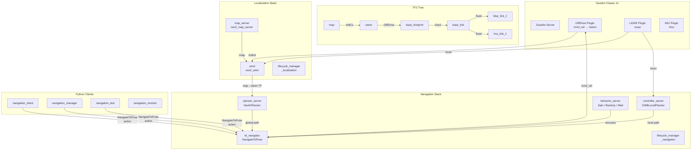

# testbed_navigation

> Nav2 autonomous navigation package for the **Testbed-T1.0.0** differential-drive robot.  
> ERIC Robotics — Level 1 ROS 2 Navigation Assignment.

---

## Table of Contents

1. [Project Objective](#project-objective)
2. [System Architecture](#system-architecture)
3. [Package Structure](#package-structure)
4. [Prerequisites](#prerequisites)
5. [Build & Install](#build--install)
6. [Launch Workflow](#launch-workflow)
7. [Navigation Nodes](#navigation-nodes)
8. [Configuration Reference](#configuration-reference)
9. [Behavior Tree](#behavior-tree)
10. [Python Modules](#python-modules)
11. [Testing](#testing)
12. [Troubleshooting](#troubleshooting)

---

## Project Objective

Implement production-quality autonomous navigation for the Testbed-T1.0.0 robot in a Gazebo Classic 11 simulated environment using the **Nav2** stack on **ROS 2 Humble**.

### Design Principles

| Principle | Implementation |
|---|---|
| **Python-first** custom logic | Launch files, action client, manager, monitor, and tests are all Python 3 / `rclpy` |
| **Official C++ Nav2 servers** for algorithms | NavFn planner, DWB controller, AMCL, Spin/BackUp/Wait behaviors |
| **No `nav2_bringup` shortcut** | Every Nav2 node is explicitly instantiated and configured in our own launch files |
| **Modular launch composition** | Localization and navigation are independently launchable, then composed in `full_navigation.launch.py` |
| **Robot-specific tuning** | All parameters derived from actual URDF/Gazebo inspection (not generic Nav2 defaults) |

---

## System Architecture



### Lifecycle Management

Three separate lifecycle managers activate nodes in dependency order:

| Manager | Nodes | Purpose |
|---|---|---|
| `lifecycle_manager_localization` | `map_server` → `amcl` | Map must be available before AMCL can localize |
| `lifecycle_manager_navigation` | `planner_server` → `controller_server` → `behavior_server` → `bt_navigator` | Nav stack requires localization to already be active |
| (optional) `lifecycle_manager_map` | `map_server` | Used by standalone `map_loader.launch.py` |

---

## Package Structure

```
testbed_navigation/
├── package.xml                   # ament_python package manifest
├── setup.py                      # Build configuration + entry points
├── setup.cfg                     # Install directories
├── resource/
│   └── testbed_navigation        # Ament index marker
├── testbed_navigation/           # Python source
│   ├── __init__.py
│   ├── navigation_client.py      # Single-goal NavigateToPose action client
│   ├── navigation_manager.py     # Interactive terminal goal entry
│   ├── navigation_monitor.py     # System diagnostics monitor
│   └── navigation_test.py        # Automated smoke test
├── launch/
│   ├── map_loader.launch.py      # Map server only
│   ├── localization.launch.py    # Map server + AMCL
│   ├── navigation.launch.py      # Planner + Controller + Behavior + BT
│   └── full_navigation.launch.py # Localization + Navigation + RViz2
├── config/
│   ├── map_server_params.yaml    # Map server parameters
│   ├── amcl_params.yaml          # AMCL localization parameters
│   └── nav2_params.yaml          # Full Nav2 stack parameters
├── behavior_trees/
│   └── navigate_to_pose.xml      # Custom BT with replanning + recovery
├── rviz/
│   └── navigation.rviz           # Pre-configured Nav2 visualization
├── test/
│   ├── test_navigation_client.py # Unit tests: node + quaternion
│   └── test_navigation_config.py # Config validation tests
└── README.md                     # This file
```

---

## Prerequisites

| Requirement | Version |
|---|---|
| Ubuntu | 22.04 LTS |
| ROS 2 | Humble Hawksbill |
| Gazebo | Classic 11 |
| Nav2 | Humble release |
| Python | 3.10+ |

Install Nav2 and dependencies:

```bash
sudo apt install ros-humble-nav2-bringup ros-humble-nav2-map-server \
  ros-humble-nav2-amcl ros-humble-nav2-planner ros-humble-nav2-controller \
  ros-humble-nav2-behaviors ros-humble-nav2-bt-navigator \
  ros-humble-nav2-lifecycle-manager ros-humble-nav2-msgs \
  ros-humble-gazebo-ros-pkgs ros-humble-xacro
```

---

## Build & Install

```bash
# Source ROS 2
source /opt/ros/humble/setup.bash

# Build the workspace (all packages)
cd ~/eric_ws   # or wherever the workspace is
colcon build --symlink-install

# Source the overlay
source install/setup.bash
```

---

## Launch Workflow

### Step 1 — Start the Simulation

```bash
ros2 launch testbed_bringup testbed_full_bringup.launch.py
```

This starts Gazebo Classic with the Testbed-T1.0.0 robot spawned at `(0.0, 5.0, 0.0)`.

### Step 2 — Start the Full Navigation Stack

```bash
ros2 launch testbed_navigation full_navigation.launch.py
```

This launches `map_server`, `amcl`, `planner_server`, `controller_server`, `behavior_server`, `bt_navigator`, two lifecycle managers, and RViz2.

To start **without RViz**:

```bash
ros2 launch testbed_navigation full_navigation.launch.py use_rviz:=false
```

### Step 3 — Send a Navigation Goal

**Option A** — Single goal via CLI parameters:

```bash
ros2 run testbed_navigation navigation_client \
    --ros-args -p x:=2.0 -p y:=3.0 -p yaw:=0.0
```

**Option B** — Interactive terminal:

```bash
ros2 run testbed_navigation navigation_manager
```

**Option C** — RViz2 "Nav2 Goal" button (click on the map).

**Option D** — Automated smoke test:

```bash
ros2 run testbed_navigation navigation_test
```

### Modular Launch (Advanced)

Launch localization and navigation separately:

```bash
# Terminal 1: Localization only
ros2 launch testbed_navigation localization.launch.py

# Terminal 2: Navigation only (after localization is active)
ros2 launch testbed_navigation navigation.launch.py

# Terminal 3: Monitor system health
ros2 run testbed_navigation navigation_monitor
```

---

## Navigation Nodes

### Map Server (`nav2_map_server`)

Loads the pre-built occupancy grid from `testbed_bringup/maps/testbed_world.yaml` (405×400 px, 0.05 m/px resolution) and publishes it on `/map`.

### AMCL (`nav2_amcl`)

Adaptive Monte Carlo Localization using the `DifferentialMotionModel`. Subscribes to `/scan` (300-beam, 1.5 m range LiDAR) and `/odom`. Publishes the `map` → `odom` transform.

**Key tuning decisions:**

- `laser_max_range: 1.5` — matches the robot's short-range LiDAR
- `max_beams: 60` — subsample of 300 beams for efficiency
- `initial_pose: (0.0, 5.0, 0.0)` — matches the Gazebo spawn position

### NavFn Planner (`nav2_navfn_planner`)

Dijkstra-based global planner operating on the global costmap. Replanning is triggered at 1 Hz by the behavior tree's `RateController`.

### DWB Local Planner (`dwb_core::DWBLocalPlanner`)

Dynamic Window approach controller with:

- `max_vel_x: 0.26 m/s` — conservative for the small robot
- `max_vel_theta: 1.0 rad/s`
- 7 trajectory critics: `RotateToGoal`, `Oscillation`, `BaseObstacle`, `GoalAlign`, `PathAlign`, `PathDist`, `GoalDist`
- `sim_time: 1.7 s` — appropriate for the 1.5 m LiDAR range

### Behavior Server (`nav2_behaviors`)

Recovery behaviors: `Spin` (90° in-place rotation), `BackUp` (0.15 m reverse), `Wait` (5 s pause). Executed in round-robin order by the behavior tree when navigation fails.

### BT Navigator (`nav2_bt_navigator`)

Executes the custom behavior tree (`navigate_to_pose.xml`) that orchestrates planning, path following, and recovery.

---

## Configuration Reference

### Robot Parameters (from URDF/Gazebo)

| Parameter | Value | Source |
|---|---|---|
| Base frame | `base_footprint` | URDF fixed joint |
| Odom frame | `odom` | Gazebo diff_drive plugin |
| Wheel separation | 0.346 m | Computed from URDF joint origins |
| Wheel radius | 0.05 m | URDF cylinder geometry |
| LiDAR frame | `lidar_link_1` | URDF joint |
| LiDAR range | 0.10–1.5 m | Gazebo sensor config |
| LiDAR samples | 300 | Gazebo sensor config |
| IMU frame | `imu_link_1` | URDF joint |
| Robot footprint | `[[-0.21,-0.24],[-0.21,0.16],[0.10,0.16],[0.10,-0.24]]` | Computed from URDF collision geometry |
| Cmd vel topic | `/cmd_vel` | Gazebo diff_drive plugin |
| Odom topic | `/odom` | Gazebo diff_drive plugin |
| Scan topic | `/scan` | Gazebo ray sensor plugin |
| IMU topic | `/imu` | Gazebo IMU plugin |

### Costmap Configuration

| Parameter | Global | Local |
|---|---|---|
| Frame | `map` | `odom` |
| Resolution | 0.05 m/px | 0.05 m/px |
| Rolling window | No | Yes (3×3 m) |
| Static layer | Yes | No |
| Obstacle layer | Yes | Yes |
| Inflation layer | Yes | Yes |
| Inflation radius | 0.55 m | 0.55 m |
| Obstacle max range | 1.4 m | 1.4 m |

---

## Behavior Tree

The custom behavior tree (`navigate_to_pose.xml`) implements:

```
RecoveryNode (max 6 retries)
├── PipelineSequence
│   ├── RateController (1 Hz) → ComputePathToPose (GridBased)
│   └── FollowPath (FollowPath/DWB)
└── ReactiveFallback (recovery)
    ├── GoalUpdated (interrupt recovery if new goal arrives)
    └── RoundRobin
        ├── ClearEntireCostmap (local + global)
        ├── Spin (90°)
        ├── Wait (5 s)
        └── BackUp (0.15 m)
```

**Design rationale:**
- `PipelineSequence` enables concurrent replanning and path following.
- `RateController` at 1 Hz prevents excessive replanning.
- `ReactiveFallback` allows `GoalUpdated` to preempt recovery when a new goal arrives.
- `RoundRobin` cycles through recovery strategies progressively.
- Short `BackUp` distance (0.15 m) is safe for the small robot footprint.

---

## Python Modules

### `navigation_client.py`

Single-goal NavigateToPose action client. Accepts goal coordinates as ROS parameters:

```bash
ros2 run testbed_navigation navigation_client \
    --ros-args -p x:=2.0 -p y:=3.0 -p yaw:=1.57
```

Reports feedback (distance remaining) and final result (SUCCEEDED/ABORTED/CANCELED).

### `navigation_manager.py`

Interactive terminal-based navigation manager. Prompts the user for `(x, y, yaw)` goals in a loop. Supports:

- Continuous goal entry
- Goal cancellation via `Ctrl+C`
- Clean shutdown

### `navigation_monitor.py`

System health monitor that checks:

- Topic availability: `/clock`, `/map`, `/scan`, `/odom`, `/imu`, `/cmd_vel`
- TF frame availability: `map`, `odom`, `base_footprint`, `base_link`, `lidar_link_1`
- Action server availability: `navigate_to_pose`

Reports status every 5 seconds.

### `navigation_test.py`

Automated smoke test that sends a navigation goal to `(1.0, 4.0, 0.0)` — a verified free-space position in the map — and reports success or failure. Useful for validating the full navigation pipeline after deployment.

---

## Testing

### Run All Tests

```bash
cd ~/eric_ws
colcon test --packages-select testbed_navigation
colcon test-result --verbose
```

### Test Categories

| Test File | What It Validates |
|---|---|
| `test_navigation_client.py` | Node initialization, parameter defaults, `yaw_to_quaternion` math, action client creation |
| `test_navigation_config.py` | YAML syntax, required keys, frame consistency, plugin names, BT structure, `package.xml` deps |

---

## Troubleshooting

### "NavigateToPose action server not available"

**Cause:** The navigation stack is not fully active.

**Fix:**
1. Verify localization is running: `ros2 lifecycle list /map_server` → should be `active`.
2. Verify navigation is running: `ros2 lifecycle list /bt_navigator` → should be `active`.
3. Check lifecycle manager logs for errors.

### Robot does not move

**Cause:** Likely a TF or costmap issue.

**Fix:**
1. Run `ros2 run testbed_navigation navigation_monitor` to check all topics and TF frames.
2. Verify AMCL is publishing `map → odom`: `ros2 run tf2_ros tf2_echo map odom`.
3. Check that `/scan` is publishing: `ros2 topic hz /scan`.
4. Check that the costmaps are receiving sensor data in RViz2.

### "Transform timeout" errors

**Cause:** Simulation clock not reaching Nav2 nodes.

**Fix:** Ensure `use_sim_time: true` is set in all parameter files. Check that Gazebo is publishing `/clock`: `ros2 topic hz /clock`.

### AMCL particle cloud not converging

**Cause:** Initial pose mismatch or poor sensor model tuning.

**Fix:**
1. Verify spawn position matches `initial_pose.x/y/yaw` in `amcl_params.yaml`.
2. Use the "2D Pose Estimate" button in RViz2 to reinitialize AMCL.
3. Drive the robot manually to help AMCL converge: `ros2 topic pub /cmd_vel geometry_msgs/Twist '{linear: {x: 0.1}}'`.

### Costmap shows no obstacles

**Cause:** LiDAR data not reaching costmap obstacle layer.

**Fix:**
1. Verify `/scan` frame_id matches the URDF: should be `lidar_link_1`.
2. Check that the TF chain `map → odom → base_footprint → base_link → lidar_link_1` is complete.
3. Verify `obstacle_max_range: 1.4` is appropriate (should be < LiDAR max range of 1.5 m).

### Path planned but robot oscillates

**Cause:** DWB controller tuning issue.

**Fix:** Adjust `sim_time`, increase `PathAlign.scale`, or reduce `max_vel_x` in `nav2_params.yaml`.

---

## License

Apache-2.0

## Author

Name - Kunal Jadhav 
Contact- 9130062558
Email- jadhavkr25.rai@coeptech.ac.in / kunaljadhav4222@gmail.com


