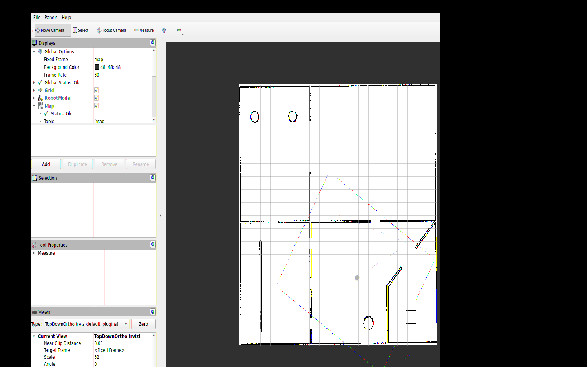

# Testbed ROS 2 Navigation

This project adds a manual Nav2 workflow for the Testbed-T1.0.0 robot. Map loading, AMCL localization, and navigation run from separate launch files. The launch files start the Nav2 nodes directly instead of using nav2_bringup.

## Requirements

The assignment targets ROS 2 Humble, Nav2, Gazebo Classic 11, and RViz. Build the four packages in a ROS 2 workspace:

~~~bash
cd ~/assignment_ws
rosdep install --from-paths src --ignore-src -r -y
colcon build --symlink-install
source install/setup.bash
~~~

## Run the simulation

Start each command in a separate terminal. Source the workspace in each terminal.

1. Start Gazebo, the robot, and RViz:

   ~~~bash
   ros2 launch testbed_bringup testbed_full_bringup.launch.py
   ~~~

2. Load the map:

   ~~~bash
   ros2 launch testbed_navigation map_loader.launch.py
   ~~~

3. Start AMCL:

   ~~~bash
   ros2 launch testbed_navigation localization.launch.py
   ~~~

4. Start navigation:

   ~~~bash
   ros2 launch testbed_navigation navigation.launch.py
   ~~~

Use RViz's 2D Goal Pose tool, or send a goal from another terminal:

~~~bash
ros2 action send_goal /navigate_to_pose nav2_msgs/action/NavigateToPose "{pose: {header: {frame_id: map}, pose: {position: {x: 3.0, y: 2.0}, orientation: {w: 1.0}}}}"
~~~

The default AMCL estimate is (0, 5, 0), matching the robot's spawn pose. To change it, pass initial_x, initial_y, or initial_yaw to localization.launch.py. The map loader also accepts a different map path with map:=/path/to/map.yaml.

## Navigation setup

- map_loader.launch.py starts map_server and its lifecycle manager.
- localization.launch.py starts AMCL and its lifecycle manager.
- navigation.launch.py starts the planner, controller, behavior server, BT navigator, velocity smoother, and lifecycle manager.
- NavFn plans paths; Regulated Pure Pursuit follows them. The behavior trees include costmap clearing and recovery actions.
- The costmaps are configured inside the planner and controller servers.
- The costmap footprint is a measured 0.35 m by 0.30 m rectangle. The LiDAR publishes /scan from lidar_link_1.
- The velocity smoother limits acceleration and stops promptly when the controller stops publishing commands. Collision Monitor is optional and is not part of this bringup.

## Verification

The four packages build in ROS 2 Humble, and rosdep reports no missing dependencies. In Gazebo, the map, localization, and navigation nodes activated successfully. Goals at (3, 2) and (0, 5) both returned SUCCEEDED. After the stop-timeout change, measured drift was about 0.036 m over three seconds.

The known model-geometry limitation and the fixes made to the starter packages are listed in bugs.txt.

## Demo

[Watch the 20-second Gazebo navigation demo](testbed_navigation/evidence/navigation_demo.mp4).

## Author

- Name: Alffrin Regi
- Email: alffrin10@gmail.com
- Contact number: +91 9495937829

`bugs.txt` is at the repository root, outside `testbed_navigation`, as requested. The starter repository has no license file; its package manifests use `TODO: License declaration`.
