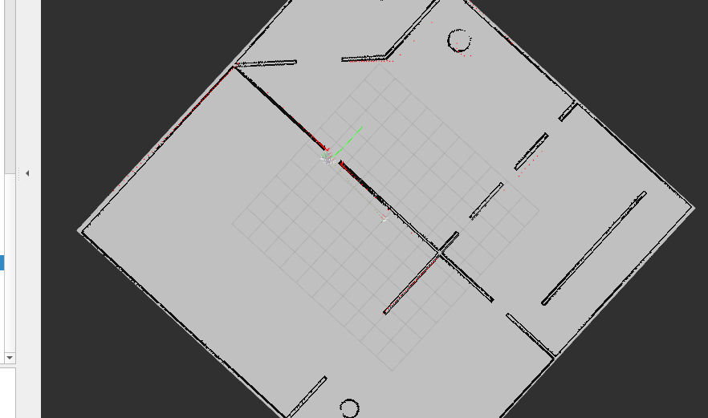
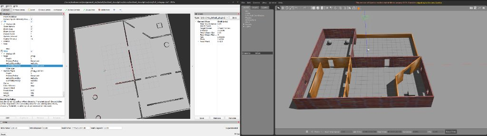

# ROS2 Navigation Assignment - Level 1
**Submitted by:** Mohammed Naveedh  
**Email:** mohammednaveedh1@gmail.com  

---

### Overview
Here is my completed submission for the Level 1 ROS2 Navigation assignment 

All intentional bugs in the starter code have been fixed and logged in `bugs_fixed.txt` in the root folder.

---

### Starter Code Bugs
The starter repository had several intentional bugs preventing it from building and running. I've resolved all of them, and documented the exact issues and fixes in [`bugs_fixed.txt`](bugs_fixed.txt) as requested.

---

### What I Built (`testbed_navigation`)

Here is how the navigation package is structured:

```
testbed_navigation/
├── config/
│   ├── amcl_params.yaml       # AMCL localization settings + initial pose
│   └── nav2_params.yaml       # Global/local costmaps, DWB controller, Navfn planner, BT
└── launch/
    ├── map_loader.launch.py   # Runs map_server + lifecycle manager
    ├── localization.launch.py # Runs map_server + AMCL together
    └── navigation.launch.py   # Brings up controller, planner, behaviors & BT navigator
```

1. **Map Loading**: Used `nav2_map_server` managed by a lifecycle manager node. In RViz, the durability QoS needs to be set to `Transient Local` so it picks up the latched map topic.
2. **Localization**: Configured `nav2_amcl` with differential motion model (`nav2_amcl::DifferentialMotionModel`) and likelihood field sensor model. Initial pose is set to `(0, 5, 0)` matching where the robot spawns in Gazebo.
3. **Navigation**: Used Navfn for global planning and DWB local planner for path following on `/cmd_vel`.

---

### Testing & Doorway Tuning

While testing navigation goals with 2D Goal Pose in RViz, I ran into an interesting behavior:

At first, when I sent a goal into the room on the left, the robot avoided the doorway completely and took a detour through the other rooms just to get there.

I checked why and found that the doorway in the map is about 0.85m wide. Because the default inflation radius was 0.45m, the inflation from both sides of the door overlapped ($0.45 + 0.45 = 0.90\text{m} > 0.85\text{m}$), so the global planner thought the door was blocked and found the open corridor instead.

When I gave a pose right next to the door and another just on the other side, it went through because the detour cost became way too high. 

To fix it properly, I tuned the parameters in `nav2_params.yaml`:
- Set `robot_radius: 0.20`
- Set `inflation_radius: 0.30`

After that, the robot cleanly paths and drives straight through the doorway without taking the long way around!



---

### Demo Video & Screenshots
- **Video:** A 2x speed recording of the robot navigating in simulation is included at [`media/demo_navigation_2x.mp4`](media/demo_navigation_2x.mp4).

Here is the simulation running with Gazebo and RViz side by side showing the map and robot alignment:



---

### How to Run

1. **Build and source:**
```bash
cd ~/assignment_ws
colcon build --symlink-install
source install/setup.bash
```

2. **Terminal 1: Start simulation & RViz**
```bash
ros2 launch testbed_bringup testbed_full_bringup.launch.py
```

3. **Terminal 2: Start Localization & Map**
```bash
ros2 launch testbed_navigation localization.launch.py
```

4. **Terminal 3: Start Navigation**
```bash
ros2 launch testbed_navigation navigation.launch.py
```

5. In RViz, use **2D Goal Pose** to send goals and watch it navigate!

---

### Contact
- **Name:** Mohammed Naveedh
- **Email:** mohammednaveedh1@gmail.com
