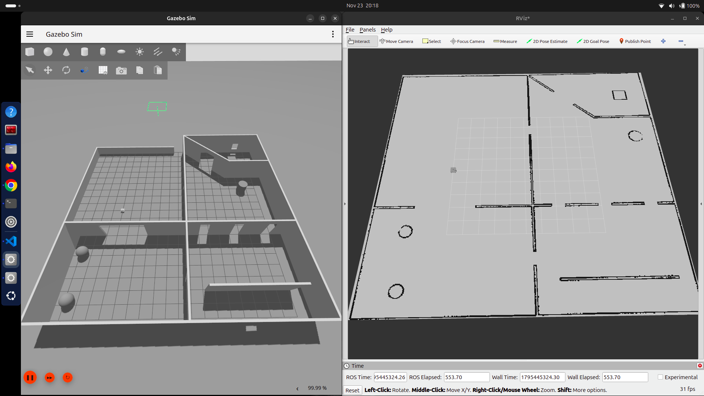
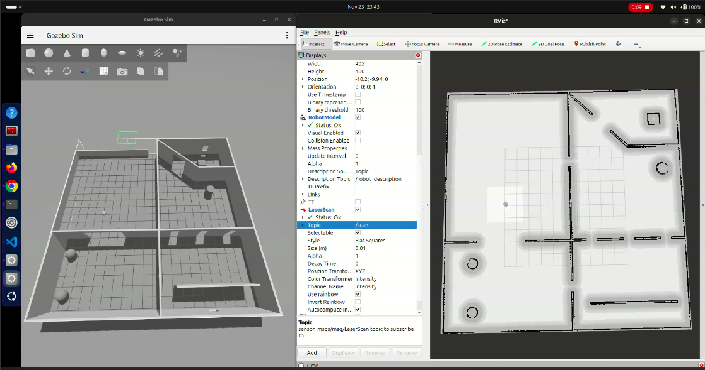
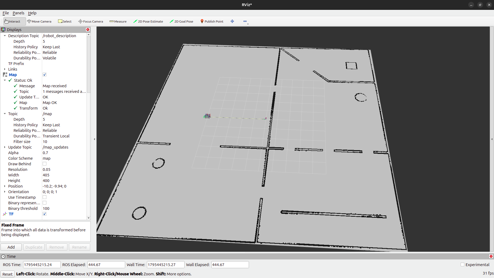
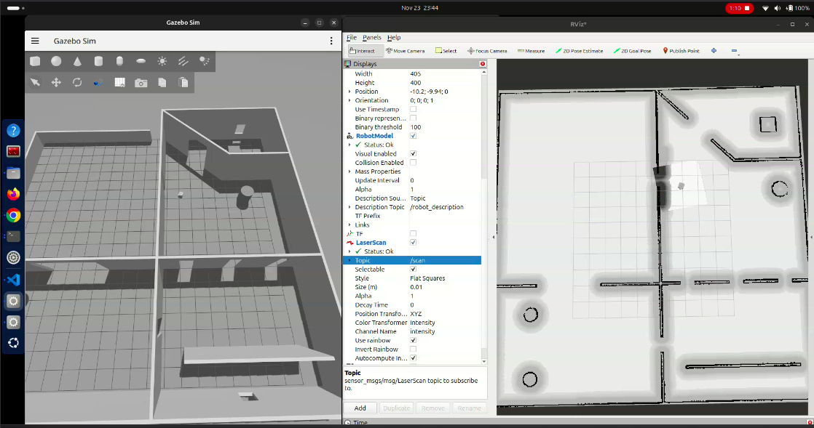
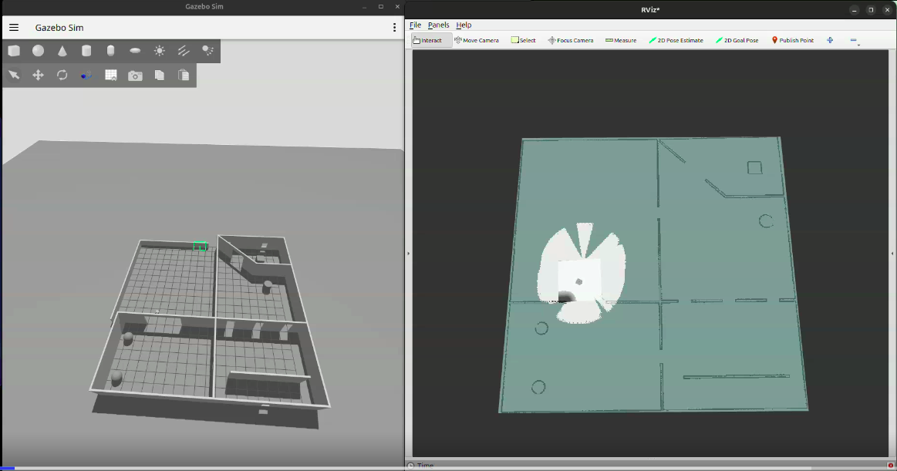

# ROS 2 Navigation Assignment -- Testbed-T1.0.0

This repository contains my implementation of the ERIC Robotics Level 1
ROS 2 Navigation assignment. The work focuses on setting up map loading,
AMCL localization and Nav2 navigation for the Testbed-T1.0.0 robot in
simulation.

The navigation code is kept in a separate package, `testbed_navigation`.
Map loading, localization and navigation each have their own launch
file.

## 1. Development environment

The assignment was originally written for:

-   Ubuntu 22.04
-   ROS 2 Humble
-   Gazebo Classic 11.10.2
-   RViz

I completed the work on:

-   Ubuntu 24.04
-   ROS 2 Jazzy
-   Gazebo Harmonic (Gazebo Sim 8.x)
-   RViz2

### Why I used a different environment

My development system runs Ubuntu 24.04. The assignment's original ROS 2
Humble and Gazebo Classic setup is intended for Ubuntu 22.04, so I used
ROS 2 Jazzy and Gazebo Harmonic to work with the installed operating
system.

This meant adapting parts of the starter repository to the newer ROS 2
and Gazebo versions. The assignment objective and navigation workflow
remained the same.

## 2. Bug fixes in the starter repository

I recorded the starter-code issues I found and the changes made to
resolve them in **[`bug_fixes.txt`](bug_fixes.txt)**, located in the
root of the repository.

The main fixes are also summarised below.

  ------------------------------------------------------------------------------------------------------------------
  File / area                                          Issue found             Change made
  ---------------------------------------------------- ----------------------- -------------------------------------
  `testbed_description/CMakeLists.txt`                 Incorrect syntax in the Corrected the CMake syntax.
                                                       `ament_package()` call. 

  `testbed_description/urdf/testbed.gazebo`            An extra `>` character  Corrected the XML tag.
                                                       in a Gazebo XML tag.    

  `testbed_gazebo/launch/spawn_playground.launch.py`   Incorrect world launch  Corrected the launch argument used to
                                                       argument.               start the world.

  `testbed_bringup/maps/testbed_world.yaml`            The image filename did  Updated the YAML file to reference
                                                       not match the supplied  `testbed_world.pgm`.
                                                       map image.              

  `testbed_bringup/CMakeLists.txt`                     The map directory was   Added the `maps` directory to the
                                                       not installed with the  package installation rules.
                                                       package.                

  Gazebo--ROS communication                            The original setup      Configured `ros_gz_bridge` for
                                                       needed a bridge         `/clock`, `/scan` and `/imu`.
                                                       compatible with Gazebo  
                                                       Harmonic.               

  Navigation configuration                             The configured odometry Set the relevant Nav2 components to
                                                       topic did not match the use
                                                       robot's controller      `/diff_drive_base_controller/odom`.
                                                       output.                 

  Velocity command interface                           The Jazzy diff-drive    Configured the Nav2 velocity command
                                                       controller uses stamped path to use
                                                       velocity commands.      `geometry_msgs/msg/TwistStamped`.
  ------------------------------------------------------------------------------------------------------------------

The separate `bug_fixes.txt` file contains the bug list required by the
assignment. The table above gives a quick summary of the changes
relevant to the working simulation and navigation setup.

## 3. Repository structure

The workspace is `eric_robotics_ws`, and the assignment repository is
located at `src/level01_ros_assignment`.

``` text
eric_robotics_ws/
├── src/
│   └── level01_ros_assignment/
│       ├── testbed_bringup/
│       │   ├── config/
│       │   ├── launch/
│       │   └── maps/
│       ├── testbed_description/
│       │   ├── launch/
│       │   ├── meshes/
│       │   ├── rviz/
│       │   └── urdf/
│       ├── testbed_gazebo/
│       │   ├── launch/
│       │   ├── models/
│       │   └── worlds/
│       ├── testbed_navigation/
│       │   ├── config/
│       │   ├── launch/
│       │   ├── maps/
│       │   ├── rviz/
│       │   ├── CMakeLists.txt
│       │   └── package.xml
│       ├── bug_fixes.txt
│       ├── help.md
│       └── README.md
├── build/
├── install/
└── log/
```

## 4. Navigation package

The `testbed_navigation` package contains the launch files and
configuration used to run the navigation workflow.

### Launch files

  --------------------------------------------------------------------------------
  Launch file                         Purpose
  ----------------------------------- --------------------------------------------
  `map_loader.launch.py`              Starts the Nav2 Map Server and its lifecycle
                                      manager. It loads
                                      `testbed_bringup/maps/testbed_world.yaml`.

  `localization.launch.py`            Starts AMCL and its lifecycle manager.

  `navigation.launch.py`              Starts the Nav2 navigation nodes and their
                                      lifecycle manager.
  --------------------------------------------------------------------------------

### Configuration files

-   `config/amcl_params.yaml` -- AMCL parameters, including the map,
    odometry, base and laser frame/topic settings.
-   `config/nav2_params.yaml` -- Nav2 parameters for the planner,
    controller, costmaps, behavior server, BT Navigator and supporting
    nodes.

The map itself is provided by the starter repository in
`testbed_bringup/maps/`.

### Nav2 components used

The navigation setup uses the following components:

-   **Map Server** -- publishes the occupancy map.
-   **AMCL** -- estimates the robot's position in the map.
-   **Planner Server with NavFn** -- calculates a global path to the
    goal.
-   **Controller Server with MPPI** -- generates velocity commands to
    follow the path.
-   **Behavior Server** -- provides recovery behaviors.
-   **BT Navigator** -- coordinates the navigation task.
-   **Waypoint Follower** -- supports navigation through waypoints.
-   **Velocity Smoother** -- smooths velocity commands before they reach
    the robot controller.
-   **Global and local costmaps** -- represent obstacles for planning
    and control.

The nodes are started individually from `navigation.launch.py`; the
implementation does not rely on launching the complete stack through
`nav2_bringup`.

## 5. Build the workspace

Open a terminal and run:

``` bash
cd ~/eric_robotics_ws
source /opt/ros/jazzy/setup.bash
colcon build --symlink-install
source install/setup.bash
```

If the workspace has already been built, source it in each new terminal
before running ROS 2 commands:

``` bash
source /opt/ros/jazzy/setup.bash
source ~/eric_robotics_ws/install/setup.bash
```

## 6. Run the simulation and navigation

The following steps describe the modular launch sequence used for
testing. Run each component in a separate terminal and leave it running.

### 1. Start Gazebo

``` bash
ros2 launch testbed_gazebo spawn_playground.launch.py
```

### 2. Start the robot description

``` bash
ros2 launch testbed_description robot_description.launch.py
```

### 3. Spawn the robot

``` bash
ros2 launch testbed_gazebo spawn_testbed.launch.py
```

### 4. Start the Gazebo--ROS bridge

``` bash
ros2 run ros_gz_bridge parameter_bridge --ros-args \
  -p config_file:=/home/$USER/eric_robotics_ws/src/level01_ros_assignment/testbed_bringup/config/bridge.yaml
```

### 5. Start the robot controllers

Start the ros2_control controllers using the controller-spawner commands
configured for the Testbed robot. The controllers should be active
before starting localization and navigation.

### 6. Load the map

``` bash
ros2 launch testbed_navigation map_loader.launch.py
```

### 7. Start localization

``` bash
ros2 launch testbed_navigation localization.launch.py
```

### 8. Start navigation

``` bash
ros2 launch testbed_navigation navigation.launch.py
```

### 9. Open RViz2

``` bash
rviz2
```

In RViz2:

1.  Set the fixed frame to `map`.
2.  Add the Map display and select `/map`.
3.  Add RobotModel, TF and LaserScan displays. Set the laser topic to
    `/scan`.
4.  Add a Path display for `/plan` to view the global planned path.
5.  Use **2D Pose Estimate** to set the robot's initial pose if needed.
6.  Use **2D Goal Pose** to send a navigation goal.

The controller-spawner commands are not written out here because they
should match the controller configuration in the repository; use the
commands already used to bring up the working robot.

## 7. Testing

The following parts of the workflow were tested in Gazebo Harmonic and
RViz2:

-   The supplied map loaded and appeared in RViz2.
-   AMCL received the map and laser scan and published the estimated
    pose and the `map` to `odom` transform.
-   The Nav2 nodes reached the active lifecycle state.
-   Sending a goal from RViz2 generated a global path and the robot
    moved towards the goal.
-   A second navigation goal was tested.
-   Obstacle avoidance was observed during navigation.
-   The velocity command path was checked between Nav2, the velocity
    smoother and the diff-drive controller. The command topic uses
    `geometry_msgs/msg/TwistStamped`.

## 8. Submission files

The repository includes the following assignment deliverables:

-   `testbed_navigation/` -- navigation package with launch and
    configuration files.
-   `bug_fixes.txt` -- list of starter-code bugs identified and the
    fixes made.
-   `README.md` -- setup, implementation and testing notes.
-   Video or screenshots -- demonstration of localization and
    navigation.


## Simulation and Navigation Results

The following screenshots demonstrate the Gazebo simulation environment, RViz visualization, Nav2 costmaps, localization, autonomous navigation, and obstacle avoidance.

### 1. Gazebo Simulation and RViz


### 2. Global Costmap Visualization


### 3. RViz Visualization


### 4. Nav2 Autonomous Navigation Demonstration


### 5. Nav2 Obstacle Layer



Contact Info 
Name : Suyash Vyankatesh Desai
email: desaisuyash2004@gmail.com


## References

-   [ROS 2 Jazzy documentation](https://docs.ros.org/en/jazzy/)
-   [Nav2 documentation](https://docs.nav2.org/)
-   [Gazebo documentation](https://gazebosim.org/docs/)

------------------------------------------------------------------------

**Assignment:** ERIC Robotics -- Level 1 ROS 2 Navigation\
**Robot:** Testbed-T1.0.0
