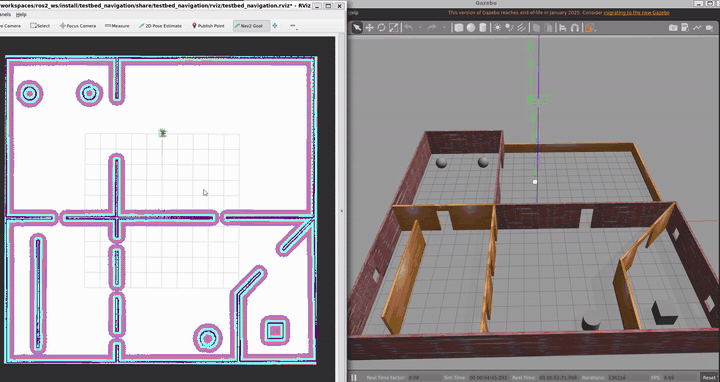

# Level 1: ROS2 Navigation Assignment - Harikrishna S

> **Submission by Harikrishna S.** This section summarises what I built. The original assignment brief is kept unchanged further down, under [Overview](#overview).

## Demo: localization and navigation



*Preview at 4x speed. Full video: [testbed_navigation/media/nav_video.mp4](testbed_navigation/media/nav_video.mp4)*

On the left, RViz shows the map loaded by `map_server`, the AMCL particle cloud, the global and local costmaps, and the NavFn path. On the right, Gazebo shows the robot driving there. Goals were sent with the **Nav2 Goal** tool in RViz.

## What I delivered

| Item | Location |
|------|----------|
| Bugs found in the starter code and how I fixed them (17 items) | [`bugs_identified_and_fixed.txt`](bugs_identified_and_fixed.txt) |
| New package `testbed_navigation` | [`testbed_navigation/`](testbed_navigation/) |
| Map loading: `map_server` | [`launch/map_loader.launch.py`](testbed_navigation/launch/map_loader.launch.py), [`config/map_server_params.yaml`](testbed_navigation/config/map_server_params.yaml) |
| Localization: `amcl` | [`launch/localization.launch.py`](testbed_navigation/launch/localization.launch.py), [`config/amcl_params.yaml`](testbed_navigation/config/amcl_params.yaml) |
| Navigation: planner, controller, behaviors, bt_navigator, velocity_smoother | [`launch/navigation.launch.py`](testbed_navigation/launch/navigation.launch.py), [`config/nav2_params.yaml`](testbed_navigation/config/nav2_params.yaml), [`behavior_trees/navigate_to_pose_testbed.xml`](testbed_navigation/behavior_trees/navigate_to_pose_testbed.xml) |
| Detailed write-up (approach, parameters, challenges) | [`testbed_navigation/README.md`](testbed_navigation/README.md) |

## How to run

```bash
sudo apt install ros-humble-navigation2 ros-humble-nav2-bringup ros-humble-rmw-cyclonedds-cpp
export RMW_IMPLEMENTATION=rmw_cyclonedds_cpp

cd ~/assignment_ws && colcon build --symlink-install && source install/setup.bash

# Everything at once: Gazebo + map + AMCL + Nav2 + RViz
ros2 launch testbed_navigation testbed_navigation_bringup.launch.py

# ...or step by step, each in its own terminal
ros2 launch testbed_bringup testbed_full_bringup.launch.py           # simulation
ros2 launch testbed_navigation map_loader.launch.py                 # 1. map
ros2 launch testbed_navigation localization.launch.py load_map:=false  # 2. AMCL
ros2 launch testbed_navigation navigation.launch.py                 # 3. Nav2 servers
```

To send goals, use **Nav2 Goal** in RViz, or `ros2 run testbed_navigation send_goal.py --tour` for an automatic 5-goal tour through both doorways.

## My approach

1. **Fix the simulation first.** Before tuning Nav2, I made the robot build, spawn and drive correctly. I measured the robot from its meshes instead of trusting the URDF numbers. That showed a wrong wheel separation, a `base_footprint` that was not on the drive axle, a 1.5 m lidar range, and friction/contact settings that made the robot slip and spin in place. All the fixes are listed in [`bugs_identified_and_fixed.txt`](bugs_identified_and_fixed.txt).
2. **Build Nav2 manually, one component at a time** (no `nav2_bringup`):
   - **Map:** `nav2_map_server/map_server` plus its own lifecycle manager. The map path is a launch argument, injected into the params with `RewrittenYaml`.
   - **Localization:** `nav2_amcl` with the differential motion model and the likelihood-field laser model. The initial pose is set to the robot's spawn pose, so it localizes on startup.
   - **Navigation:**
     - planner: NavFn (A*)
     - controller: Regulated Pure Pursuit
     - behaviors: Spin, BackUp and Wait recoveries
     - bt_navigator: a custom behavior tree that replans at 1 Hz and runs recoveries when stuck
     - velocity smoother between the controller and the robot
     - costmaps: footprint and inflation sized from the measured robot (0.36 x 0.42 m) and the 0.85 m doorways
3. **Test each part on its own**, then together. All 5 goals of a 40 m tour through both doorways succeeded, and the AMCL estimate stayed within about 8 cm of the Gazebo ground truth.

## Challenges I faced

- **The robot rotated slowly while standing still.** The wheels weren't turning, so the chassis was sliding on its contacts. There were six coplanar mesh contacts (2 wheels + 4 fixed casters) and the casters were frictionless. I fixed it with sphere casters 2 mm above the ground and cylinder wheels.
- **Weak localization.** The lidar only saw 1.5 m in rooms up to 10 m across. Raising the range to 12 m made AMCL reliable.
- **Launch arguments leaking between included files.** In ROS 2 Humble, every stage reading a shared `params_file` argument picked up the same value. I gave each stage its own argument name.
- **Sim-time mismatch.** `robot_state_publisher` ran on wall-clock time, which caused TF extrapolation errors in Nav2.

More detail is in [`testbed_navigation/README.md`](testbed_navigation/README.md).

---


## Overview
At ERIC Robotics, we’re big believers in building software with modularity. The nav2 stack reflects this perfectly with flexible, plugin-based framework, allowing you to pick and choose which pieces you need and run them independently. In this assignment, you’ll walk through the navigation workflow step by step—manually creating and calling actions—to bring an autonomous robot to life.

**Here’s what to do:**
1. We have shared some starter code for the 'Testbed-T1.0.0', a simple open-source robot developed by the team here at ERIC Robotics. **Please note that there are some bugs intentionally left in the starter code that you will need to identify and fix. You also need to make a text file listing the bugs you were able to identify and how did you fix them and add that file in the root directory outside the navigation package** Your task is to develop a new ROS2 package called `testbed_navigation` to manage the navigation workflow for this robot.
2. However, rather than simply calling `nav2_bringup`, in this assignment you will manually build the required action components (i.e., using the `map_server`, `amcl`, `planner` plugins, and `bt_` plugins) to run ros2 navigation, by working directly with the respective `nav2` plugins.
3. i.e., In the `testbed_navigation` package, write individual launch files to load a map, perform localization, and navigate using the plugins provided by `nav2`.
4. Document your process so we can see how you tackled the task.

This assignment gives you hands-on experience with ROS2’s navigation plugins, while showcasing your ability to design modular and effective robotics solutions.

### Deadline & submissions
1. Four days (96 hrs) from the moment you accept the assignment.
2. All applicants should fork the repository for the assignment. To submit your code, after completion create a Pull Request (PR) back to the `main` branch. You can commit any number of times to your fork before your deadline.

## Repository Structure

```
ros_nav2_assignment/
├── testbed_description/
│   ├── launch/            # Launch the full base simulation
│   ├── meshes/
│   ├── rviz/            # RVIZ configuration files
│   └── urdf/            # URDF files for Testbed-T1.0.0
├── testbed_gazebo/
│   ├── worlds/            # Simulation world files
│   ├── launch/            # Launch files for Gazebo
│   └── models/            # Misc. Gazebo model files
├── testbed_bringup/
│   ├── launch/            # Launch file for bringing up the robot
│   └── maps/              # Predefined map of the test environment
├── help.md                # Guidelines and FAQs
└── README.md              # Instructions for the assignment
```

## Assignment Objective
Your goals are to:
1. Learn how to configure and use ROS2 `nav2` plugins in independent files.
2. Set up manual map loading and localization for the given simulation environment.
3. Implement the required navigation plugins to handle robot navigation in the `testbed_navigation` package. Only basic navigational functionality is expected in this assignment, so choose your plugins accordingly.

## Requirements

To get started, you’ll need:
- ROS2 Humble installed. (Install from [Humble Installation](https://docs.ros.org/en/humble/Installation.html)) (You will need Ubuntu 22.04/Windows 10 for this. More in the help section.)
- Gazebo simulator (version 11.10.2 is compatible with ROS2 Humble) (Install from [Gazebo Installation](https://classic.gazebosim.org/tutorials?tut=install_ubuntu)) and Rviz simulator.
- Basic to intermediate knowledge of ROS2 navigation concepts.
- Familiarity with creating and managing ROS2 packages, actions, and parameter files.
- The reference documentation for the `nav2` stack is going to be your best friend for this assignment: [Nav2 Documentation](https://navigation.ros.org/).

## Instructions

### 1. Setting Up the Repository
1. Create your workspace:
    ```bash
    mkdir -p ~/assignment_ws/src
    ```
2. Fork this repository to your GitHub account, then clone your fork:
   ```bash
   cd ~/assignment_ws/src
   git clone <your-fork-url>
   ```
2. Build the workspace:
   ```bash
   cd ~/assignment_ws/
   colcon build
   source install/setup.bash
   ```

### 2. Launching the Simulation Environment
1. Start the full simulation using:
   ```bash
   ros2 launch testbed_bringup testbed_full_bringup.launch.py
   ```
   This brings up the testbed environment in Gazebo and Rviz.

### 3. Creating the `testbed_navigation` Package
1. In your workspace, create a new package:
   ```bash
   ros2 pkg create testbed_navigation --build-type ament_cmake
   ```
2. Set up the necessary directories for parameters, launch files, and scripts.
3. Write proper build commands in CMakeLists.txt for your navigation package.

### 4. Map Loading
1. Use the map provided in `testbed_bringup/maps/testbed_world.yaml`.
2. Write actions in the launch file `testbed_navigation/launch/map_loader.launch.py` to load the map using the `map_server` plugin.
3. Test and confirm that the map is loaded correctly in Rviz.

### 5. Localization
1. Implement localization with the AMCL plugin:
   - Write a parameter file for AMCL in `testbed_navigation/config/amcl_params.yaml`.
   - Create actions in the launch file `testbed_navigation/launch/localization.launch.py` to run AMCL.
   - Verify that the robot can localize itself in the simulated environment using Rviz.

### 6. Navigation
1. Set up navigation using `nav2` plugins:
   - Configure parameter files for the global and local planners, behaviour tree plugins and any other nav2 plugin you want to use, like 'collision_monitor' or 'velocity_smoother', in `testbed_navigation/config/nav2_params.yaml`.
   - Write actions in the launch file `testbed_navigation/launch/navigation.launch.py` to bring up the navigation workflow.
2. Test the navigation setup by sending goals to the robot and observing its behavior.

### 7. Deliverables
1. Submit your completed `testbed_navigation` package with:
   - Parameter files for map loading, localization, and navigation.
   - Launch files for each component.
   - A `README.md` describing your approach and any challenges you faced.
2. Provide a short video or screenshots showing your robot performing localization and navigation.

### 8. Evaluation Criteria
We’ll be looking for:
- A functional manual navigation setup.
- Clear, well-structured parameter files and launch files.
- A modular, well-documented implementation.
- Successful localization and navigation in the simulation.

## Notes
- You’re welcome to modify the robot description or simulation setup to better suit your implementation.
- Thorough testing is encouraged to ensure everything works as expected.
- If you have questions, check out the help section and don’t hesitate to reach out to us.
- Lastly, we encourage you to share your code for review—even if it’s still a work in progress.
---

We’re excited to see how you approach this task. Good luck, and happy coding! :)

## Contact Info 
 - Name: Harikrishna S
 - Contact number: 9486854519
 - Email Address: harikrishpvt@gmail.com
