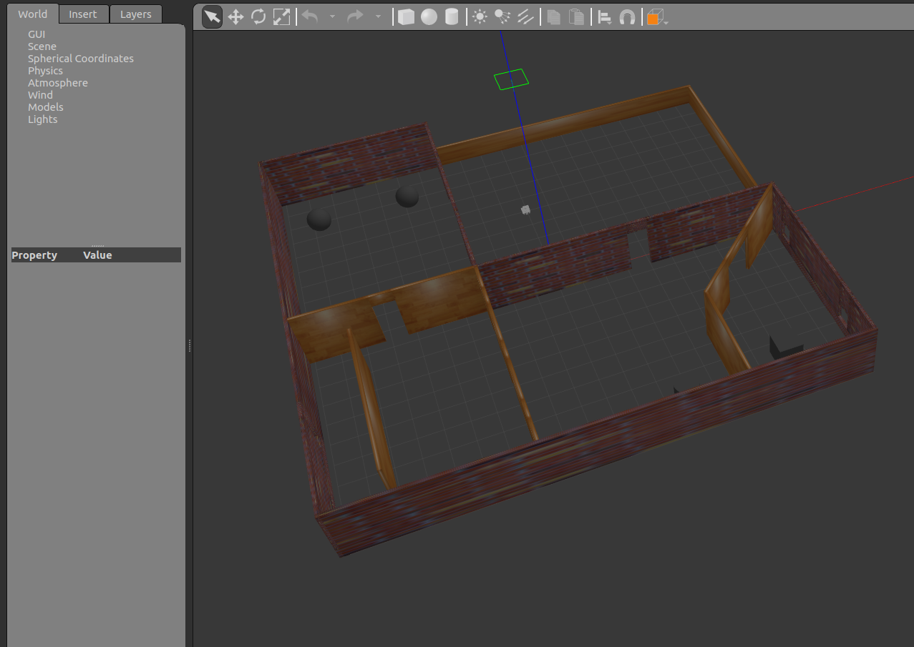
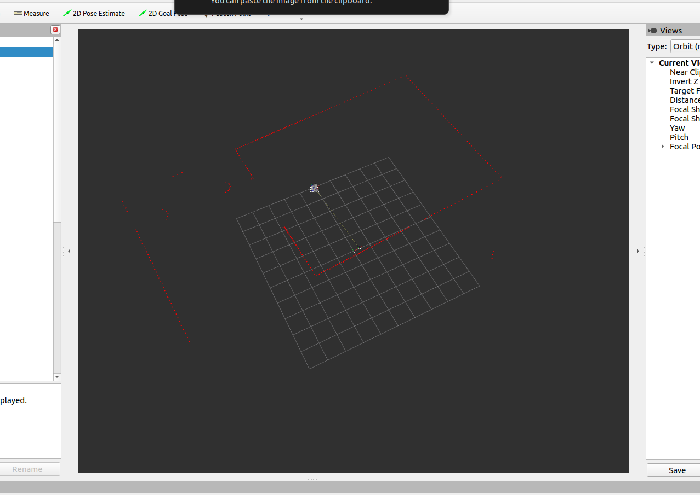

# testbed_navigation

Manual Nav2 workflow for the Testbed robot (differential drive, 2D lidar), simulated in Gazebo Classic with ROS 2 Humble. The map server, AMCL localization and the navigation stack are launched as separate, independently testable steps instead of using `nav2_bringup`.

## Package structure
testbed_navigation/
├── launch/
│ ├── map_loader.launch.py # map_server + lifecycle manager
│ ├── localization.launch.py # AMCL + lifecycle manager
│ └── navigation.launch.py # controller, planner, behavior server, BT navigator + lifecycle manager
├── config/
│ ├── map_server_params.yaml
│ ├── amcl_params.yaml
│ └── nav2_params.yaml
└── docs/ # screenshots

## Robot setup used for the configuration

| Item | Value |
|---|---|
| TF chain | `map -> odom -> base_footprint -> base_link -> lidar_link_1` |
| Base frame | `base_footprint` (the diff-drive plugin publishes odom on it) |
| Topics | `/scan`, `/odom`, `/cmd_vel` |
| Lidar | 360 degrees, range 0.1 to 12 m, frame `lidar_link_1` |
| Time | `use_sim_time: true` everywhere |
| Map | `testbed_bringup/maps/testbed_world.yaml` (405 x 400 cells at 0.05 m/px) |

## Build

```bash
cd ~/assignment_ws
colcon build --symlink-install
source install/setup.bash
```

## How to run

Use one terminal for each step, and wait for each step to finish starting before launching the next.

1. Simulation:
   ```bash
   ros2 launch testbed_bringup testbed_full_bringup.launch.py
   ```
2. Map server:
   ```bash
   ros2 launch testbed_navigation map_loader.launch.py
   ```
3. Localization (AMCL):
   ```bash
   ros2 launch testbed_navigation localization.launch.py
   ```
4. Navigation:
   ```bash
   ros2 launch testbed_navigation navigation.launch.py
   ```

In RViz:
1. Set **Fixed Frame** to `map`. It only appears in the list after AMCL is running, so type it in if needed.
2. Add the **Map** display on `/map` with Durability Policy set to `Transient Local`.
3. Add **PoseArray** on `/particle_cloud`, **Path** on `/plan`, and Map displays on `/global_costmap/costmap` and `/local_costmap/costmap`.
4. If the laser points do not line up with the walls, use **2D Pose Estimate** to place the robot.
5. Use **2D Goal Pose** to send a navigation goal.

## Approach

**Map loading.** `map_server` loads the provided occupancy grid and a lifecycle manager brings it up automatically (`autostart: true`). The map is published on `/map` with a transient-local QoS so late subscribers such as RViz and AMCL receive it.

**Localization.** AMCL uses the likelihood-field laser model with the differential motion model. It runs in the `base_footprint` base frame and uses the `odom` frame from the diff-drive plugin. It publishes the `map -> odom` transform. The initial pose is set to the robot's spawn position, and it can be corrected from RViz.

**Navigation.** The stack is made of four lifecycle nodes under a single lifecycle manager:
- `planner_server` with NavFn as the global planner on the global costmap
- `controller_server` with the DWB local planner on a rolling local costmap
- `behavior_server` for recovery behaviours (spin, back up, wait)
- `bt_navigator` running the default navigate-to-pose behavior tree

Both costmaps use the lidar as an obstacle source and an inflation layer. The global costmap also uses the static map layer. The robot radius and inflation radius are set so that the robot can pass through the doorways in the test world.

## Bugs found and fixed in the starter code

The full list with file names is in [`BUGS.txt`](../BUGS.txt) in the repository root. In summary:

1. `testbed_description/CMakeLists.txt`: `ament_package` was missing its parentheses, which broke the whole workspace build.
2. `testbed_bringup/maps/testbed_world.yaml`: the `image:` path pointed to a file that does not exist.
3. `testbed_description/urdf/testbed.gazebo`: a stray `>` made the XML malformed.
4. `testbed_description/urdf/testbed.gazebo`: the lidar max range was 1.5 m, too short for localization in this map, so it was increased to 12 m.
5. `testbed_description/launch/robot_description.launch.py`: `robot_state_publisher` was not using simulated time, causing TF timestamp warnings.
6. `testbed_bringup/CMakeLists.txt`: the `maps` folder was never installed, so the map could not be found after a build.

## Challenges

- **Build failure from a one-character CMake error.** The first `colcon build` failed and stopped the other packages from building too. Reading the CMake error, which pointed at the last line, led straight to the bug.
- **Finding the other starter-code bugs.** Having the simulation launch without errors did not mean it was correct. I checked the topics, the TF frames, the scan frame and range, and the map file path and install rules, which is where bugs 2 to 6 turned up.
- **AMCL failed to configure.** In this Nav2 release, `robot_model_type` needs the full plugin name `nav2_amcl::DifferentialMotionModel`, not `differential`. The error message listed the valid names.
- **The `map` frame was not selectable in RViz.** RViz only offers frames that exist in TF, and `map` appears only once AMCL publishes `map -> odom`, so localization must be running first.
- **Pose alignment.** AMCL starts from the configured initial pose, so if the laser scan does not match the map at startup, I set the pose with 2D Pose Estimate and drove a little to let the particles converge.

## Demo


| Map and localization | Path planning |
|---|---|
|  |  |
