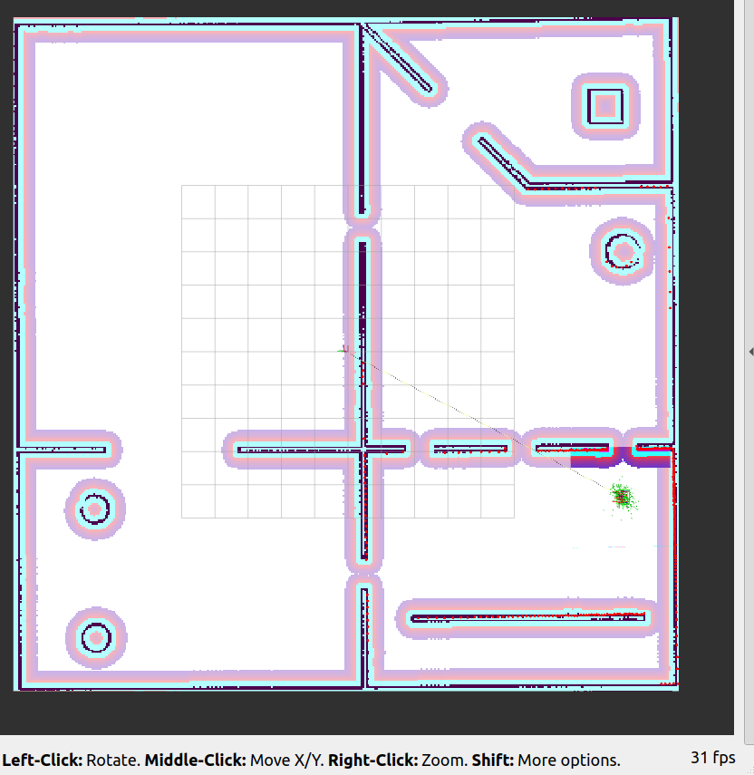
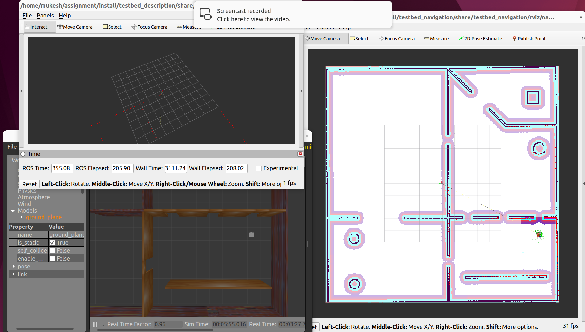

# testbed_navigation

Author: **Mukesh Dhevan B** (dhevanmukesh@gmail.com)

A modular Nav2 setup for **Testbed-T1.0.0** on ROS 2 Humble.

It does not use `nav2_bringup`. Each part of the navigation workflow is started
by its own launch file and configured by its own parameter file:

| Step | Launch file | Parameter file | Nav2 component(s) |
|------|-------------|----------------|-------------------|
| 1. Map loading  | `launch/map_loader.launch.py`   | `config/map_server_params.yaml` | `nav2_map_server/map_server` |
| 2. Localization | `launch/localization.launch.py` | `config/amcl_params.yaml`       | `nav2_amcl/amcl` |
| 3. Navigation   | `launch/navigation.launch.py`   | `config/nav2_params.yaml`       | planner, controller, behaviours, BT navigator, velocity smoother, collision monitor |
| all of the above + RViz | `launch/testbed_navigation.launch.py` | – | – |

Each step has its **own lifecycle manager** (`lifecycle_manager_map`,
`lifecycle_manager_localization`, `lifecycle_manager_navigation`). So each step
can be started, restarted or debugged independently, and the RViz *Navigation 2*
panel still finds the localization and navigation managers.

---

## Architecture

```
                 /map (transient local)
 map_server ───────────────┬───────────────────────────────┐
                           ▼                               ▼
 /scan ──► amcl ──► TF map→odom              global_costmap (static+inflation)
 /odom TF (Gazebo)                                  │ planner_server  "GridBased" = NavFn
                                                    ▼
 NavigateToPose goal ──► bt_navigator ── BT: navigate_to_pose_w_replanning_and_recovery
   (RViz "Nav2 Goal" /   │  ComputePathToPose ─► planner_server
    send_goal.py)        │  FollowPath        ─► controller_server "FollowPath" = Regulated Pure Pursuit
                         │                         local_costmap (static+inflation, 3 m × 3 m rolling)
                         │  recoveries        ─► behavior_server (ClearCostmap, Spin, Wait, BackUp)
                         ▼
 controller / behaviours ─/cmd_vel_nav─► velocity_smoother ─/cmd_vel_smoothed─► collision_monitor ─/cmd_vel─► Gazebo diff drive
                                                                                    ▲
                                                                         /scan (live obstacles)
```

### Plugin choices (kept simple: "basic navigation" only)

| Role | Plugin | Why |
|------|--------|-----|
| Global planner | `nav2_navfn_planner/NavfnPlanner` (Dijkstra) | Complete and fast on a 20 m × 20 m 2D map. No kinematic constraints are needed for a differential-drive robot. |
| Controller | `nav2_regulated_pure_pursuit_controller::RegulatedPurePursuitController` | Simple and predictable path tracking for a differential drive, with few parameters to tune. `use_rotate_to_heading` turns the robot in place towards the path first. Collision checking up to the carrot is enabled. |
| Goal / progress checker | `SimpleGoalChecker` (0.20 m, 0.25 rad), `SimpleProgressChecker` | Standard checkers. |
| Costmap layers | `StaticLayer`, `InflationLayer` (both costmaps) | The planner and controller keep the robot away from every wall on the map. Live laser data is *not* put into the costmaps, because the `ObstacleLayer` triggers a tf2 deadlock in ROS 2 Humble (see Challenges #3). |
| Behaviours | `Spin`, `BackUp`, `DriveOnHeading`, `Wait` | These are what the default recovery tree uses. |
| BT | `behavior_trees/navigate_to_pose_w_replanning_and_recovery.xml` | Replans at 1 Hz and recovers by clearing costmaps, spinning, waiting and backing up. A copy ships with the package and its path is passed by the launch file. |
| Velocity smoother | `nav2_velocity_smoother` | Limits acceleration to 1.5 m/s² and 3.2 rad/s². |
| Collision monitor | `nav2_collision_monitor`, "approach" model with the robot footprint | Live-obstacle safety layer. It reads `/scan` directly and slows or stops the robot so it never comes within 1.2 s of anything the lidar sees, including obstacles that are not on the map. |

### Robot model used by Nav2

* Base frame: `base_footprint`, at the centre of the wheel axle (see `BUGS_FIXED.md` #9).
* Footprint: `[[0.19, 0.215], [0.19, -0.215], [-0.19, -0.215], [-0.19, 0.215]]`. This is the real body (0.35 m × 0.405 m) plus about 1.5 cm of padding.
* Limits: 0.3 m/s cruise speed, 1.0 rad/s rotation.
* Lidar: 360°, 300 beams, 0.10–12 m, 10 Hz. Odometry/TF from the diff-drive plugin at 30 Hz.

---

## Requirements

* ROS 2 Humble, Gazebo 11, Nav2 (`ros-humble-navigation2`)
* **Cyclone DDS**, as recommended in `help.md`. With the default Fast DDS, a
  lifecycle `change_state` reply was sometimes lost, and the navigation start-up
  then hung with the servers "unconfigured":

```bash
sudo apt install ros-humble-rmw-cyclonedds-cpp
echo "export RMW_IMPLEMENTATION=rmw_cyclonedds_cpp" >> ~/.bashrc   # then open a new terminal
```

## Build

```bash
mkdir -p ~/assignment_ws/src && cd ~/assignment_ws/src
git clone <your-fork-url>
cd ~/assignment_ws
rosdep install --from-paths src --ignore-src -y
colcon build
source install/setup.bash
```

## Run

**Terminal 1: simulation** (Gazebo + robot_state_publisher + RViz)

```bash
ros2 launch testbed_bringup testbed_full_bringup.launch.py
```

**Option A: step by step** (each command in a new terminal, in this order)

```bash
ros2 launch testbed_navigation map_loader.launch.py      # 1. /map is published -> add a Map display in RViz
ros2 launch testbed_navigation localization.launch.py    # 2. AMCL: map->odom, /amcl_pose, /particle_cloud
ros2 launch testbed_navigation navigation.launch.py      # 3. planner/controller/BT/... servers
```

**Option B: everything in one terminal, with a navigation RViz layout**

```bash
ros2 launch testbed_navigation testbed_navigation.launch.py
```

Useful arguments:

| Argument | Default |
|----------|---------|
| `map:=` | `testbed_bringup/maps/testbed_world.yaml` |
| `map_params_file:=` / `amcl_params_file:=` / `nav2_params_file:=` | files in `config/` |
| `use_sim_time:=` | `true` |
| `rviz:=` (combined launch only) | `true` |
| `nav_delay:=` (combined launch only): seconds before the Nav2 servers start, so the map and AMCL are up first | `8.0` |

### Localize

AMCL starts at the spawn pose `(0.0, 5.0, 0.0)` (`set_initial_pose: true` in
`amcl_params.yaml`). If you move the robot in Gazebo, use **2D Pose Estimate** in
RViz to set its new pose.

### Send goals

* In RViz, use **Nav2 Goal** (navigation layout), or
* call the `NavigateToPose` action yourself:

```bash
# one goal
ros2 run testbed_navigation send_goal.py --x -6.0 --y 6.0 --yaw 3.14
# several goals in a row ("x,y,yaw" triplets)
ros2 run testbed_navigation send_goal.py --waypoints "3.5,-3.0,-1.57  -5.0,-5.0,3.14  0.0,5.0,0.0"
# or from the CLI
ros2 action send_goal /navigate_to_pose nav2_msgs/action/NavigateToPose \
  "{pose: {header: {frame_id: map}, pose: {position: {x: -6.0, y: 6.0}, orientation: {w: 1.0}}}}" --feedback
```

### Verify each step

```bash
ros2 lifecycle get /map_server          # active
ros2 topic echo --once /map --field info
ros2 lifecycle get /amcl                # active
ros2 run tf2_ros tf2_echo map odom      # map -> odom is published
ros2 topic echo --once /amcl_pose
ros2 action list                        # /navigate_to_pose, /follow_path, /compute_path_to_pose, /spin, ...
```

---

## Test results

Tested on Ubuntu 22.04, ROS 2 Humble and Nav2 1.1.20. The first rows ran headless (`gzserver` only). The stress tests ran with the full GUI (Gazebo client and both RViz windows) *and* a 1080p screen recording running, to reproduce the heaviest load.

| Test | Result |
|------|--------|
| Map vs. world alignment: one `/scan` projected with the Gazebo ground-truth pose | 283 / 298 beam endpoints on occupied map cells, with no offset applied |
| `map→odom` right after start-up | (0.014, −0.016) m. The map frame and the Gazebo world frame coincide |
| Goal `(-6.0, 6.0, π)` from the spawn point, through the door in the x ≈ −3 wall | **Reached**, 0 recoveries. Final ground-truth pose (−5.90, 5.98) |
| Route `(3.5,-3) → (-5,-5) → (6,6) → (0,5)` through both doors of the y ≈ −0.3 wall (`send_goal.py --waypoints`) | **All 4 goals reached** (≈ 40 m in total) |
| AMCL accuracy at the end of the route | AMCL (0.172, 5.019) vs ground truth (0.144, 5.092): **≈ 8 cm** error |
| **Stress test (final configuration, Cyclone DDS):** full GUI + 1080p screen recording, 6 goals (two laps through both doors) | **All 6 goals reached.** Both costmaps up to date at the end (stamps 442 / 443 at sim time 440) |
| Stress test repeated, 3-goal route | **All 3 goals reached.** Robot finished 5 cm from the last goal. No navigation errors or warnings in the logs |

### Demo

**Video:** [docs/media/navigation_demo.webm](docs/media/navigation_demo.webm) (70 s). It shows Gazebo,
both RViz windows, AMCL localization (green particle cloud) and the robot driving to Nav2 goals
through the doors between the rooms.

| Localization + navigation in RViz | Full setup (Gazebo + both RViz windows) |
|---|---|
|  |  |


---

## Challenges and how they were solved

1. **Launch arguments leak between included launch files.** In Humble,
   `IncludeLaunchDescription` does not scope launch configurations. Using one
   generic `params_file` argument in all three launch files made AMCL and the
   Nav2 servers load the *map server's* parameter file. The controller then fell
   back to DWB and failed with "No critics defined for FollowPath". The fix was
   to give each file its own argument name (`map_params_file`,
   `amcl_params_file`, `nav2_params_file`).
2. **Empty BT XML.** Setting `default_nav_to_pose_bt_xml: ""` does *not* select
   the default tree in this Nav2 version. Goals were aborted with "Behavior tree
   threw exception: Empty Tree". The default trees now ship in
   `behavior_trees/`, and `navigation.launch.py` passes their installed paths.
3. **Costmap robot pose freezing (tf2 deadlock).** With live `/scan` data in the
   costmaps (`ObstacleLayer`), the costmap's robot pose froze after one to
   several minutes of driving, sooner under load. Goals then failed with
   "Controller patience exceeded", "Resulting plan has 0 poses in it" or
   "Pose Goes Off Grid". How it was tracked down:
   * Plain `/tf` subscribers kept receiving data, so DDS delivery was fine.
     Switching Fast DDS to UDP-only or synchronous publishing did not help.
   * The stock `nav2_bringup/navigation_launch.py` showed the same problem.
     Removing the obstacle layers made it go away.
   * Running `controller_server` under `gdb` and interrupting it while frozen
     showed a **lock-order deadlock inside tf2_ros**. The laser-subscription
     thread is in `tf2_ros::Buffer::waitForTransform` → `BufferCore::addTransformableRequest`,
     and the TF-listener thread is in `BufferCore::testTransformableRequests` →
     the `waitForTransform` callback (`buffer.cpp:219`). Each holds the mutex
     the other one needs.

   No Nav2 parameter fixes this. Both costmaps therefore use the static map +
   inflation, and the `collision_monitor`, which reads `/scan` without tf2's
   MessageFilter, handles live obstacles. Lowering the lidar to 10 Hz and
   odometry to 30 Hz reduces TF load further. After this change, every stress
   test (full GUI + screen recording, multi-goal routes) passed with both
   costmaps up to date. Full details are in `../BUGS_FIXED.md`.
4. **Lost lifecycle service replies (Fast DDS).** Sometimes `lifecycle_manager_navigation`
   never got the reply to its "configure" request ("failed to send response to
   /behavior_server/change_state (timeout)"), and navigation stayed
   unconfigured. Switching to Cyclone DDS, as `help.md` recommends, fixed it.
5. **Warnings under load.** "Planner loop missed its desired rate",
   "Behavior Tree tick rate exceeded" and "Timed out while waiting for action
   server to acknowledge goal" were removed by setting realistic values
   (`expected_planner_frequency: 1.0`, `bt_loop_duration: 20`,
   `default_server_timeout: 100`). The shipped BTs also name the goal checker.
   Messages that remain and are harmless: RViz's "GLSL link result" line, and a
   one-time AMCL `/particle_cloud` QoS notice while RViz starts.
6. **Robot model problems** (base frame offset from the rotation centre, wrong
   wheel separation, 1.5 m lidar range, missing wheel joint states). These are
   listed in `../BUGS_FIXED.md`.
