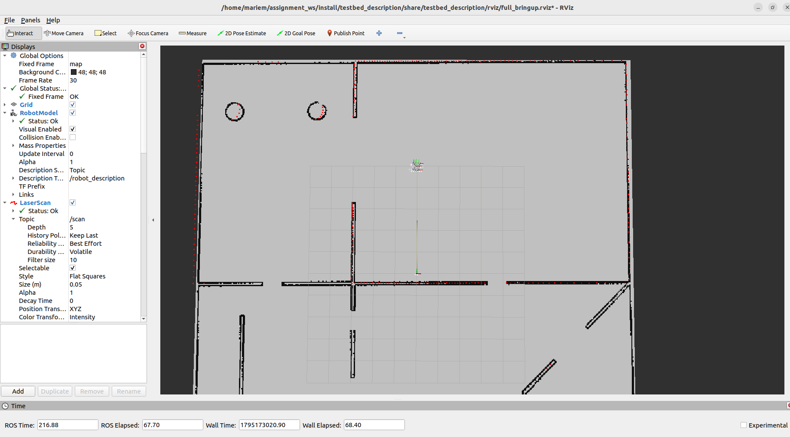
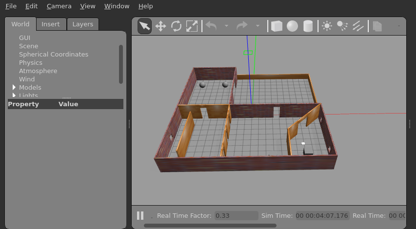
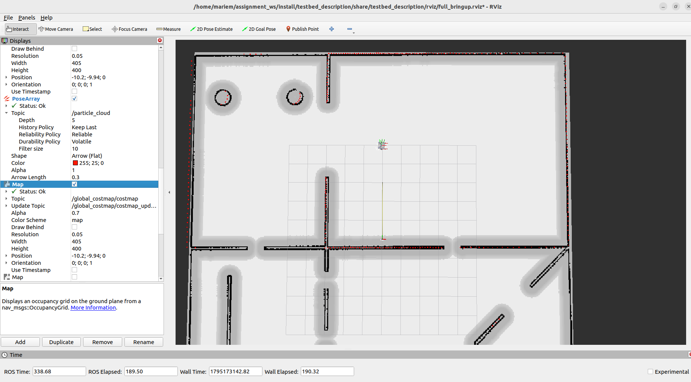
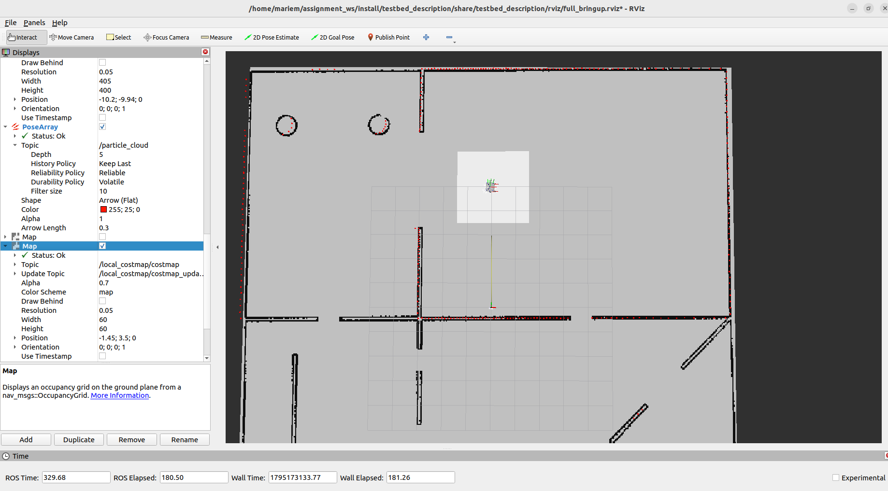
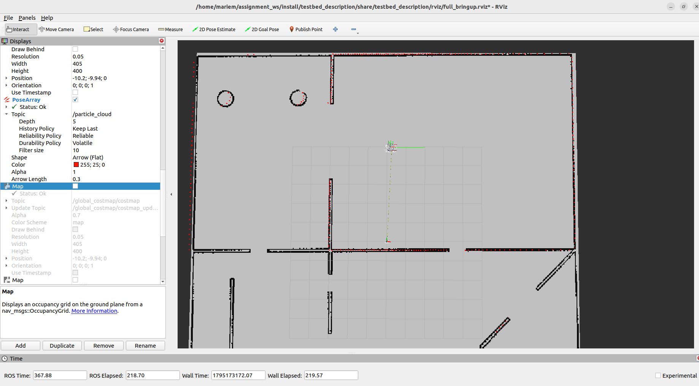
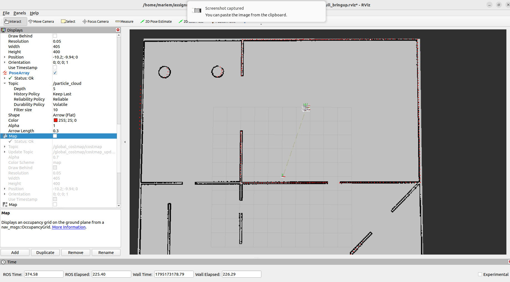

# testbed_navigation

Modular ROS 2 Nav2 workflow for the **Testbed-T1.0.0** robot (ERIC Robotics, Level 1 assignment).

Instead of calling `nav2_bringup`, each stage of the navigation stack is launched manually from its own launch file, using the individual Nav2 plugins: `map_server`, `amcl`, `planner_server`, `controller_server`, `behavior_server` and `bt_navigator`.

**Author:** Meriem Sakka (meriem.sakka@ensi-uma.tn)

---

## Package structure

```
testbed_navigation/
├── CMakeLists.txt
├── package.xml
├── config/
│   ├── amcl_params.yaml      # AMCL localization parameters
│   └── nav2_params.yaml      # planner, controller, costmaps, behaviors, BT navigator
├── launch/
│   ├── map_loader.launch.py      # map_server only
│   ├── localization.launch.py    # map_server + AMCL
│   └── navigation.launch.py      # planner, controller, behaviors, BT navigator
└── media/                    # screenshots / demo video
```

## Requirements

- Ubuntu 22.04
- ROS 2 Humble
- Gazebo Classic 11 and RViz2
- Nav2: `ros-humble-navigation2`, `ros-humble-nav2-bringup`
- Cyclone DDS (recommended by the assignment to avoid navigation timeouts):

```bash
sudo apt install ros-humble-rmw-cyclonedds-cpp ros-humble-gazebo-ros-pkgs \
  ros-humble-xacro ros-humble-diagnostic-updater ros-humble-teleop-twist-keyboard
export RMW_IMPLEMENTATION=rmw_cyclonedds_cpp
```

## Build

```bash
mkdir -p ~/assignment_ws/src && cd ~/assignment_ws/src
git clone <your-fork-url>
cd ~/assignment_ws
rosdep install --from-paths src -y --ignore-src
colcon build --symlink-install
source install/setup.bash
```

## How to run

Open each command in its own terminal, after sourcing `install/setup.bash`.

**1. Simulation (Gazebo + RViz)**

```bash
ros2 launch testbed_bringup testbed_full_bringup.launch.py
```

**2. Map + localization**

```bash
ros2 launch testbed_navigation localization.launch.py
```

The robot is stationary after startup, so AMCL does not update by default. Trigger a few corrections (or drive the robot a little with teleop) until the scan lines up with the map:

```bash
ros2 service call /request_nomotion_update std_srvs/srv/Empty
```

**3. Navigation**

```bash
ros2 launch testbed_navigation navigation.launch.py
```

**4. Send a goal**

Use the **2D Goal Pose** tool in RViz, or from the command line:

```bash
ros2 action send_goal /navigate_to_pose nav2_msgs/action/NavigateToPose \
"{pose: {header: {frame_id: map}, pose: {position: {x: 2.0, y: 5.0}, orientation: {w: 1.0}}}}" --feedback
```

### Testing the map alone

`map_loader.launch.py` loads the map on its own. Do not run it together with `localization.launch.py`, because both start a `map_server` node with the same name.

```bash
ros2 launch testbed_navigation map_loader.launch.py
ros2 lifecycle get /map_server   # active [3]
```

### Suggested RViz setup

- Fixed Frame: `map`
- Map display on `/map` (Durability: Transient Local)
- LaserScan on `/scan` (Reliability: Best Effort)
- PoseArray on `/particle_cloud`
- Map displays on `/global_costmap/costmap` and `/local_costmap/costmap`
- Path displays on `/plan` and `/local_plan`

---

## Approach

### 1. Map loading (`map_loader.launch.py`)

`nav2_map_server` loads `testbed_bringup/maps/testbed_world.yaml` (405 x 400 cells at 0.05 m/cell). It is a lifecycle node, so a `nav2_lifecycle_manager` configures and activates it. The map path is resolved with `get_package_share_directory`, so nothing is hard-coded.

### 2. Localization (`localization.launch.py`, `config/amcl_params.yaml`)

`map_server` and `nav2_amcl` run under one lifecycle manager (`map_server` is brought up first). Key choices:

- Differential-drive motion model (`nav2_amcl::DifferentialMotionModel`) and likelihood-field laser model.
- Frames: `map`, `odom`, `base_footprint`; scan topic `/scan`.
- `laser_max_range: 12.0`, matching the lidar range after the fix described below.
- Initial pose set to the robot's spawn pose in the world: `x = 0.0, y = 5.0, yaw = 0.0`.

### 3. Navigation (`navigation.launch.py`, `config/nav2_params.yaml`)

Only basic navigation is used, as required. The nodes run under one lifecycle manager:

| Component | Plugin / choice | Reason |
|---|---|---|
| Global planner | `nav2_navfn_planner/NavfnPlanner` | simple and reliable grid planner |
| Local controller | `dwb_core::DWBLocalPlanner` | standard differential-drive local planner |
| Costmaps | static, obstacle and inflation layers (global); obstacle and inflation layers (local, rolling window) | enough for a known static map with a 2D lidar |
| Behaviors | spin, backup, drive_on_heading, wait | recovery behaviors used by the BT |
| BT navigator | default Nav2 behavior tree with the standard BT plugin list | handles `NavigateToPose` |

The costmaps are created inside `planner_server` and `controller_server`, so they read their parameters from the same `nav2_params.yaml`.

---

## Changes to the starter code (bugs fixed)

The full list is in [`BUG_FIXES.txt`](../BUG_FIXES.txt) in the repository root. Summary:

1. `testbed_description/CMakeLists.txt`: `ament_package` was missing its parentheses, so it is now `ament_package()`.
2. `testbed_bringup/maps/testbed_world.yaml`: the image name pointed to `wrong_path_testbed_world.pgm`; corrected to `testbed_world.pgm`.
3. `testbed_bringup/CMakeLists.txt`: the `maps` directory was not installed, so `map_server` could not find the yaml; added `maps` to the install block.
4. `testbed_description/urdf/testbed.gazebo`: the lidar max range was 1.5 m, so most beams returned `inf` and AMCL could not localize in the roughly 20 m map; increased to 12.0 m.
5. `testbed_description/urdf/testbed.gazebo`: removed a stray `>` after `</initial_orientation_as_reference>` in the IMU plugin block.

---

## Challenges and solutions

- **`map_server` could not configure ("bad file").** The installed package had no `maps` folder. The fix was in the `testbed_bringup` install rules.
- **No laser points in RViz.** `ros2 topic echo /scan --field range_max` showed 1.5 m. Raising the range in the URDF fixed it. The LaserScan display also needs Reliability Policy set to Best Effort.
- **AMCL stuck on "Waiting for map".** `map_server` was defined in the launch file but not started and not listed in the lifecycle manager's `node_names`. Both were fixed.
- **Scan not aligned with the map.** The initial pose was wrong, and AMCL does not update while the robot is stationary. Setting the real spawn pose (0, 5, 0) in `amcl_params.yaml` and calling `/request_nomotion_update` (or driving a little) made it converge.
- **Missing system library for the lifecycle manager.** `libdiagnostic_updater.so` was missing on my machine; installing `ros-humble-diagnostic-updater` fixed it. This is an environment issue, not a code bug.

## Results

### Localization
After launching `localization.launch.py`, the laser scan (red points) lies on the
walls of the map and the AMCL particle cloud has converged around the robot.



The same moment in Gazebo, showing the robot at its real position in the world:



### Costmaps
Global costmap (static map + obstacle + inflation layers):



Local costmap (rolling window around the robot, built from the lidar):



### Navigation
A goal sent with the 2D Goal Pose tool, and the global path computed by the
NavFn planner:



The robot reaching the goal. The action finished with status `SUCCEEDED`, with no
recoveries and about 0.23 m from the goal (tolerance 0.25 m):



### Demo video
[Watch the demo](media/demo.mp4)

## Possible improvements

- Add `velocity_smoother` and `collision_monitor` between the controller and `/cmd_vel`.
- Add a single `bringup.launch.py` that includes the localization and navigation launch files.
- Tune `robot_radius` and the inflation radius to the exact robot footprint for narrow doorways.
