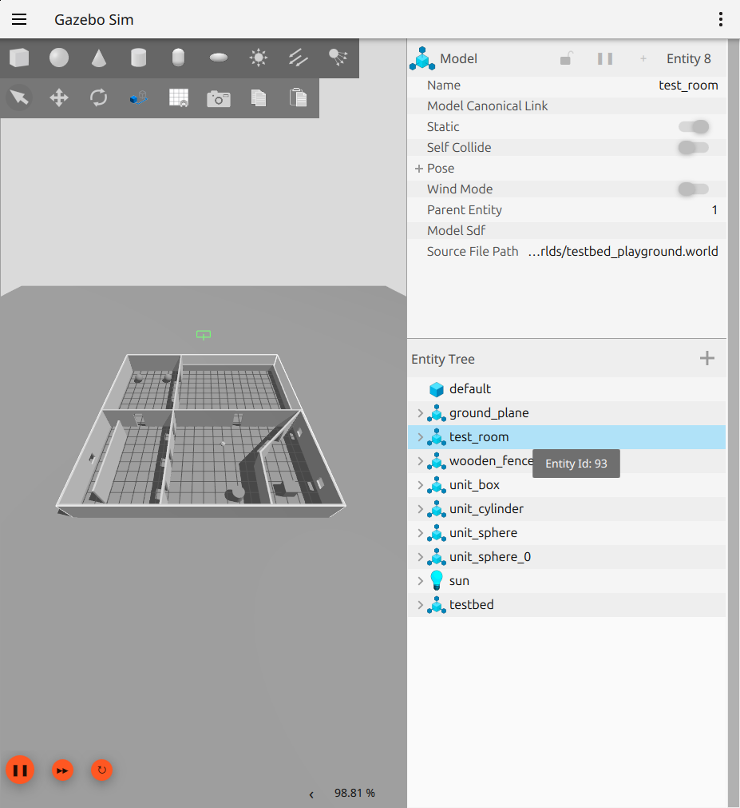
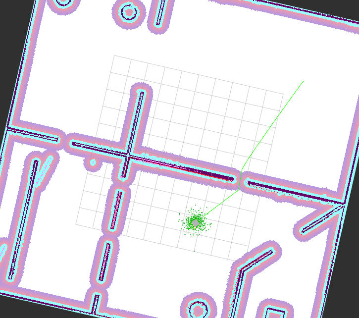
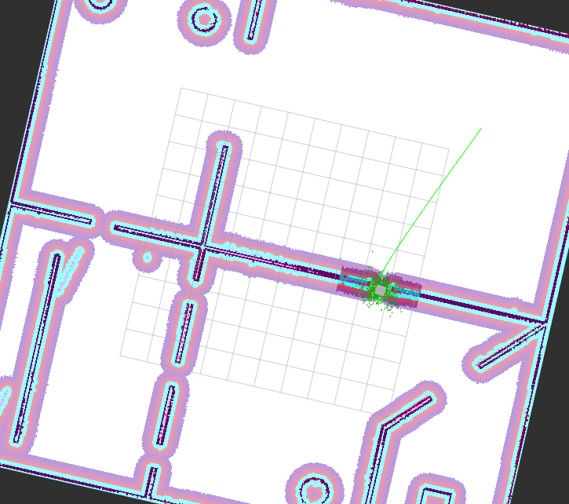
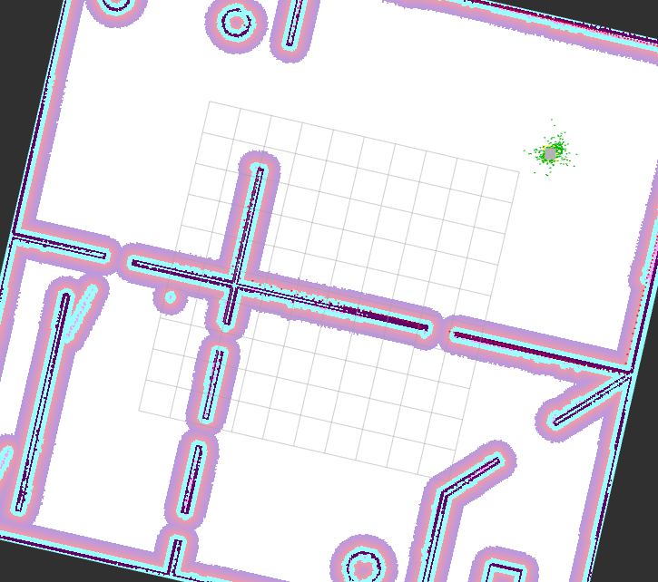

# testbed_navigation

Nav2 for the Testbed-T1.0.0, set up by hand instead of through `nav2_bringup`. Every piece
(map server, AMCL, planner, controller, behaviors, BT navigator) is started from this package
with its own parameters, and the three stages (map, localization, navigation) each have their
own launch file and their own lifecycle manager, so you can bring them up and test them one at
a time.

Target: ROS 2 Humble + Gazebo Classic 11.

## Package layout

```
testbed_navigation/
├── launch/
│   ├── map_loader.launch.py          # map_server + lifecycle_manager_map
│   ├── localization.launch.py        # amcl + lifecycle_manager_localization
│   ├── navigation.launch.py          # planner/controller/behavior/bt_navigator/velocity_smoother
│   └── testbed_navigation.launch.py  # just includes the sim + the three above
├── config/
│   ├── map_server_params.yaml
│   ├── amcl_params.yaml
│   └── nav2_params.yaml
├── behavior_trees/
│   └── navigate_to_pose.xml          # trimmed down replanning + recovery BT
└── rviz/
    └── navigation.rviz               # map, costmaps, particles, plans, footprint
```

## Build

```bash
cd ~/assignment_ws
rosdep install --from-paths src --ignore-src -y
colcon build
source install/setup.bash
```

The README for the assignment recommends Cyclone DDS. I'd use it too, Fast DDS sometimes drops
the action calls from rviz:

```bash
sudo apt install ros-humble-rmw-cyclonedds-cpp
export RMW_IMPLEMENTATION=rmw_cyclonedds_cpp
```

## Running it step by step

Each step in a new terminal (remember to `source install/setup.bash` in each one).

**0. Simulation**

```bash
ros2 launch testbed_bringup testbed_full_bringup.launch.py \
    rvizconfig:=$(ros2 pkg prefix testbed_navigation)/share/testbed_navigation/rviz/navigation.rviz
```

You can leave out `rvizconfig`, but then rviz opens with the original config (fixed frame `odom`, no map).

**1. Map**

```bash
ros2 launch testbed_navigation map_loader.launch.py
```

The map should appear in rviz. To check without rviz: `ros2 topic echo /map --once --field info`
should give 405 x 400 cells at 0.05 m. To load a different map, pass `map:=/abs/path/map.yaml`.

**2. Localization**

```bash
ros2 launch testbed_navigation localization.launch.py
```

The green particle cloud should show up on the robot at (0, 5). If you move the robot in gazebo or
the cloud is off, use **2D Pose Estimate** in rviz. Drive it around a bit with teleop and the cloud
should shrink:

```bash
ros2 run teleop_twist_keyboard teleop_twist_keyboard
```

**3. Navigation**

```bash
ros2 launch testbed_navigation navigation.launch.py
```

Wait for `lifecycle_manager_navigation: Managed nodes are active` and then send a **2D Goal Pose**
from rviz. Or from the terminal:

```bash
ros2 action send_goal /navigate_to_pose nav2_msgs/action/NavigateToPose \
  "{pose: {header: {frame_id: map}, pose: {position: {x: 0.0, y: -5.0}, orientation: {z: -0.707, w: 0.707}}}}"
```

That goal is in the lower room, so the robot has to find the doorway in the middle wall (around x = 3.3).

**All at once**

```bash
ros2 launch testbed_navigation testbed_navigation.launch.py
```

This starts the sim with the navigation rviz config and then the three launch files above, with a
few seconds' delay so gazebo can start publishing `/clock` first. Use `sim:=false` if the
simulation is already running.

## How I approached it

### Fixing the starter code first

Nothing would build at first, so the first job was getting the given packages working. All the
bugs and fixes are in [`../BUGS_FOUND.txt`](../BUGS_FOUND.txt). The ones that mattered most for
navigation:

- the robot barely moved because the fixed casters had as much friction as the drive wheels
- the lidar only reached 1.5 m, which is useless for AMCL in a 20 m room
- robot_state_publisher wasn't on sim time, which gives TF timing errors as soon as nav2 starts
- the map yaml pointed to a file that didn't exist, and the maps folder wasn't installed anyway

Before writing any AMCL config I checked whether the map is actually in Gazebo's world
coordinates. I converted the wall poses from the .world file into world coordinates and compared
them with the occupied cells in the pgm. They match once you use the poses from the `<state>`
block in the world file (it overrides the model pose further up), so the map frame equals the
world frame and the initial pose is the spawn point (0, 5, yaw 0).

### Map loading

`map_server` on its own with a lifecycle manager. The only parameter that changes per run is
`yaml_filename`, so the params file leaves it empty and the launch file fills it with the
installed path of `testbed_bringup/maps/testbed_world.yaml`. The map is published transient
local, so AMCL / costmaps / rviz started later still get it.

### Localization (AMCL)

`config/amcl_params.yaml`. The main choices:

- `base_frame_id: base_footprint`, because that's the frame the gazebo diff drive plugin publishes odom for
- `robot_model_type: nav2_amcl::DifferentialMotionModel` (this is the Humble name, the older `differential` doesn't work)
- `laser_max_range: 12.0` to match the fixed lidar
- `set_initial_pose: true` at (0, 5, 0) so I don't have to click 2D Pose Estimate every run
- `likelihood_field` laser model, 500-2000 particles, update every 0.2 m / 0.2 rad. Gazebo odometry
  is pretty clean, so the default noise alphas (0.2) are fine

AMCL has its own lifecycle manager, separate from the map server, so I can restart localization
without reloading the map.

### Navigation

Only basic navigation was needed, so I kept the server set small:

| Server | Plugin | Why |
|---|---|---|
| planner_server | `nav2_navfn_planner/NavfnPlanner` | Simple and reliable. Dijkstra on a 20 x 20 m map is fast enough |
| controller_server | `RegulatedPurePursuitController` | Much fewer parameters than DWB and works well on a diff drive. `use_rotate_to_heading` makes it turn on the spot first when the goal is behind it |
| behavior_server | spin, backup, wait | The recoveries the BT uses |
| bt_navigator | custom `navigate_to_pose.xml` | See below |
| velocity_smoother | open loop | Limits acceleration between the controller and the wheels |

Velocity flow: `controller_server -> /cmd_vel_nav -> velocity_smoother -> /cmd_vel -> gazebo`.

**Behavior tree.** I wrote a smaller version of nav2's `navigate_to_pose_w_replanning_and_recovery.xml`.
It replans at 1 Hz while following the path. If planning or following fails, it clears that
costmap and retries once. If it keeps failing, it goes round-robin through clear costmaps,
spin 90°, wait 3 s and back up 25 cm, up to 6 times before giving up. The `plugin_lib_names` list
in the params is the standard Humble one. bt_navigator also loads the NavigateThroughPoses tree
at startup, and that tree needs those nodes, so I left the list complete.

**Footprint.** `base_footprint` isn't at the centre of the robot. The chassis mesh runs from
x = -0.226 to 0.124, and the wheels stick out to y = +0.165 and -0.241. A circle around the origin
would have to be ~0.35 m to cover it, which makes the doorways look tighter than they are. So both
costmaps use a polygon taken from the mesh bounding boxes. The inflation radius is 0.45 m in the
local costmap and 0.55 m in the global one, so global paths keep some distance from the walls.

**Costmaps.** The global one is static layer + obstacle layer (lidar) + inflation in `map`. The
local one is a 3 x 3 m rolling window in `odom` with obstacle + inflation. Obstacles are marked
up to 5 m and cleared up to 6 m.

## Testing

- `colcon build` on the whole workspace, `check_urdf` on the xacro output.
- I checked the converted SDF (`gz sdf -p`) to make sure the caster friction survives the fixed
  joints being merged into base_link.
- Each stage was brought up on its own first (map, then AMCL, then navigation), checking that each
  lifecycle manager reports "Managed nodes are active" and that `/map` comes out at 405 x 400 cells.
- Goals sent: one across the top room (0, 5) -> (6, 6), and one through the doorway into the lower
  room (0, 5) -> (0, -5). Both returned SUCCEEDED.
- TF tree should be `map -> odom -> base_footprint -> base_link -> lidar_link_1`
  (`ros2 run tf2_tools view_frames`).

Note on the setup I tested with: my laptop is on Ubuntu 24.04 with ROS 2 Jazzy and Gazebo
Harmonic, so I couldn't run Humble + Gazebo Classic directly. For testing I made a local copy of
the workspace where I swapped the Classic plugins in `testbed.gazebo` for the Harmonic ones (diff
drive, joint state publisher, imu, gpu_lidar), spawned the robot with ros_gz and bridged the
topics, and changed the nav2 plugin names to the Jazzy format. The goals above and the screenshots
below are from that copy. The files in this repo are the Humble versions, with the parameter names
taken from Humble's own nav2_bringup.

### Screenshots

The playground world in Gazebo, robot on its way to the goal:



Starting from the lower room at (0, -5). Right after setting the initial pose with a big covariance,
the AMCL particles are still spread out and the global path to (6, 6) goes through the doorway:



Halfway there, the particle cloud has already tightened up:



Goal reached:



Full rviz window: `media/rviz_full.png`

## Problems / gotchas

- **Robot not driving properly.** Not a nav2 problem: the fixed casters had as much friction as the
  drive wheels (bug 7). Worth checking first if cmd_vel arrives but the robot barely moves.
- **AMCL with a 1.5 m lidar.** With the original range the scan sees almost no walls in this room,
  so AMCL has nothing to match. That's why the range is 12 m now.
- **"Extrapolation into the future" TF errors.** These come from robot_state_publisher not using
  sim time (bug 5).
- **Humble vs newer nav2 parameter names.** A lot of the examples online are for Iron/Jazzy and use
  `::` plugin names everywhere, `progress_checker_plugins` (plural) and no `plugin_lib_names`. On
  Humble it's `nav2_navfn_planner/NavfnPlanner`, `nav2_behaviors/Spin`,
  `progress_checker_plugin` (singular), and the BT plugin list is required. I used Humble's own
  `nav2_bringup` params as the reference.
- **Off-centre robot origin.** Because base_footprint isn't at the centre of the robot, a circular
  footprint big enough to cover it makes the doorway in the middle wall look narrower than it is.
  That's why the footprint is a polygon.

## Things I'd do next

- Add `collision_monitor` between the velocity smoother and the robot as a last safety layer.
- Tune AMCL noise from actual odom drift measurements instead of defaults.
- Fix the IMU/dummy joint swap in the URDF and fuse IMU + wheel odom with `robot_localization`.
