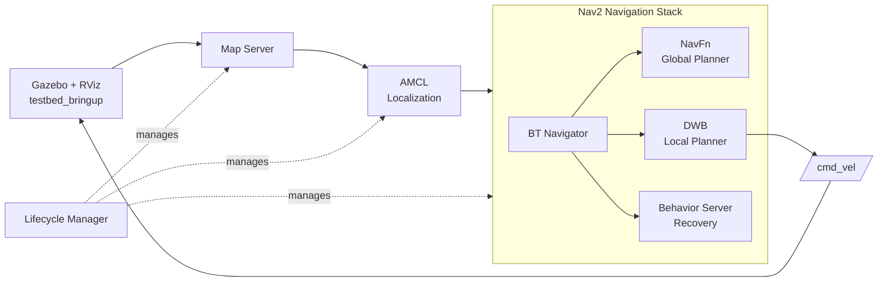
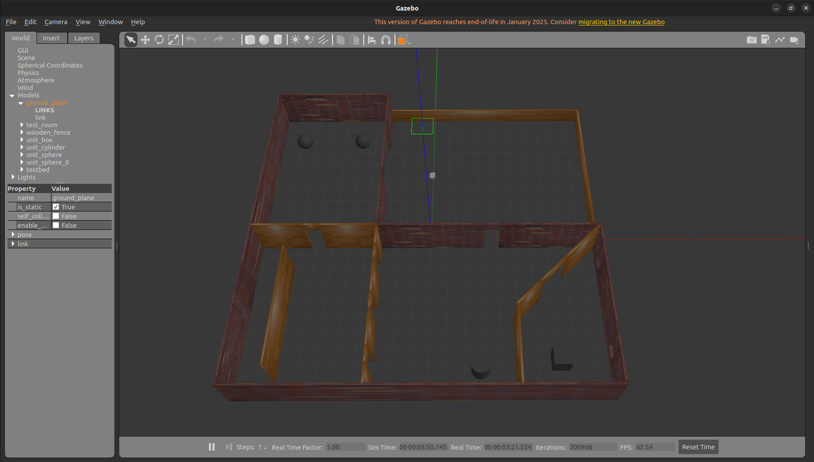
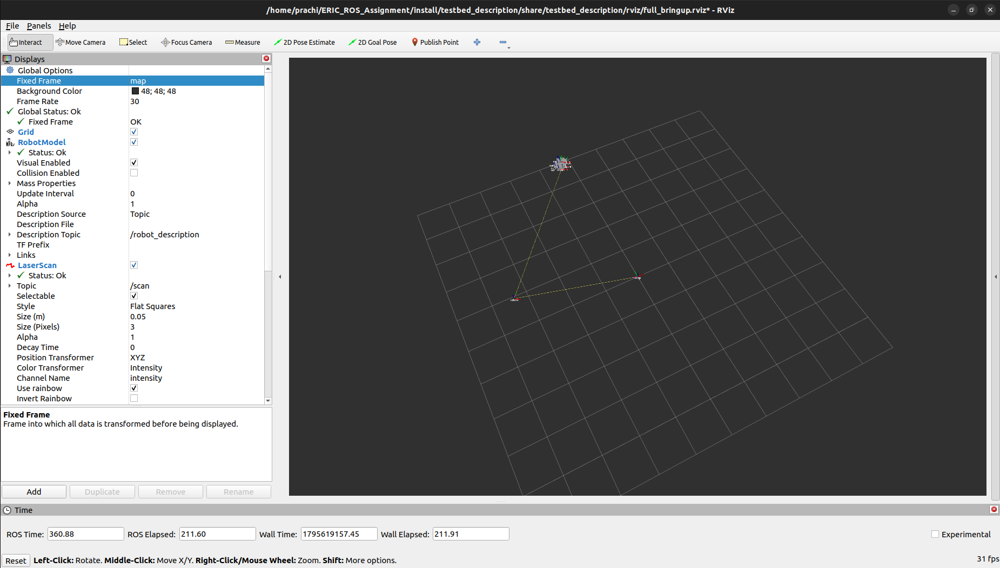
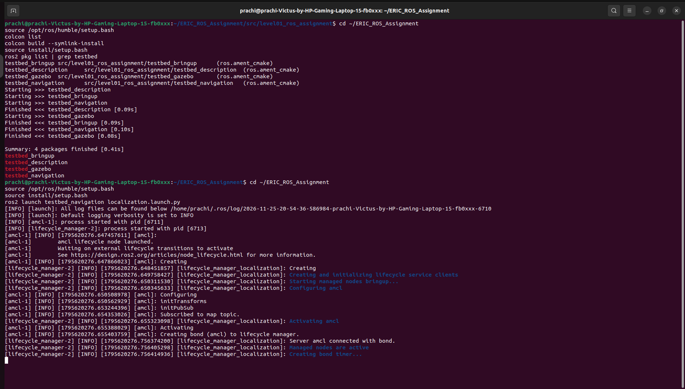
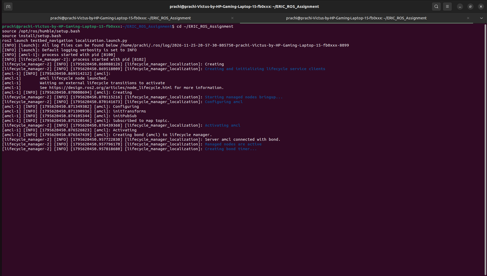

<div align="center">

# 🤖 ROS 2 Navigation – ERIC Mobile Robot

**A manually configured Nav2 stack for autonomous navigation in Gazebo Classic**


</div>

---

## 📑 Table of Contents

1. [Project Overview](#1--project-overview)
2. [System Architecture](#2--system-architecture)
3. [Software Requirements](#3--software-requirements)
4. [Package Structure](#4--package-structure)
5. [Build Instructions](#5--build-instructions)
6. [Launch Instructions](#6--launch-instructions)
7. [Initial Pose Configuration](#7--initial-pose-configuration)
8. [Sending a Navigation Goal](#8--sending-a-navigation-goal)
9. [Screenshots](#9--screenshots)
10. [Demonstration Video](#10--demonstration-video)
11. [Troubleshooting](#11--troubleshooting)

---

## 1. 📌 Project Overview

This package implements a **manually configured ROS 2 Navigation (Nav2) stack** for the **ERIC mobile robot** simulation. Instead of relying on the default `nav2_bringup` launch files, each Nav2 component is configured and launched individually, giving full control over parameters and node lifecycle.

The robot runs in **Gazebo Classic**, and **RViz2** is used for map visualization, localization monitoring and goal selection.

### Key Components

| Component | Role |
|---|---|
| **Map Server** | Loads and publishes the occupancy grid map |
| **AMCL** | Adaptive Monte Carlo Localization – estimates robot pose on the map |
| **NavFn** | Global path planner |
| **DWB** | Local planner and velocity controller |
| **Behavior Server** | Recovery behaviours (e.g. spin, back up, wait) |
| **BT Navigator** | Executes navigation tasks using Behavior Trees |
| **Lifecycle Manager** | Manages the lifecycle states of all Nav2 nodes |

---

## 2. 🏗️ System Architecture



---

## 3. 💻 Software Requirements

| Software | Version |
|---|---|
| Ubuntu | 22.04 |
| ROS 2 | Humble Hawksbill |
| Gazebo | Classic 11 |
| RViz2 | Included with ROS 2 Humble |
| Navigation2 | `ros-humble-navigation2`, `ros-humble-nav2-bringup` |

> **Dependency:** Terminal 1 uses the `testbed_bringup` package, which must be present in the same workspace.

---

## 4. 📂 Package Structure

```text
testbed_navigation/
├── config/
│   ├── amcl_params.yaml        # AMCL localization parameters
│   └── nav2_params.yaml        # Planner, controller, BT and behavior parameters
├── launch/
│   ├── map_loader.launch.py    # Starts the map server
│   ├── localization.launch.py  # Starts AMCL
│   └── navigation.launch.py    # Starts the Nav2 navigation stack
├── screenshots/                # Demonstration images
├── CMakeLists.txt
├── package.xml
└── README.md
```

---

## 5. 🔨 Build Instructions

```bash
# 1. Go to the workspace
cd ~/ERIC_ROS_Assignment

# 2. Source ROS 2 Humble
source /opt/ros/humble/setup.bash

# 3. Build the workspace
colcon build --symlink-install

# 4. Source the workspace
source install/setup.bash
```

---

## 6. 🚀 Launch Instructions

Run each component in a **separate terminal**, in the order shown below. In every terminal, first run:

```bash
cd ~/ERIC_ROS_Assignment
source /opt/ros/humble/setup.bash
source install/setup.bash
```

| Step | Terminal | Purpose | Command |
|:---:|---|---|---|
| 1 | **Terminal 1** | Gazebo + RViz | `ros2 launch testbed_bringup testbed_full_bringup.launch.py` |
| 2 | **Terminal 2** | Map Server | `ros2 launch testbed_navigation map_loader.launch.py` |
| 3 | **Terminal 3** | AMCL Localization | `ros2 launch testbed_navigation localization.launch.py` |
| 4 | **Terminal 4** | Nav2 Navigation | `ros2 launch testbed_navigation navigation.launch.py` |

> ⚠️ Wait for each terminal to finish starting up before launching the next one.

---

## 7. 📍 Initial Pose Configuration

After starting the map server and AMCL, give the robot an initial pose estimate so localization can converge:

1. Set the RViz **Fixed Frame** to `map`.
2. Select the **2D Pose Estimate** tool.
3. Click the robot's approximate location on the map.
4. Drag the arrow to indicate the robot's orientation.

The particle cloud should then gather around the robot as AMCL localizes it.

---

## 8. 🎯 Sending a Navigation Goal

Once Nav2 is active and the robot is localized:

1. Select the **Nav2 Goal** (or **2D Goal Pose**) tool in RViz.
2. Click the target position on the map and drag to set the final heading.
3. The global path (NavFn) will appear, and the robot will follow it using DWB.

---

## 9. 📸 Screenshots

| # | Preview | Description |
|:---:|---|---|
| 1 |  | Gazebo robot simulation |
| 2 |  | RViz map and robot visualization |
| 3 |  | AMCL localization activation |
| 4 |  | Nav2 lifecycle activation |

---

## 10. 🎥 Demonstration Video

A demonstration of the complete ROS 2 navigation workflow is available here:

[ros2_navigation_demo.webm](https://github.com/user-attachments/assets/b2ac0686-f602-4c8e-a129-3b30c4a3b6d8)

---

## 11. 🛠️ Troubleshooting

| Problem | Possible Fix |
|---|---|
| Map does not appear in RViz | Set Fixed Frame to `map` and confirm the Map Server is running |
| Robot does not localize | Provide the initial pose using **2D Pose Estimate** |
| Nav2 nodes not activating | Check the Lifecycle Manager output in Terminal 4 for errors |
| `package not found` error | Re-run `source install/setup.bash` in that terminal |
| Robot does not move after setting a goal | Make sure all four terminals are running and AMCL has localized the robot |

---

<div align="center">

**Author:** Prachi Kale  
Built with ROS 2 Humble · Nav2 · Gazebo Classic

</div>
