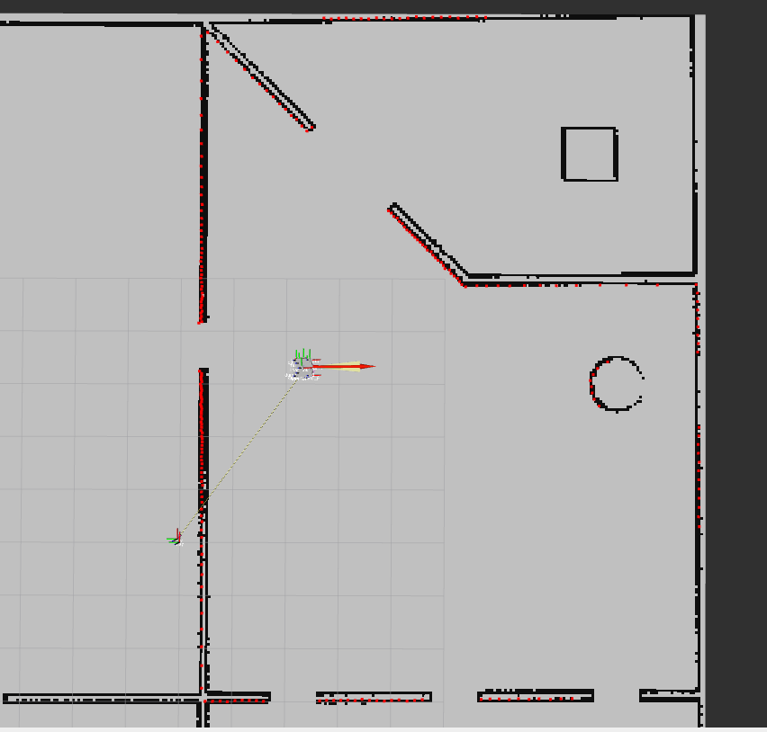
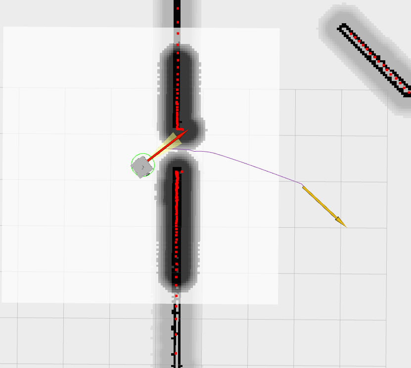
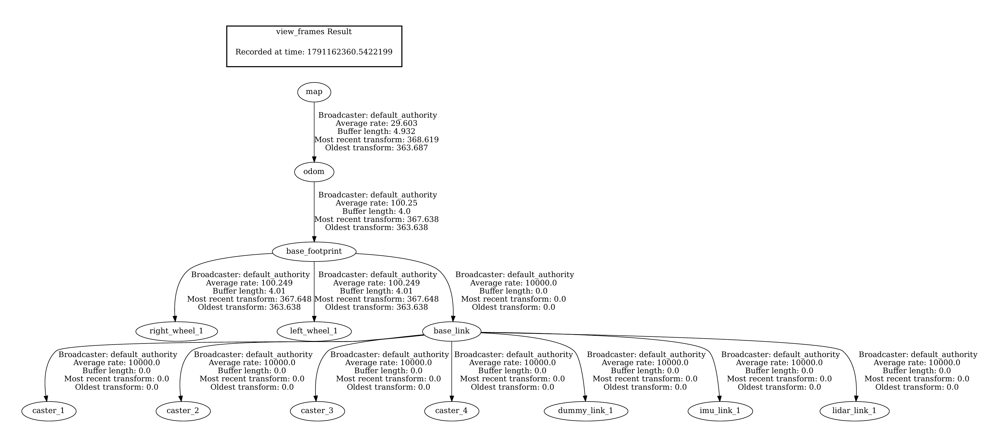

# testbed_navigation

Navigation setup for the Testbed robot (ERIC Robotics Level 1 assignment). It is built from individual Nav2 servers instead of `nav2_bringup`. 

Map loading, localization and navigation each have their own launch file, parameter file and lifecycle manager, so each one can be started on its own.

Environment: Ubuntu 22.04, ROS 2 Humble, Gazebo Classic 11, RViz2.  
Author: Krishnil Shindore

## Demo

- Localization (laser scan lined up with the map walls): 
- Navigation (global path and local plan): 
- Video: [docs/navigation_demo.mp4](docs/navigation_demo.mp4)

## What is in the package

- level01_ros_assignment/


   - bugs_fixed.txt  (starter-code bugs and fixes)


   - testbed_navigation/
      - config/
         - map_server_params.yaml
         - amcl_params.yaml
         - nav2_params.yaml
      - launch/
         - map_loader.launch.py
         - localization.launch.py
         - navigation.launch.py
      - docs/ (screenshots and demo video)
      - CMakeLists.txt
      - package.xml


   - testbed_bringup, testbed_description, testbed_gazebo   (supplied packages, bugs fixed)


| Launch file | Parameters | Starts |
|---|---|---|
| `map_loader.launch.py` | `map_server_params.yaml` | `map_server` |
| `localization.launch.py` | `amcl_params.yaml` | `amcl` |
| `navigation.launch.py` | `nav2_params.yaml` | `planner_server`, `controller_server`, `behavior_server`, `bt_navigator`, `velocity_smoother` |

Each launch file also starts its own lifecycle manager and accepts `use_sim_time:=true|false` and `params_file:=<path>`.

Only standard Nav2 plugins are used. The assignment asks for basic navigation, so I did not write any custom plugins.

## Setup and running

Install the dependencies:

```bash
sudo apt install ros-humble-navigation2 ros-humble-teleop-twist-keyboard
```

Build:

```bash
cd ~/assignment_ws
colcon build
source install/setup.bash
```

Run each of these in its own terminal, in this order:

```bash
# 1. simulation bringup: Gazebo, RViz and the robot
ros2 launch testbed_bringup testbed_full_bringup.launch.py

# 2. map
ros2 launch testbed_navigation map_loader.launch.py

# 3. localization (the initial pose is read from amcl_params.yaml)
ros2 launch testbed_navigation localization.launch.py

# 4. navigation
ros2 launch testbed_navigation navigation.launch.py
```

- Each lifecycle manager prints `Managed nodes are active` when its nodes are ready.

### RViz displays

Set the Fixed Frame to `map` and add:

- Map on `/map` (Durability Policy: Transient Local)
- Map on `/global_costmap/costmap` (Transient Local)
- Map on `/local_costmap/costmap`
- Path on `/plan` (global plan)
- Path on `/local_plan` (local plan)
- LaserScan on `/scan` (Reliability Policy: Best Effort)
- PoseWithCovariance on `/amcl_pose`
- Pose on `/goal_pose`

### Sending a goal

Use the 2D Goal Pose tool in RViz or call the action directly (pick a point in free space):

```bash
ros2 action send_goal /navigate_to_pose nav2_msgs/action/NavigateToPose \
  "{pose: {header: {frame_id: map}, pose: {position: {x: -5.0, y: 5.0, z: 0.0}, orientation: {w: 1.0}}}}" --feedback
```

The individual servers can also be called one at a time:

```bash
ros2 action list

# planner only
ros2 action send_goal /compute_path_to_pose nav2_msgs/action/ComputePathToPose \
  "{goal: {header: {frame_id: map}, pose: {position: {x: -5.0, y: 5.0, z: 0.0}, orientation: {w: 1.0}}}, planner_id: GridBased, use_start: false}"

# one recovery behavior only
ros2 action send_goal /spin nav2_msgs/action/Spin "{target_yaw: 1.57}"
```

## How it works

The data flows like this:

1. `map_server` publishes the saved map on `/map`.
2. `amcl` compares `/scan` against that map, uses `/odom` for motion, and publishes the `map -> odom` transform.
3. `bt_navigator` receives a goal and runs the behavior tree. It asks `planner_server` for a path on the global costmap and `controller_server` to follow it using the local costmap. `behavior_server` supplies the recoveries (spin, back up, wait).
4. `controller_server` publishes velocity commands on `/cmd_vel_nav`. `velocity_smoother` republishes them on `/cmd_vel`, which the simulated diff-drive plugin listens to. This is done with topic remappings in `navigation.launch.py`.

Both costmaps take their obstacles from `/scan`.

The TF tree is: 

`map -> odom` comes from AMCL and `odom -> base_footprint` from the diff-drive plugin.


## Configuration choices

### **Localization (`amcl_params.yaml`):** 
Frames are `map`, `odom` and `base_footprint`. It uses 500 to 2000 particles, the likelihood-field model, and `max_beams: 120` (the default is 60 and the lidar has 300 beams). The filter updates after 0.15 m or 0.15 rad of motion. The initial pose is set in the file (`set_initial_pose: true`, x 0.0, y 5.0, yaw 0.0), since the robot always spawns there.

### **Global planner:** 
NavFn with `tolerance: 0.5` and `allow_unknown: true`. It is simple and dependable for basic point-to-point navigation.

### **Local controller:** 
DWB, limited to 0.26 m/s and 1.0 rad/s to match the simulated robot, running at 20 Hz. The critics are RotateToGoal, Oscillation, BaseObstacle, GoalAlign, PathAlign, PathDist and GoalDist, which is the standard Nav2 set. I left out ObstacleFootprint on purpose as it sums costmap cost along the trajectory just like BaseObstacle, so using both counts obstacles twice, and at a high weight it made the robot refuse to enter narrow openings. 

Mostly the weights are the standard Nav2 ones: PathAlign and PathDist 32, GoalAlign and GoalDist 24, RotateToGoal 32. BaseObstacle is given a relatively low weight so that small variations in costmap cost do not dominate path following, while the inflated costmap still provides strong obstacle-related costs near obstacles. `forward_point_distance` is 0.1 m for PathAlign and GoalAlign, which is the standard Nav2 value. 

DWB samples 20 forward speeds (`vx_samples`) and 40 rotation rates (`vtheta_samples`) over a `sim_time` of 1.7 s. The extra rotation samples give finer steering when lining up with an opening. `min_vel_x` is 0.0 so DWB does not sample reverse motion, and backing up is left to the BackUp recovery. `min_speed_xy` 0.0 and `max_speed_xy` 0.26 are required for forward motion (see challenge 3). The acceleration and deceleration limits (2.5 m/s² and 3.2 rad/s²) match the velocity smoother, and the controller runs at 20 Hz, the Nav2 default. The progress checker gives the robot 10 s to move 0.5 m before the controller reports a failure and recovery starts.

### **Costmaps:** 
The global costmap (map frame) has static, obstacle and inflation layers. The obstacle layer is there so the planner can see obstacles that are not on the map and replan around them. The local costmap is a 6x6 m rolling window in the odom frame with obstacle and inflation layers. 

Both use a 0.05 m resolution, 0.45 m inflation radius and cost scaling of 6.0. Obstacles are marked within 2.5 m and raytraced to 3.0 m. That is shorter than the 8 m lidar range so noisy far away returns are not marked.

The inflation radius of 0.45 m is 0.21 m larger than the 0.24 m robot radius. That gradient makes the planner centre its path in openings instead of hugging the door frame, and a cost scaling of 6.0 makes the cost fall off gently enough that the middle of a door stays well below lethal. `inf_is_valid: true` lets max-range (`inf`) readings clear free space, so old obstacle marks are removed. `track_unknown_space: true` in the global costmap matches `allow_unknown: true` in the planner.

### **Footprint:** 
Both costmaps use `robot_radius: 0.24`. I chose it by testing. The default of 0.1 m was much smaller than the robot and it hit walls in narrow openings. 0.22 m still touched walls at times, and 0.24 m stopped the collisions while keeping the narrow openings passable. 

A circle around the origin is only an approximation and does not fit the robot properly.

### **Velocity smoother:** 
20 Hz, open loop, with the same limits as DWB (0.26 m/s, 1.0 rad/s, 2.5 m/s² and 3.2 rad/s² acceleration). With equal limits it works as a safety limiter between the controller and the robot rather than changing the behavior.

### **Behavior tree and recovery:** 
I left the behavior tree and its plugin list at the Nav2 defaults, which is the standard navigate-to-pose tree with replanning and recovery. The recovery behaviors are Spin, BackUp, DriveOnHeading and Wait. `bt_loop_duration` is 10 ms and `default_server_timeout` is 20 ms, which are the Nav2 defaults, and the behavior server uses a `transform_tolerance` of 0.1 s.


## Challenges

1. **AMCL drifted and the scan did not match the map:** With a 1.5 m range most laser rays returned `inf`. Next to a single wall, a scan gives distance and angle but not position along the wall, so odometry drift never got corrected. Raising the range to 8 m fixed it, as the scan now covered major nearby walls.

2. **Localization suddenly jumped and was distorted:** The AMCL log showed a second `/initialpose` message, due to my mistake of 2D Pose Estimate stray click in RViz, which reset the initial pose to a stray point. Setting the initial pose in the parameter file later, and avoiding faulty clicks stopped it.

3. **The robot rotated in place but never drove forward:** `/cmd_vel` always had `linear.x = 0.0`. I checked TF, AMCL, the costmaps, the goal position and the critic weights first, and none of them was the cause. The cause was that parameters `min_speed_xy` and `max_speed_xy` were not set for DWB. As far as I could tell, with `max_speed_xy` left at its default of 0, DWB discarded every forward velocity sample. Setting `min_speed_xy: 0.0` and `max_speed_xy: 0.26` fixed it. The lesson was that a controller can look active and healthy and still produce no motion, so it is worth looking at the raw `/cmd_vel` output.

4. **A costmap display stayed empty after I toggled it in RViz:** The static global costmap publishes its full grid only when it changes, so a display that subscribes later needs Durability Policy set to Transient Local.

5. **The robot hit walls in narrow openings and sharp turns:** The default radius of 0.1 was way too small and the chassis is offset from `base_footprint`. I tuned the radius to 0.24 m by comparing the footprint with the robot body in RViz.

6. **The robot stalled before narrow openings:** The robot stalled, rotated in place or only sometimes got through openings it could easily pass. This started once the obstacle layers began working (challenge 7). Before that the costmaps could not see the walls, so the robot passed freely. All the critics were set so as to prioritize path following with sufficient obstacle avoidance, therefore allowing the bot to pass through narrow openings smoothly.

7. **The obstacle layers did not mark anything, so dynamic obstacle avoidance and the local costmap did not work:** Even with an obstacle layer in both costmaps, obstacles from `/scan` did not show up in the local costmap, and the global one was affected as well, so the robot could not avoid anything that was not already a wall on the map. The `scan` source had only `topic`, `data_type`, `marking` and `clearing`, with `observation_sources: scan` unquoted. It started working when I rewrote the layer in both costmaps with `enabled: true`, a quoted `observation_sources: "scan"`, a quoted `data_type: "LaserScan"`, and every range and height value written out. 

For debugging in general, I checked one stage at a time: sensors and topics, then TF, map loading, AMCL, costmaps, planner and finally the controller. That made it clear each time where the fault was.

## Testing

I checked these in simulation:

- `ros2 topic list` shows `/scan`, `/odom`, `/cmd_vel`, `/tf` and `/map`.
- `ros2 run tf2_tools view_frames` shows `map -> odom -> base_footprint -> base_link -> lidar_link_1`.
- `ros2 run tf2_ros tf2_echo map odom` prints a continuously updating transform, and the scan lines up with the map walls in RViz.
- After sending a goal, `/plan` appears and `ros2 topic echo /cmd_vel` shows `linear.x` above 0.
- `ros2 topic info /cmd_vel_nav` and `/cmd_vel` show the path controller, then smoother, then diff-drive plugin.
- Dynamic obstacle avoidance works: obstacles that are not on the map show up in the local and global costmaps and the robot plans around them.
- Everything was verified in RViz using different colours for different displays.

Goals across the whole map, around walls and through narrow openings were successfully completed in my tests. During fast rotation the scan briefly sits slightly off the walls, but is corrected at AMCL's next update.


## Results

In simulation, all three stages of the assignment work independently and together.

- **Map loading:** `map_loader.launch.py` loads the provided map with `map_server`, and it shows correctly in RViz on `/map`.
- **Localization:** AMCL keeps the scan lined up with the map walls and publishes a continuously updating `map -> odom` transform. Odometry drift is corrected, and during fast rotation the scan is only briefly off until AMCL's next update.
- **Navigation:** goals across the whole map and around walls are completed using NavFn, DWB and the behavior tree, with recovery behaviors and the velocity smoother in the command path. The robot also passes through narrow openings.
- **Dynamic obstacle avoidance:** obstacles that are not on the map appear in both costmaps, and the robot goes around them.
- **Modularity:** map loading, localization and navigation each run from their own launch file, parameter file and lifecycle manager, without `nav2_bringup`.

## Limitations and future work

- Goals/robot very close to a wall, or inside the inflated zone, can stall, even though the recovery behaviors try to make it move. Choosing goals clear of walls helped.
- The circular footprint only roughly approximates the chassis. A polygon footprint taken from the mesh outline, with `base_footprint` moved to the axle centre, would be tighter.
- The initial pose is fixed to the default spawn. If the spawn changes, update `initial_pose` in `amcl_params.yaml` or use RViz 2D Pose Estimate.