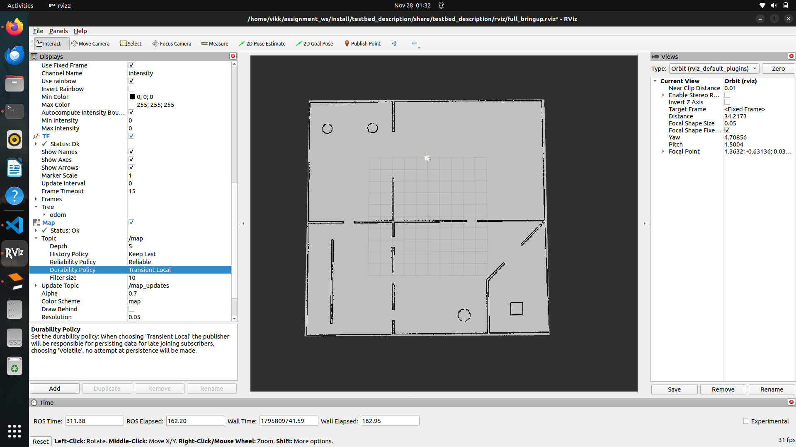
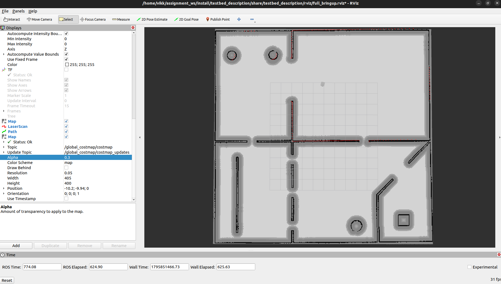
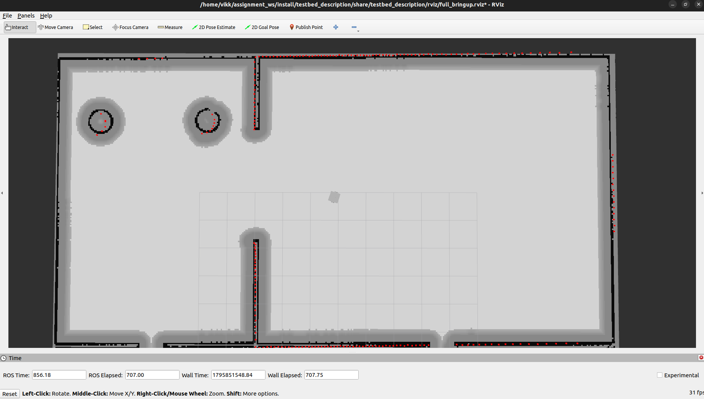
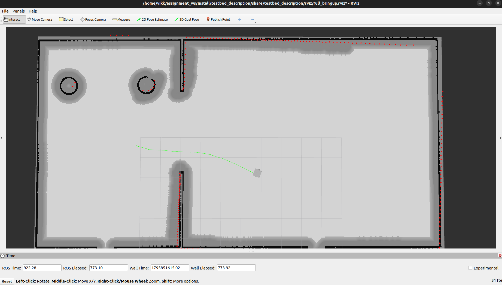
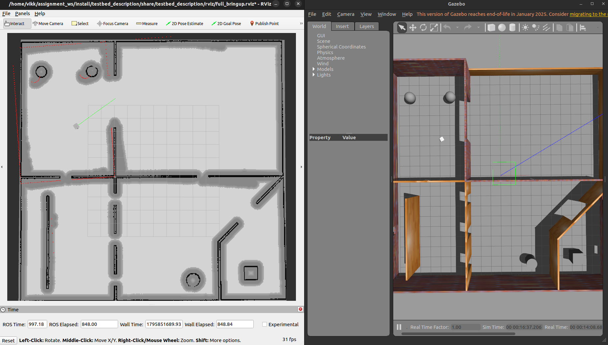
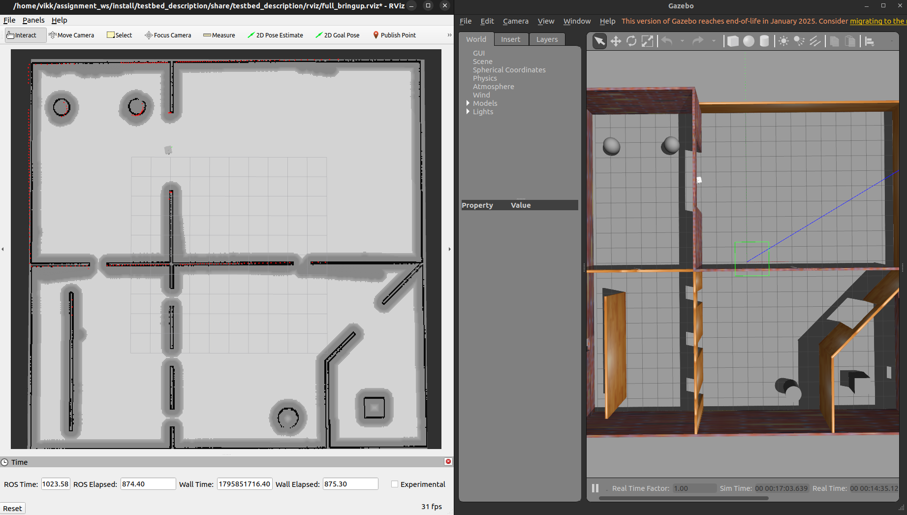
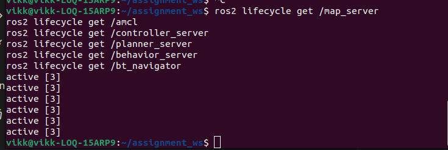
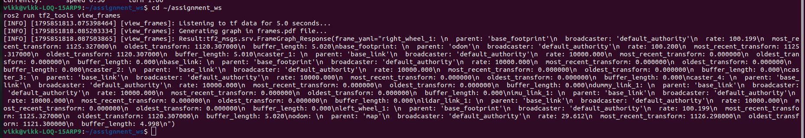

# testbed_navigation

Manual Nav2 setup for the Testbed T1.0.0 robot. The map server, AMCL, planner,
controller, behavior server and BT navigator are each launched by hand from their own
launch file and parameter file. `nav2_bringup` is not used.


## Environment

- Ubuntu 22.04
- ROS 2 Humble
- Gazebo Classic 11.10.2
- RViz2

## Package layout

```
testbed_navigation/
├── launch/
│   ├── map_loader.launch.py       # map_server + lifecycle manager
│   ├── localization.launch.py     # AMCL + lifecycle manager
│   └── navigation.launch.py       # controller, planner, behaviors, BT navigator + lifecycle manager
├── config/
│   ├── amcl_params.yaml
│   └── nav2_params.yaml
├── docs/                          # screenshots used below
└── README.md
```

The bugs I found in the starter code, and how I fixed them, are listed in
[`bugs.txt`](../bugs.txt) at the repository root.

## How to run

```bash
cd ~/assignment_ws
colcon build
source install/setup.bash
```

Run each of these in its own terminal (source the workspace in each one), in this order:

```bash
ros2 launch testbed_bringup testbed_full_bringup.launch.py   # Gazebo + robot + RViz
ros2 launch testbed_navigation map_loader.launch.py          # map
ros2 launch testbed_navigation localization.launch.py        # AMCL
ros2 launch testbed_navigation navigation.launch.py          # Nav2 servers
```

In RViz:

1. Set **Fixed Frame** to `map` (it only appears in the list once AMCL is running).
2. Add a **Map** display on `/map` and set its Durability Policy to `Transient Local`.
3. Add a **LaserScan** on `/scan` and a **Path** on `/plan`.
4. If the scan does not sit on the walls, use **2D Pose Estimate**.
5. Use **2D Goal Pose** to send a goal.

A goal can also be sent from the command line:

```bash
ros2 action send_goal /navigate_to_pose nav2_msgs/action/NavigateToPose \
  "{pose: {header: {frame_id: map}, pose: {position: {x: 2.0, y: 5.0}, orientation: {w: 1.0}}}}"
```

To check that everything is up:

```bash
ros2 lifecycle get /map_server
ros2 lifecycle get /amcl
ros2 lifecycle get /controller_server
ros2 lifecycle get /planner_server
ros2 lifecycle get /behavior_server
ros2 lifecycle get /bt_navigator
```

## Approach

I worked in stages and tested each one before moving to the next.

1. **Starter code first.** The workspace did not even build at the start, so I fixed the
   planted bugs before touching Nav2 (see `bugs.txt`). I logged each one as I found it.
2. **Map loading.** `map_loader.launch.py` starts `nav2_map_server` with
   `testbed_bringup/maps/testbed_world.yaml`, plus a lifecycle manager with
   `autostart: true`. The map is published once, so RViz needs a `Transient Local`
   durability setting to receive it.
3. **Localization.** `localization.launch.py` starts AMCL with `config/amcl_params.yaml`
   and its own lifecycle manager. I checked what the robot really publishes before
   writing the parameters: `odom → base_footprint` comes from the diff-drive plugin, and
   the lidar publishes `/scan` in the `lidar_link_1` frame. AMCL then provides
   `map → odom`.
4. **Navigation.** `navigation.launch.py` starts `controller_server`, `planner_server`,
   `behavior_server` and `bt_navigator` with `config/nav2_params.yaml`, managed by one
   lifecycle manager. After starting it I checked that all nodes were `active` and that
   the `/navigate_to_pose` action existed, then sent goals.

## Key parameter choices

| Area | Choice | Reason |
|---|---|---|
| Frames | `map`, `odom`, `base_footprint`, scan topic `/scan` | These are what the robot actually publishes. A mismatch here silently breaks AMCL. |
| `use_sim_time` | `true` in every node | Gazebo runs on simulation time. |
| AMCL | `DifferentialMotionModel`, likelihood-field laser model, 500 to 2000 particles | Suits a differential-drive robot with a 2D lidar. |
| AMCL initial pose | x 0.0, y 5.0, yaw 0.0 | The robot spawns here, and this spot is free space on the map. |
| Lidar range | raised from 1.5 m to 10 m | With 1.5 m the robot saw almost no walls and AMCL had nothing to match. |
| Planner | `NavfnPlanner` | Basic global planner, enough for this task. |
| Controller | `RegulatedPurePursuitController`, `desired_linear_vel` 0.3 m/s | Slow, stable driving in a small map. |
| Costmaps | global: static + obstacle + inflation layers in `map`. local: rolling 3 m window in `odom` | Global layer plans around the known map, local layer reacts to what the lidar sees. |
| `robot_radius` | 0.25 m | The robot body is roughly 0.35 m by 0.35 m. |
| Behaviors | `spin`, `backup`, `drive_on_heading`, `wait` | The standard set of recovery behaviors. |

## Results

### Map loading

The map server loads the provided map and RViz shows it with `Status: Ok`.



### Localization

With AMCL running and Fixed Frame set to `map`, the red laser points sit on the black
walls of the map. The grey halo is the inflated global costmap.



Zoomed in, the scan lines up with the walls and the circular obstacles.



### Navigation

After sending a goal, the global planner draws a path (green line, `/plan`).



RViz and Gazebo side by side while the robot is driving, and at the end of a run.





### System state

All six lifecycle nodes report `active`.



The TF tree from `view_frames` shows the chain `map → odom → base_footprint → base_link`,
with the lidar and IMU as children of `base_link`.



## Challenges

- **Workspace would not build.** `ament_package()` had been cut off in
  `testbed_description/CMakeLists.txt`, and CMake stopped with a parse error.
- **Launch failed with "executable not found".** The message printed a substitution
  object instead of a name, which made it hard to read. The real cause was that `xacro`
  was not installed on my machine. I installed it and also added it to `package.xml`.
- **"Package not found" for my own packages.** My `.bashrc` was sourcing another
  workspace, so new terminals did not know about `assignment_ws`. I had to source the
  right workspace in every terminal.
- **Edits not taking effect.** Launch, yaml and xacro files are used from the `install/`
  folder, so every change needs a `colcon build` and a restart.
- **Install lists missing folders.** `maps` and `models` were not being installed, so the
  map and model paths did not exist after a build.
- **Map not visible in RViz.** The `map` frame is not in the Fixed Frame list until AMCL
  publishes `map → odom`, and the map topic needs `Transient Local` durability.
- **Scan moving in the `map` frame while driving.** The scan was stable in the `odom`
  frame but drifted in `map`, which meant AMCL's estimate was unstable. I raised the
  lidar range, fixed `use_sim_time` for `robot_state_publisher`, and drove more slowly
  with teleop. I also compared `/amcl_pose` with `/odom`: after about 1.6 m of driving
  they differed by about 9 cm, so AMCL was tracking the robot and applying small
  corrections.
- **Short goals look like success.** My first command-line test goal was less than half a
  metre from the robot's position, so I used goals further away in RViz for the real
  test.

## Limitations and next steps

- `velocity_smoother` and `collision_monitor` are optional and were not added.
- The parameters are working defaults, not heavily tuned. Controller speeds, costmap
  inflation and AMCL update thresholds could be tuned further.
- The recovery behaviors are configured but I did not deliberately stress-test them.
