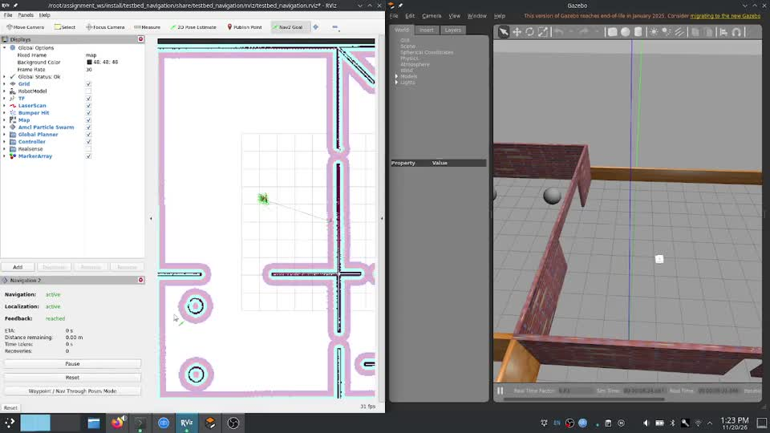

# testbed_navigation

A modular Nav2 setup for the **Testbed-T1.0.0** robot. This package does **not** call
`nav2_bringup`. Each Nav2 server is started as its own lifecycle node in its own launch file,
with its plugins configured in a dedicated parameter file.

```
testbed_navigation/
|-- CMakeLists.txt
|-- package.xml
|-- config/
|   |-- map_server_params.yaml   # nav2_map_server
|   |-- amcl_params.yaml         # nav2_amcl (localization)
|   `-- nav2_params.yaml         # planner / controller / behaviours / BT navigator / velocity smoother + costmaps
|-- launch/
|   |-- map_loader.launch.py     # step 1: map_server + lifecycle_manager_map
|   |-- localization.launch.py   # step 2: amcl + lifecycle_manager_localization (includes step 1 by default)
|   |-- navigation.launch.py     # step 3: navigation servers + lifecycle_manager_navigation
|   `-- testbed_navigation.launch.py  # convenience: steps 1-3 + RViz
|-- rviz/testbed_navigation.rviz # Nav2 RViz view (map, particles, costmaps, plan, goal tools)
`-- scripts/send_goal.py         # send a NavigateToPose goal from the terminal
```

## Demo

[](../media/navigation_demo.mp4)

Video: [`media/navigation_demo.mp4`](../media/navigation_demo.mp4). RViz with the Nav2 panel
(localization and navigation active) next to Gazebo, with the robot driving to Nav2 goals.

## Architecture

```
/scan, /odom, TF odom->base_footprint   (from Gazebo / testbed_bringup)

map_server  --/map-->  amcl  --TF map->odom-->  costmaps
planner_server     (NavFn)                + global costmap
controller_server  (Regulated Pure Pursuit) + local costmap  --/cmd_vel_nav-->  velocity_smoother  --/cmd_vel-->  robot
behavior_server    (spin, backup, drive_on_heading, wait)
bt_navigator       (NavigateToPose action, goals from RViz or send_goal.py)
```

Three separate lifecycle managers (`lifecycle_manager_map`, `_localization`, `_navigation`) keep
the stages independent. Each one can be started, stopped or debugged without touching the others.

### Plugin choices (basic navigation)

| Server | Plugin | Why |
|---|---|---|
| map_server | `nav2_map_server` | loads `testbed_bringup/maps/testbed_world.yaml` |
| amcl | `nav2_amcl::DifferentialMotionModel`, likelihood-field laser model | the robot is diff-drive with a 360 deg 2D lidar |
| planner_server | `nav2_navfn_planner/NavfnPlanner` (A*) | simple and reliable on a static 2D map |
| controller_server | `nav2_regulated_pure_pursuit_controller` | simple to tune for diff drive. Rotates to the path heading first, slows down in tight turns and near the goal, and stops for obstacles via collision checking |
| behavior_server | Spin, BackUp, DriveOnHeading, Wait | the recoveries used by the default BT |
| bt_navigator | default `navigate_to_pose_w_replanning_and_recovery.xml` | replans at 1 Hz, clears costmaps and runs recoveries on failure |
| velocity_smoother | `nav2_velocity_smoother` | limits acceleration/deceleration before commands reach `/cmd_vel` |

Footprint: the STL meshes give a 0.36 m x 0.42 m rectangle around `base_footprint`, after
`base_footprint` was moved to the wheel-axle centre (see `../BUGS_FIXED.txt`).

## Build

```bash
cd ~/assignment_ws
colcon build --symlink-install
source install/setup.bash
export RMW_IMPLEMENTATION=rmw_cyclonedds_cpp   # recommended in help.md
```

## Run

Terminal 1: simulation (Gazebo + RViz):
```bash
ros2 launch testbed_bringup testbed_full_bringup.launch.py
```

Terminal 2: either everything at once:
```bash
ros2 launch testbed_navigation testbed_navigation.launch.py
```
or step by step, testing each stage on its own:
```bash
ros2 launch testbed_navigation map_loader.launch.py                    # check /map in RViz (Fixed Frame: map)
ros2 launch testbed_navigation localization.launch.py load_map:=false  # check /particle_cloud converges
ros2 launch testbed_navigation navigation.launch.py                    # send goals
```

AMCL starts with the robot's spawn pose `(0, 5, 0)`, so no manual pose estimate is needed.
If the robot is moved, use **2D Pose Estimate** in RViz.

Send goals with **Nav2 Goal** in RViz, or from a terminal:
```bash
ros2 run testbed_navigation send_goal.py 1.0 -4.0 0.0     # x y yaw (map frame)
```

Launch arguments: `map`, `use_sim_time`, `autostart`, `log_level`, and
`map_params_file` / `amcl_params_file` / `nav2_params_file`.

## Process and challenges

1. **Fixed the starter code first.** The workspace did not build, and the map could not be
   loaded. All 12 bugs and their fixes are listed in `../BUGS_FIXED.txt`. The ones that mattered
   most for navigation:
   - The **1.5 m lidar range** made AMCL unusable in rooms ~10 m wide. It is now 12 m.
   - The **friction values** let the drive wheels slip and the fixed casters drag.
   - The **missing `use_sim_time`** on robot_state_publisher caused TF time mismatches.
2. **Map -> localization -> navigation, one at a time.** Each stage was checked before starting the
   next: `/map` published and latched, AMCL publishing `map->odom` with a converged particle cloud,
   then the navigation servers reaching the *active* state.
3. **Launch-argument scoping in Humble.** `IncludeLaunchDescription` does not scope launch
   configurations. When every file declared `params_file`, the value from the first include
   (the AMCL file) leaked into `navigation.launch.py`. `controller_server` then fell back to its
   defaults (DWB with no critics) and failed to configure. Giving each file its own argument name
   (`map_params_file`, `amcl_params_file`, `nav2_params_file`) fixed this.
4. **"Empty Tree" on every goal.** I first set `default_nav_to_pose_bt_xml: ""`, expecting it
   to mean "use the default". In Humble it loads an empty behaviour tree, so `bt_navigator`
   aborted every goal with `Behavior tree threw exception: Empty Tree`. Leaving the parameter
   unset fixed it.
5. **Robot turning back in the middle of a route.** The robot sometimes followed the path well,
   then suddenly spun and reversed. I logged ground truth against the AMCL estimate during a
   5-goal run. Localization error stayed under 0.2 m, so AMCL was not the cause. The planner log
   showed `Failed to create a plan from potential when a legal potential was found`, a known
   NavFn issue when A* is enabled. Each failed replan made the BT run its recovery sequence
   (clear costmaps, spin, wait, back up). After switching NavFn to Dijkstra (`use_astar: false`),
   the same run had 0 planner failures and 0 recoveries (before: 2 failures, 2 recoveries).
6. **Velocity smoother wiring.** The controller publishes on `cmd_vel_nav`. The smoother remaps
   `cmd_vel_nav -> cmd_vel` so that the Gazebo diff-drive plugin receives smoothed commands.
7. **Testing.** Everything was tested headless in the provided ROS 2 Humble Docker image:
   gzserver + robot + navigation stack, with `NavigateToPose` goals sent across rooms through
   the doorways using `send_goal.py`. Result: goal (1.0, -4.0) reached at AMCL pose (1.06, -3.87),
   and goal (-7.0, 7.0) reached at (-6.93, 6.79), both inside the 0.2 m goal tolerance.
