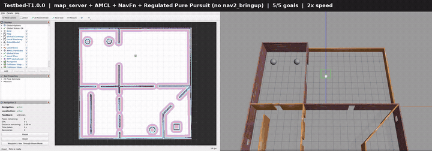
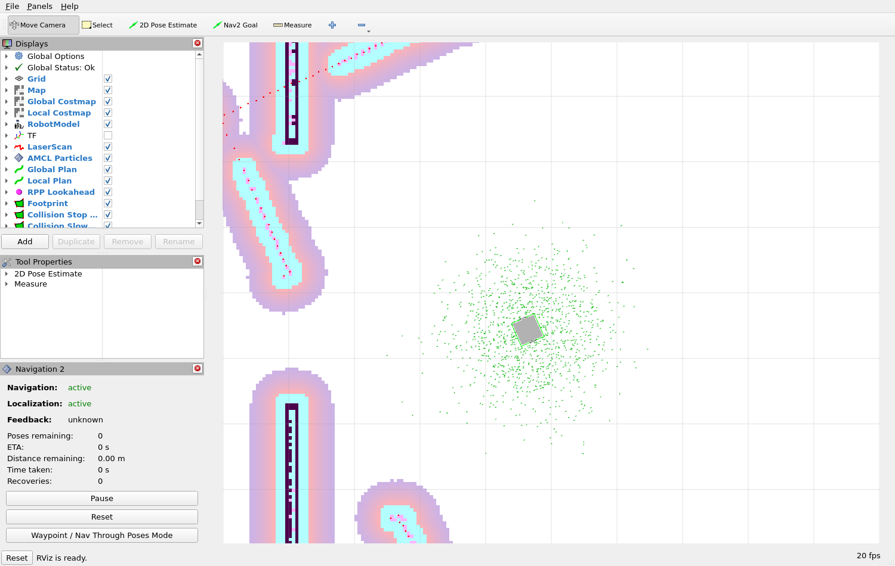
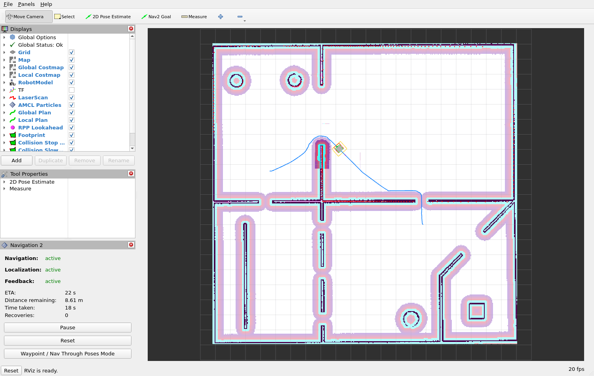
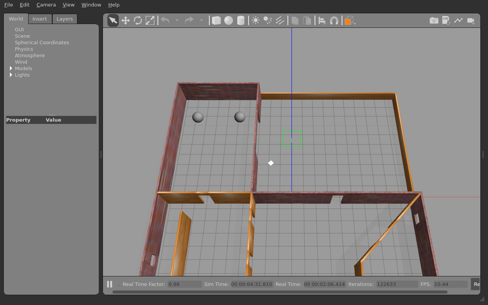

# testbed_navigation

Nav2 setup for the Testbed robot, split into 3 launch files: map, localization and navigation.
Each one has its own lifecycle manager and I start every nav2 node myself (no nav2_bringup).



Full video (rviz + gazebo): [media/demo.mp4](media/demo.mp4)

## How to run

Build:
```bash
cd ~/assignment_ws
rosdep install --from-paths src --ignore-src -y
colcon build --symlink-install
source install/setup.bash
```

Step by step, each in its own terminal:
```bash
ros2 launch testbed_bringup testbed_full_bringup.launch.py
ros2 launch testbed_navigation map_loader.launch.py
ros2 launch testbed_navigation localization.launch.py
ros2 launch testbed_navigation navigation.launch.py
```
Then send a goal with "Nav2 Goal" in rviz (set the fixed frame to `map`, or use `rviz/navigation.rviz`), or run:
```bash
ros2 run testbed_navigation send_goal.py --x 6.0 --y 7.5
```

Or start everything at once (gazebo, map, amcl, nav2 and rviz):
```bash
ros2 launch testbed_navigation testbed_navigation.launch.py
```
Add `gui:=false` to skip the gazebo window. On my laptop (no GPU) gzclient alone used about 3.5 cores.

I'm on Ubuntu 24.04, so I did everything in a Humble docker container. The Dockerfile is in `docker/`:
```bash
docker build -t testbed_nav:humble -f docker/Dockerfile docker
./docker/run.sh
```

## What's in it

- `map_loader.launch.py`: map_server with the map from testbed_bringup
- `localization.launch.py`: amcl. The initial pose is set to the spawn point (0, 5), so you don't need to set a 2D pose estimate
- `navigation.launch.py`: planner (NavFn), controller (Regulated Pure Pursuit), behavior server, bt_navigator, waypoint follower, velocity smoother and collision monitor
- `behavior_trees/navigate_to_pose_testbed.xml`: small change from the default tree. It only replans when the path gets blocked or the goal changes, and the recovery order is clear costmaps, back up, spin, wait
- `scripts/waypoint_benchmark.py`: drives through 5 waypoints in both rooms and prints time and error for each

Why these plugins: the map is static and fully known, so NavFn is enough. RPP was much easier to tune than DWB for a diff drive robot.
The footprint is a 0.36 m square, from the chassis mesh size.

## Results

Ran the waypoint script for 2 laps (10 goals): all 10 reached, about 103 m in total, including the narrow door (~0.9 m) between the two rooms.
The gazebo diff drive publishes /odom in the world frame, so I used it as ground truth to check amcl. Amcl error stayed under 0.11 m.

In the first run the robot always stopped with about 10° yaw error and amcl error went up to 0.2 m.
I lowered the goal tolerance (0.25 to 0.12 rad), lowered the amcl alpha values (gazebo odom is very clean) and made amcl update more often. After that the yaw error was under 4°.

I also tested amcl from a wrong start pose (about 0.9 m and 30° off). After driving ~3 m it was back to 4 cm error:

| wrong initial pose | after driving 3 m |
|---|---|
|  |  |

Robot going through the door:

| rviz | gazebo |
|---|---|
|  |  |

## Problems I ran into

- **Lidar returned nothing.** All ranges were inf because the max range in the urdf was 1.5 m. Changed it to 12 m.
- **Wheel TFs were attached to base_footprint instead of base_link.** The diff drive plugin was publishing them and nothing published joint_states. Turned that off and added the joint state publisher plugin.
- **base_link wasn't the center of the robot.** It's at a corner of the CAD model, about 5 cm / 4 cm away from the point between the wheels. I moved base_footprint to the wheel center so the footprint is centered.
- **params_file name clash.** In the combined launch file all 3 stages used a `params_file` argument. Launch args are global, so amcl and nav2 got the map_server params file and the controller fell back to DWB ("No critics defined for FollowPath"). Fixed by giving each one its own name (`map_params_file`, `amcl_params_file`, `nav_params_file`).
- **Humble differences.** bt_navigator needs the full plugin_lib_names list in humble, and the collision monitor polygon points are a flat list.
- **Gazebo GUI was very slow without a GPU,** so I ran gazebo headless while testing.

The bugs I fixed in the starter code are in `bugs_fixed.txt` in the repo root.

## Test

There's a launch test that starts everything headless and checks that all nav2 nodes become active:
```bash
colcon test --packages-select testbed_navigation
colcon test-result --verbose
```
It also runs on GitHub Actions (`.github/workflows/ci.yml`).
