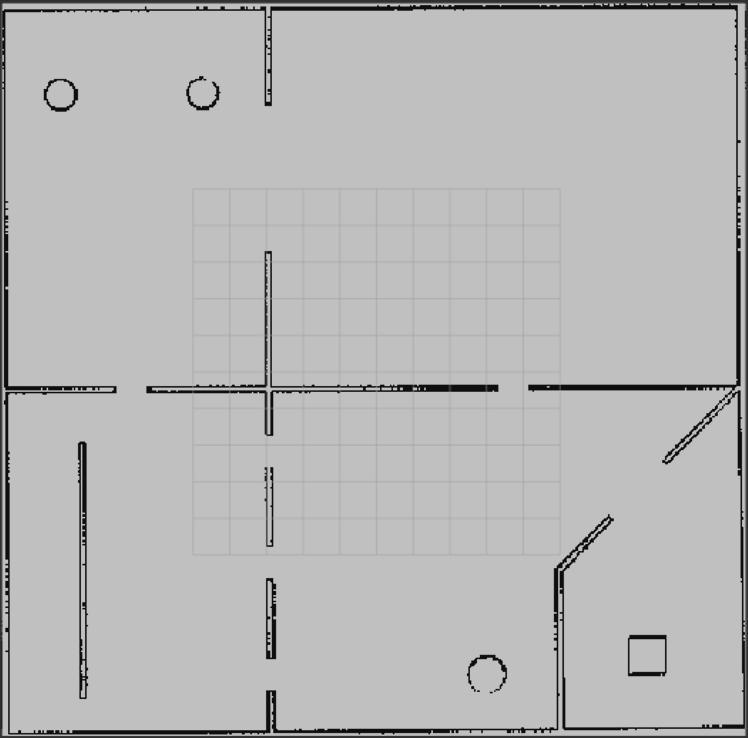
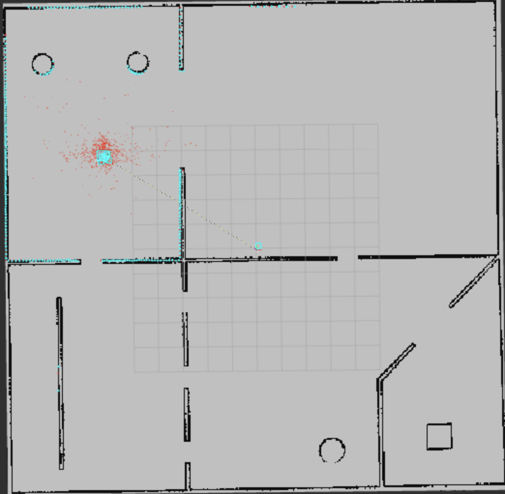
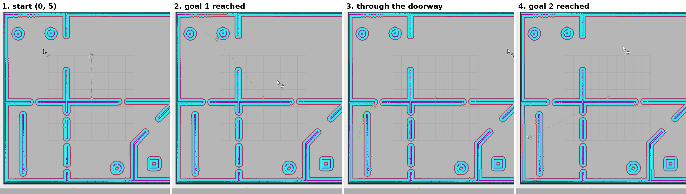

# testbed_navigation

This package runs navigation for the ERIC Testbed robot using Nav2, set up by hand instead of through `nav2_bringup`. It's split into three parts, map loading, localization and navigation, and each one has its own launch file, its own parameter file and its own lifecycle manager, so you can start and test them one at a time.

Built and tested on ROS 2 Humble with Gazebo 11.

Sannidhi D Math

## What works

| Part | What I checked |
|---|---|
| Map loading | map_server loads `testbed_world.yaml` (405 x 400 cells, 0.05 m per cell) and the map shows up in RViz |
| Localization | AMCL starts at the spawn pose, the laser scan sits on the map's walls, and the particle cloud tightens up as the robot moves |
| Navigation | The robot plans a path and drives to goals, including through a narrow doorway into another room. The log ends with "Goal succeeded" |

Video of the robot navigating: https://drive.google.com/file/d/1nqJZ-fX99lcb8Fc6LzJinGQzU4Y2qju8/view?usp=sharing

| Map loading | Localization | Navigation |
|---|---|---|
|  |  |  |

## What's in the package

```
testbed_navigation/
├── launch/
│   ├── map_loader.launch.py      map_server + its lifecycle manager
│   ├── localization.launch.py    amcl + its lifecycle manager
│   └── navigation.launch.py      planner, controller, behavior and bt_navigator servers
│                                 + their lifecycle manager
├── config/
│   ├── map_server_params.yaml
│   ├── amcl_params.yaml
│   └── nav2_params.yaml
├── rviz/
│   └── navigation.rviz           map, costmap, planned path, laser scan, particle cloud
└── docs/                         screenshots
```

## How to run it

```bash
# Cyclone DDS, as help.md recommends
sudo apt install ros-humble-rmw-cyclonedds-cpp
export RMW_IMPLEMENTATION=rmw_cyclonedds_cpp

cd ~/assignment_ws && colcon build && source install/setup.bash
```

Open four terminals and start these in order. Wait for the message before moving to the next one.

| # | Command | Wait for |
|---|---|---|
| 1 | `ros2 launch testbed_bringup testbed_full_bringup.launch.py` | `Successfully spawned entity [testbed]` |
| 2 | `ros2 launch testbed_navigation map_loader.launch.py` | `Managed nodes are active` |
| 3 | `ros2 launch testbed_navigation localization.launch.py` | `Managed nodes are active` |
| 4 | `ros2 launch testbed_navigation navigation.launch.py` | `Managed nodes are active` |

Then in RViz, go to File > Open Config and pick `testbed_navigation/rviz/navigation.rviz`. Click **2D Goal Pose** and drag on the map to send the robot somewhere.

I deliberately didn't make `localization.launch.py` start the map server too. Keeping the three parts separate let me test each one on its own, which is what help.md suggests, and it made debugging much easier: when something broke, I knew which layer to look at.

## How I approached it

### Map loading
`map_server` reads the map YAML and image and publishes them on `/map`. It's a lifecycle node, which means it does nothing until something configures and activates it. That's the lifecycle manager's job (`autostart: true`). Without it, map_server just sits there quietly and never publishes.

help.md suggests using an absolute path to the map. I used `get_package_share_directory('testbed_bringup')` instead, because a path like `/home/sannidhi/...` won't exist on anyone else's computer. That only worked after fixing two of the starter bugs (the wrong image name and the maps folder not being installed). The rest of map_server's settings are in `config/map_server_params.yaml`.

### Localization (AMCL)
These are the settings I chose in `config/amcl_params.yaml`. Everything else is left at AMCL's defaults.

| Parameter | Value | Why |
|---|---|---|
| frames | map / odom / base_footprint | the diff drive plugin publishes odom -> base_footprint |
| `scan_topic` | scan | that's where the lidar publishes |
| `robot_model_type` | DifferentialMotionModel | it's a two-wheel differential drive robot |
| `laser_min_range` / `laser_max_range` | 0.10 / 10.0 m | to match the lidar, after I raised its range (bug 5) |
| `set_initial_pose`, `initial_pose` | true, (0, 5, 0) | the robot spawns there, and that spot lines up with the map |
| `min_particles` / `max_particles` | 500 / 2000 | the defaults, plenty for a map this size |
| `update_min_d` / `update_min_a` | 0.1 m / 0.1 rad | so AMCL corrects itself more often than the defaults, especially while turning |

### Navigation (Nav2)
The assignment only asks for basic navigation, so I stuck to standard plugins with as few settings as possible:

| Server | Plugin | Why |
|---|---|---|
| planner_server | NavFn (Dijkstra) | Nav2's default planner for a grid map |
| controller_server | Regulated Pure Pursuit | follows the path and slows down near obstacles. It has far fewer parameters than DWB, so it was quicker to tune and I can explain every value |
| behavior_server | spin, backup, wait | the recovery moves the default behaviour tree uses when the robot gets stuck |
| bt_navigator | default navigate_to_pose tree | plan, follow, replan, recover |

For the costmaps:
- The **global costmap** (map frame) uses the static map plus inflation. It's what the planner plans on.
- The **local costmap** (odom frame, a 3 m x 3 m window that moves with the robot) uses the lidar plus inflation, so the controller sees obstacles close by.
- Both use `robot_radius: 0.25`, `inflation_radius: 0.35` and `cost_scaling_factor: 5.0`.
- I kept the speeds low (0.2 m/s, turning at 0.5 rad/s), since it's a small robot in small rooms.

Every node runs with `use_sim_time: true`.

## Problems I ran into

**1. I don't have a Linux machine, and the simulated sensors wouldn't work on my Mac.**
I only have an M3 MacBook, so I started in an Ubuntu 22.04 ARM64 virtual machine (Parallels). ROS 2 and Nav2 installed fine, but Gazebo Classic's ROS plugins have no ARM64 packages for Humble. I installed Gazebo 11 from the Open Robotics PPA, built `gazebo_ros_pkgs` from source, and fixed two problems inside the VM: Gazebo's internal messaging (with `GAZEBO_IP=127.0.0.1`) and a gzserver crash (by switching to software rendering). After all that the simulation ran at normal speed, but `/scan` and `/imu` never sent a single message, and nothing showed up in the logs to say why.

I didn't want to lose the whole weekend to it, so I put a time limit on it, emailed Rohit about it, and kept building everything that didn't need sensors inside the VM: the bug fixes, this package, and map loading. Then I moved testing to an x86 Ubuntu 22.04 virtual machine on Google Cloud. The same code worked there straight away with the normal apt packages, with `/scan` at about 30 Hz. Localization and navigation were tested there, using a remote desktop (TigerVNC + noVNC) and tmux.

**2. "Ghost walls" in the global costmap.**
In my first navigation run, tilted copies of real walls started appearing on the global costmap and the robot got stuck going around walls that weren't there. What was happening: when the robot turned on the spot, AMCL's idea of its heading was a few degrees off, and the global costmap was adding lidar hits from as far as 9.5 m away. A few degrees of error at that distance puts a wall a metre or more out of place. I fixed it by planning on the static map only (the lidar obstacles stay in the local costmap), making AMCL update more often, and slowing the turns down.

**3. The robot wouldn't go through a doorway.**
In the second run the planner found a path through a doorway, but the controller kept saying "RegulatedPurePursuitController detected collision ahead!", tried all its recoveries, and gave up. My settings were too cautious: a 0.28 m robot radius plus 0.5 m of inflation on both sides almost closed the gap. I set the radius to the robot's real size (0.25 m), brought the inflation down to 0.35 m with the cost dropping off faster, and slowed down the spin recovery. On the third run the robot went through the doorway and reached both goals.

## Where I tested what

- Bug fixes and map loading: on both the ARM64 VM and the x86 cloud VM (both Ubuntu 22.04).
- Localization and navigation: only on the x86 cloud VM, because the simulated sensors didn't publish on the ARM64 VM.

## What I'd do with more time

- Use a proper polygon footprint, since base_link isn't at the centre of the robot.
- Tune AMCL's odometry noise values and try A* in NavFn.
- Add the velocity smoother and collision monitor.
- Add one top-level launch file that starts all three parts for convenience.
- Get to the bottom of why the sensors didn't publish on ARM64.
