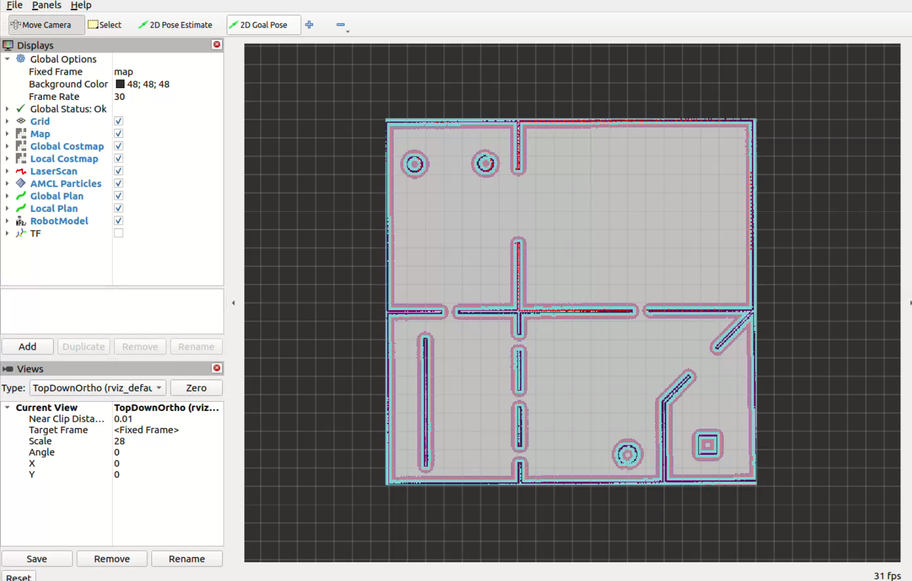
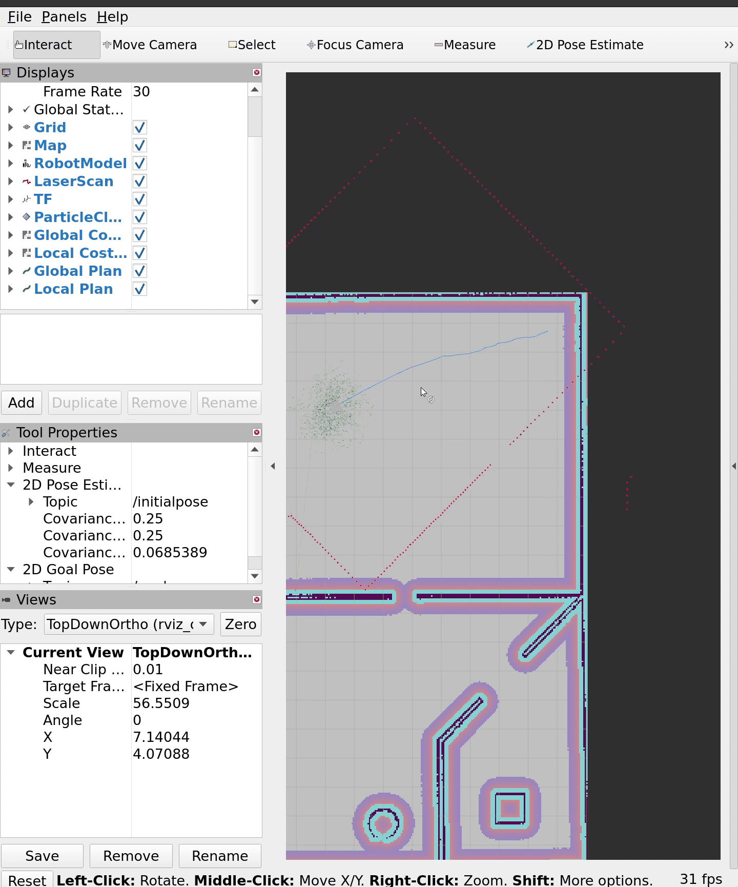

# testbed_navigation

Manually assembled Nav2 (ROS 2 Humble) workflow for the ERIC Testbed-T1.0.0. No `nav2_bringup`:
each Nav2 server is started by hand from its own launch file with its own lifecycle manager.

## Layout
```
launch/map_loader.launch.py    nav2_map_server + lifecycle_manager_map
launch/localization.launch.py  nav2_amcl + lifecycle_manager_localization
launch/navigation.launch.py    controller, planner, behaviours, bt_navigator, velocity_smoother
launch/rviz.launch.py          RViz with a navigation layout (fixed frame: map)
launch/full_navigation.launch.py  the three above (+ RViz) in one command
config/map_server_params.yaml, amcl_params.yaml, nav2_params.yaml
scripts/send_goal.py           NavigateToPose action client
```

## Run
```bash
cd ~/assignment_ws && colcon build && source install/setup.bash
export RMW_IMPLEMENTATION=rmw_cyclonedds_cpp          # recommended in help.md

ros2 launch testbed_bringup testbed_full_bringup.launch.py   # 1. Gazebo + robot

ros2 launch testbed_navigation map_loader.launch.py          # 2. map      (check /map in RViz)
ros2 launch testbed_navigation localization.launch.py        # 3. AMCL
ros2 launch testbed_navigation navigation.launch.py          # 4. Nav2
ros2 launch testbed_navigation rviz.launch.py                # 5. RViz (2D Pose Estimate / Nav2 Goal)
# or steps 2-5 at once: ros2 launch testbed_navigation full_navigation.launch.py
```
Send a goal: use RViz "Nav2 Goal", or
`ros2 run testbed_navigation send_goal.py 5.0 5.0 0.0`, or
`ros2 action send_goal /navigate_to_pose nav2_msgs/action/NavigateToPose "{pose: {header: {frame_id: map}, pose: {position: {x: 5.0, y: 5.0}, orientation: {w: 1.0}}}}"`.

## Design
* **Map**: `map_server` loads `testbed_bringup/maps/testbed_world.yaml` (override with `map:=`).
* **Localization**: AMCL (likelihood field, differential motion model) with the initial pose set
  to the spawn pose (0, 5, 0); map frame = Gazebo world frame. Re-set it with RViz *2D Pose Estimate*.
* **Planner**: `NavfnPlanner` (Dijkstra) on the global costmap (static + obstacle + inflation layers).
* **Controller**: `RegulatedPurePursuitController` on a 3x3 m rolling local costmap.
* **BT navigator**: Nav2's default `navigate_to_pose_w_replanning_and_recovery` tree, with the
  `behavior_server` (spin, backup, wait, ...) for recoveries.
* **Velocity chain**: controller -> `/cmd_vel_nav` -> `velocity_smoother` -> `/cmd_vel` (diff drive).
* Footprint (0.36 x 0.42 m, centred on `base_footprint`) was measured from the STL meshes.
  Inflation radius is 0.35 m so ~0.8 m doorways in the map stay passable.

## Starter-code bugs
See `bugs_and_fixes.txt` in the repository root.

## Results / challenges

Map loading, AMCL localization and goal-based navigation all work in the Gazebo
testbed world. The map loads in RViz, AMCL particles converge around the robot, and the robot
plans a path and drives to goals sent from RViz (Nav2 Goal) and from `scripts/send_goal.py`.




Demo video: <media/demo1.mp4>
Demo video: <media/demo2.mp4>

## Challenges and how I solved them

**Starter-code bugs.** The workspace would not build or run until the bugs listed in
`bugs_and_fixes.txt` were fixed (bad map path, missing install rules, `ament_package`
without parentheses, world argument not forwarded, and others).

**Gazebo Classic vs. new Gazebo.** `ros-humble-gazebo-ros-pkgs` would not install because
Gazebo Harmonic/Fortress (`gz-tools2`) was already on my machine and conflicts with Gazebo
Classic 11, which ROS 2 Humble's `gazebo_ros` needs. I removed the new Gazebo packages and
installed Gazebo Classic.

**Missing Nav2 packages.** `nav2_map_server` and the other Nav2 packages were not found
because they were not installed. I installed `ros-humble-navigation2`.

**Lifecycle manager crashing.** `lifecycle_manager` died with
`libdiagnostic_updater.so: cannot open shared object file`. Because the lifecycle manager
never ran, the map server, AMCL and planner nodes stayed unconfigured and nothing worked.
Installing `ros-humble-diagnostic-updater` fixed it.

**Workspace not sourced.** New terminals reported `package 'testbed_navigation' not found`
until I sourced `/opt/ros/humble` and `install/setup.bash` (now in `~/.bashrc`).

**Start-up order.** The local costmap reported `frame "odom" does not exist` and RViz
dropped laser messages when navigation was started before the simulation was publishing TF
and before AMCL provided `map -> odom`. Starting Gazebo first, then map, AMCL, navigation
and RViz in that order, with the same `RMW_IMPLEMENTATION` in every terminal, fixed it.

**Tuning notes.**
- Footprint (0.36 x 0.42 m) was measured from the STL meshes; inflation radius is 0.35 m
  so the ~0.8 m doorways stay passable.
- The lidar range was raised from 1.5 m to 10 m so AMCL has enough of the map to match.
- Regulated Pure Pursuit was chosen as the controller because it is simple and stable for a
  differential-drive robot.
