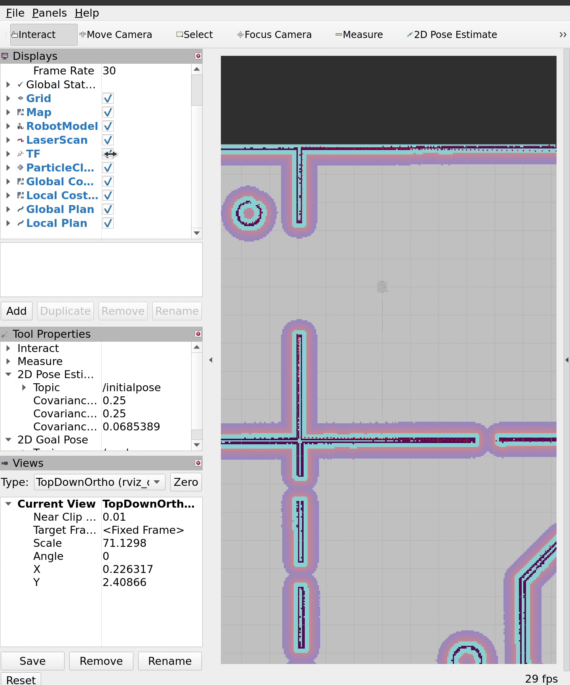
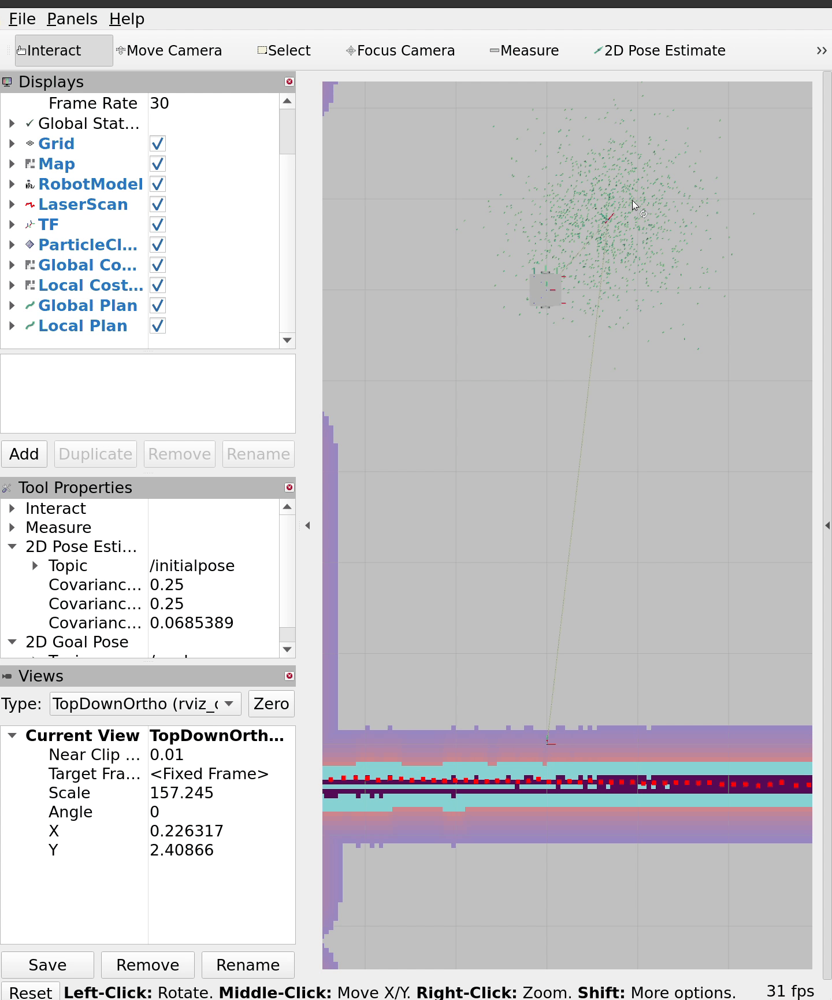
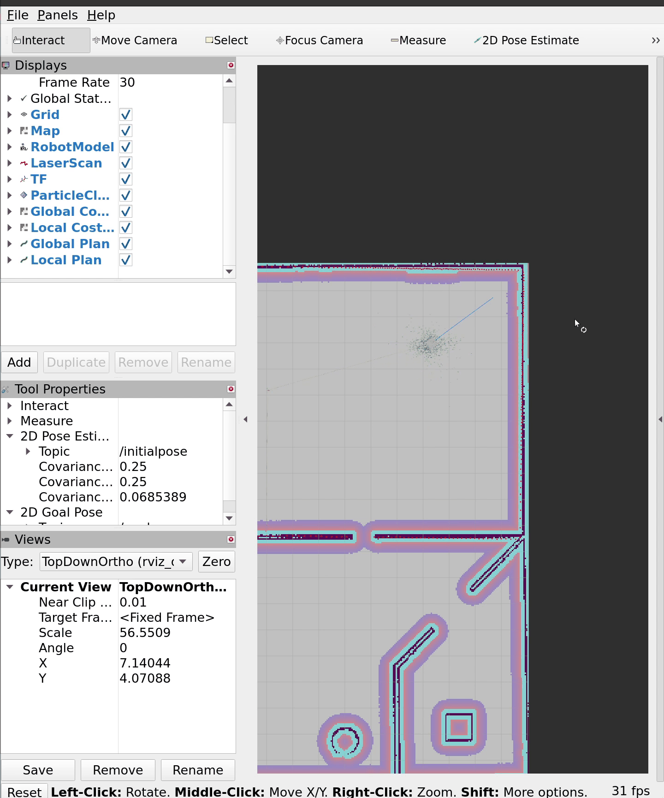
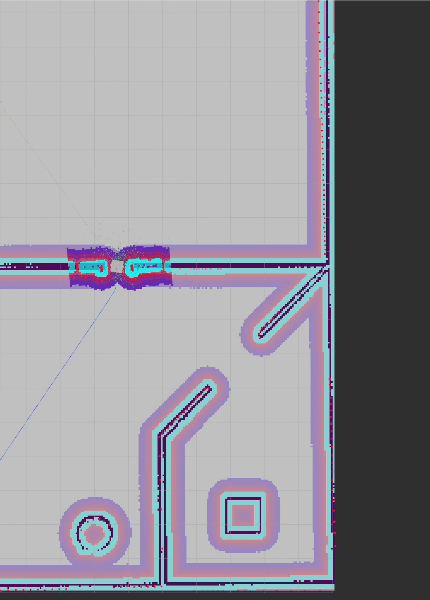
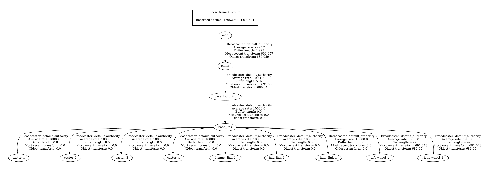

# testbed_navigation

## 1. Overview

This package runs Nav2 for the Testbed-T1.0.0 robot in Gazebo Classic, without `nav2_bringup`.
I split it into three launch files: map loading, localization (AMCL) and navigation
(planner, controller, behaviors, BT navigator). Each one has its own lifecycle manager.
The robot localizes at its spawn pose and drives to goals sent from RViz or the terminal.

Demo video: https://youtu.be/XdpVcIbXU_E

## 2. Package structure

```
testbed_navigation/
├── CMakeLists.txt
├── package.xml
├── README.md
├── config/
│   ├── map_server_params.yaml   # map_server (map path comes from the launch file)
│   ├── amcl_params.yaml         # AMCL, initial pose = spawn pose
│   └── nav2_params.yaml         # planner, controller, behaviors, BT navigator, costmaps
├── launch/
│   ├── map_loader.launch.py     # map_server + lifecycle_manager_map
│   ├── localization.launch.py   # amcl + lifecycle_manager_localization
│   └── navigation.launch.py     # Nav2 servers + lifecycle_manager_navigation
├── rviz/
│   └── navigation.rviz          # map, scan, particles, costmaps, plan
├── scripts/
│   └── send_goals.py            # sends NavigateToPose goals and prints the result
└── media/                       # screenshots
```

The list of bugs I fixed in the starter packages is in `BUGS_FIXED.txt` in the repo root.

## 3. How to run

Build:

```bash
cd ~/assignment_ws
colcon build
source install/setup.bash
```

Then start these in four terminals, in this order (source the workspace in each one):

```bash
# 1. Gazebo + robot + RViz (opens navigation.rviz)
ros2 launch testbed_bringup testbed_full_bringup.launch.py
# 2. Map
ros2 launch testbed_navigation map_loader.launch.py
# 3. Localization
ros2 launch testbed_navigation localization.launch.py
# 4. Navigation
ros2 launch testbed_navigation navigation.launch.py
```

Wait for `Managed nodes are active` in terminals 2, 3 and 4. AMCL starts at the spawn
pose (0, 5, 0), so no manual initial pose is needed. If you want to set one, use
"2D Pose Estimate" in RViz.

Send a goal from RViz: click "2D Goal Pose" and drag on the map.

Send goals from the terminal (`x,y,yaw_deg`, any number of goals, run in order):

```bash
ros2 run testbed_navigation send_goals.py 3.7,-2.5,-90
ros2 run testbed_navigation send_goals.py          # default route G1-G4
```

It prints the result, time and final pose for each goal, for example
`G1 (3.7, -2.5, -90.0): SUCCEEDED in 34.9 s (sim), final pose (3.726, -2.353), recoveries 0`.

## 4. Approach

**Separate launch files.** The assignment asks for map loading, localization and navigation
as separate steps. Each launch file starts only its own nodes and a lifecycle manager for
them. This way I could restart AMCL or Nav2 alone while tuning, and a failure in one part
does not stop the others. I do not use `nav2_bringup`; every node is declared directly.

- `map_loader.launch.py`: `nav2_map_server` with `testbed_bringup/maps/testbed_world.yaml`
  (launch arg `map`), managed by `lifecycle_manager_map`.
- `localization.launch.py`: `nav2_amcl`, managed by `lifecycle_manager_localization`.
- `navigation.launch.py`: `controller_server`, `planner_server`, `behavior_server` and
  `bt_navigator` with the stock `navigate_to_pose_w_replanning_and_recovery.xml` tree,
  managed by `lifecycle_manager_navigation`.

**Key parameters**

| Parameter | Value | Why |
|---|---|---|
| `footprint` | 0.35 x 0.406 m polygon around base_footprint | Chassis and outer wheel faces measured from the STLs |
| `inflation_radius` / `cost_scaling_factor` | 0.55 / 4.0 | Larger than the 0.282 m circumscribed radius, but the 0.85 m doorway centre still costs only ~96, so the planner goes through doorways |
| Planner | NavFn (Dijkstra), tolerance 0.5 | Simple and reliable for a static indoor map |
| Controller | Regulated Pure Pursuit, 0.3 m/s, lookahead 0.6 m | Smooth for a diff-drive robot, slows near obstacles, rotates to heading first |
| AMCL | Mostly defaults, `DifferentialMotionModel`, likelihood field, 500-2000 particles | The defaults worked once odometry was fixed; laser range set to the real 0.1-12 m |
| AMCL initial pose | `set_initial_pose: true`, (0, 5, 0) | Same as the Gazebo spawn pose; map and world frames are aligned |
| Goal checker | xy 0.15 m, yaw 0.15 rad | Yaw 0.25 left 10-14 deg final heading error |
| Obstacle height | `min_obstacle_height` 0.0, `max_obstacle_height` 2.0 | The Humble default max is 0.0, which drops every lidar point (lidar at z = 0.228 m) |
| `inf_is_valid` | true | Lets no-return rays clear old obstacles in open space |
| Behaviors | spin, backup, drive_on_heading, wait | What the stock recovery tree uses |

## 5. Results

All numbers are against Gazebo ground truth (model pose from `/gazebo/default/pose/info`).

**Odometry vs AMCL, 2 m square loop**

| Checkpoint | Odom error | AMCL error |
|---|---|---|
| After side 1 | 0.004 m, 0.3 deg | 0.042 m, 0.6 deg |
| After side 2 | 0.101 m, 2.9 deg | 0.040 m, 0.1 deg |
| After side 3 | 0.230 m, 6.7 deg | 0.035 m, 0.9 deg |
| After side 4 | 0.327 m, 10.2 deg | 0.034 m, 0.0 deg |
| End | 0.326 m, 13.1 deg | 0.048 m, 1.7 deg |

Odometry drifts mostly in heading (wheel slip while turning). AMCL stays under 5 cm.

**Wrong initial pose**

| Test | Start error | Result |
|---|---|---|
| Square loop, initial pose (0.4, 5.3, 15 deg) | 0.46 m, 13 deg | 0.13 m after the first side, 0.05 m after the loop |
| Goal 2 m away, initial pose 1.0 m / 29 deg off | 1.02 m, 29 deg | < 0.2 m / 10 deg about 2 s after moving, 0.05 m at the goal, no wall contact |

**Goals G1-G4** (one run, 0 recoveries each)

| Goal | Target (x, y, yaw) | Result | Time (sim) | Final error |
|---|---|---|---|---|
| G1 | 1.5, 6.5, 90 | SUCCEEDED | 9.4 s | 0.12 m |
| G2 | 3.7, -2.5, -90 | SUCCEEDED | 35.0 s | 0.12 m |
| G3 | -9.0, -9.0, 180 | SUCCEEDED | 55.1 s | 0.19 m |
| G4 | 0.0, 5.0, 0 | SUCCEEDED | 68.3 s | 0.14 m |

Closest footprint-to-wall distance over all four: 0.16 m.

**Dynamic obstacles** (0.4 x 0.4 x 0.5 m box spawned in Gazebo, not in the map)

| Test | What happened | Result |
|---|---|---|
| A1 box spawned on the path | Box in both costmaps within 1.3 s, plan bent 0.75 m around it, 0.38 m min clearance | SUCCEEDED, 0.23 m final error |
| A2 right doorway blocked | Plan switched to the left doorway once the box was seen, no recoveries | SUCCEEDED in 96 s |
| A3 box removed | Old box cleared from the costmap in ~1 s, robot used the right doorway | SUCCEEDED in 19 s |
| A4 wrong initial pose | See the table above | SUCCEEDED |

## 6. Challenges

**Gazebo Classic vs Harmonic.** My machine had Gazebo Harmonic installed. apt would not install
`ros-humble-gazebo-ros-pkgs` next to it because both ship a `gz` command line tool.
I ran `apt install ros-humble-gazebo-ros-pkgs gz-tools2-`, which removed Harmonic and installed Gazebo 11.

**RViz and Gazebo flicker.** RViz alternated between black and the map, and gzclient drew
only part of its window. I ruled out duplicate processes, Wayland and the RViz config. The cause was
Qt HiDPI scaling on my 200% laptop screen. Setting `QT_AUTO_SCREEN_SCALE_FACTOR=0`,
`QT_SCALE_FACTOR=1` and `QT_SCREEN_SCALE_FACTORS=1` fixed it.

**World vs encoder odometry.** While reading the diff drive plugin options I saw that the
default `odometry_source` (1) publishes Gazebo ground truth as `/odom`. That would hide all
drift. I set it to 0 (wheel encoders) so the test is realistic and AMCL has drift to correct.

**base_footprint not at the rotation centre.** Checking the URDF against the wheel STLs, I found that
base_link is 5 cm (x) and 3.8 cm (y) from the axle midpoint, so base_footprint was not the
rotation centre. I moved base_footprint to the axle midpoint and remeasured the footprint.

**Obstacle height filter.** A box spawned in front of the robot never showed up in the
costmaps and the robot drove into it. `ros2 param get` showed
`obstacle_layer.scan.max_obstacle_height` = 0.0 (the Humble default), so every scan point was
filtered out. Setting it to 2.0 fixed it.

**Rays with no return.** After I deleted a box, it stayed in the global costmap, and the robot
took the long way through the other doorway. Behind the doorway the lidar sees nothing (inf),
and those rays were ignored. `inf_is_valid: true` lets them clear the cells.

**gzserver crash on startup.** About one launch in three, gzserver died with exit code -11 a
few seconds after the robot spawned. A gdb backtrace showed the lidar's sensor thread crashing
inside ODE (`RaySensor::UpdateImpl` -> `dSpaceCollide2` -> `cleanGeoms`) while physics was
stepping. I start Gazebo with `lockstep: true` (in `spawn_playground.launch.py`) so physics waits
for the sensors. After that, 10 of 10 fresh launches came up with no crash, at real time factor 1.0.

## 7. Known limitations

- Wheel odometry has about 3% heading slip from wheel contact during turns. AMCL corrects it.
- Gazebo now runs in lockstep to avoid a startup crash. If gzserver still exits with code -11
  on startup, relaunch T1.
- The map is about 0.1 m off the Gazebo world at the doorways, so the robot passes slightly
  off-centre in the real doorway (still at least 0.09 m from the walls in my tests).

## 8. Screenshots

Taken from my demo video.

Map loaded in RViz (map_server active):



AMCL particles spread out before converging:



AMCL converged (tight particle cloud) while following the global plan:



Navigating with the global plan and both costmaps:


A box spawned in the doorway shows up in the costmap and the plan goes around it:



TF tree (`ros2 run tf2_tools view_frames`):


