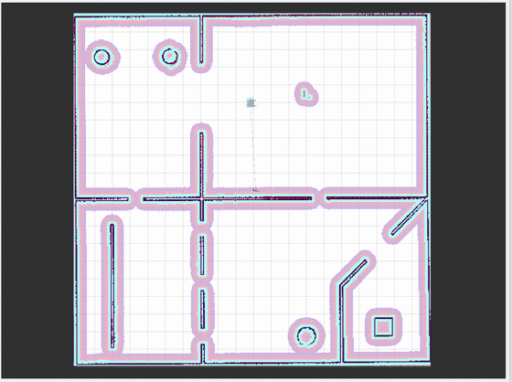
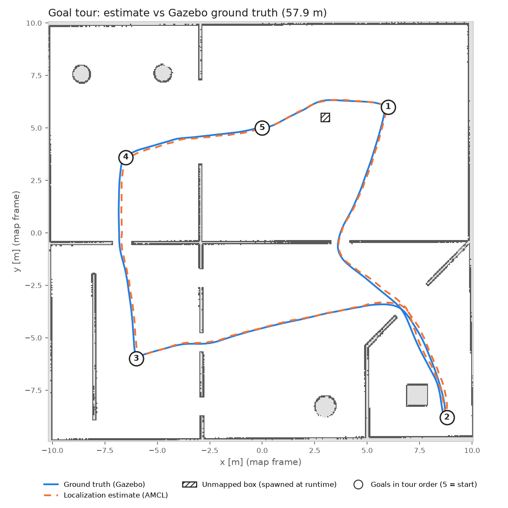
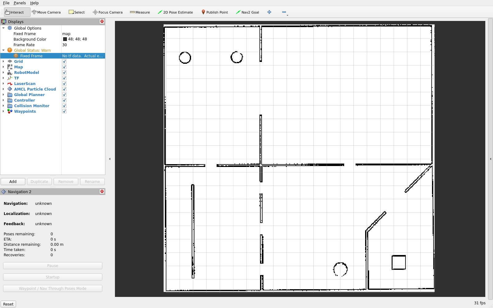
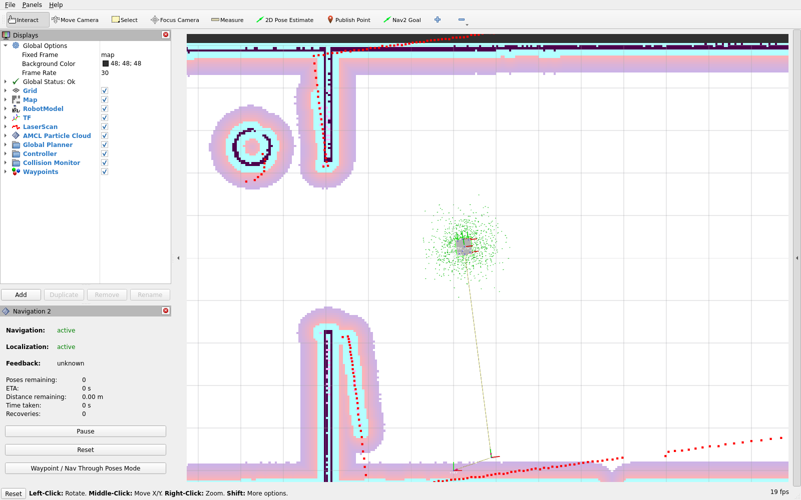
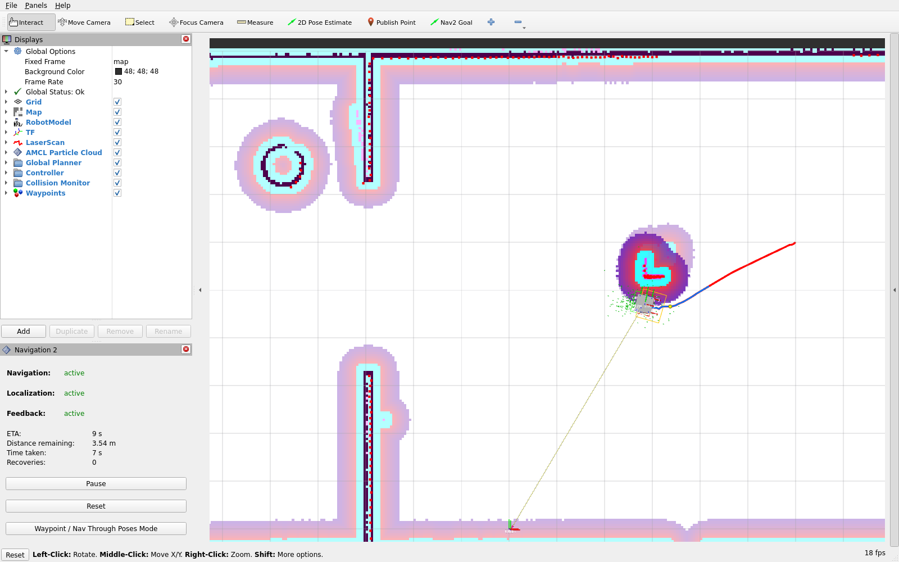
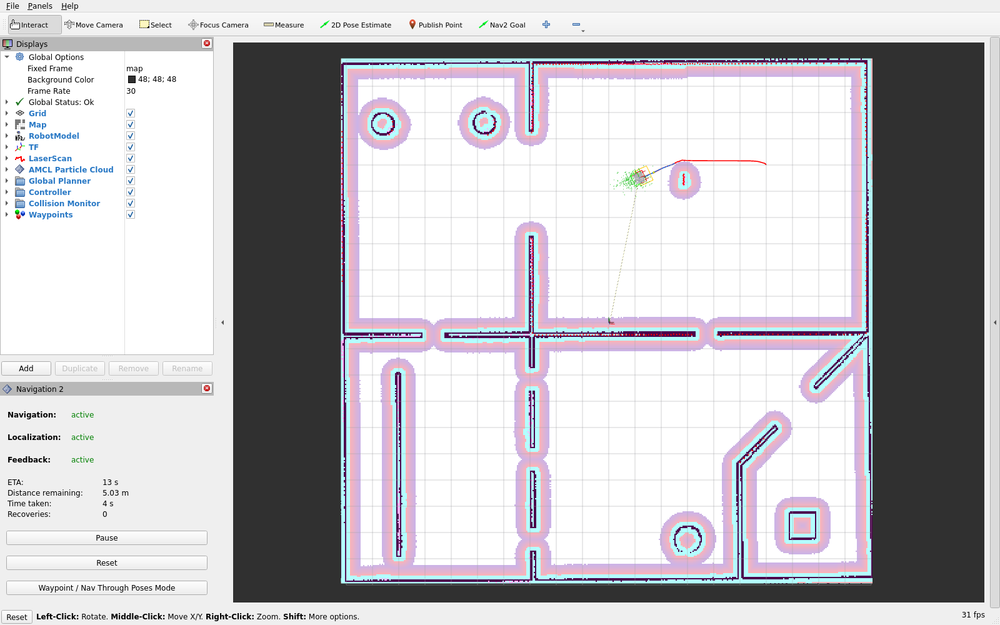
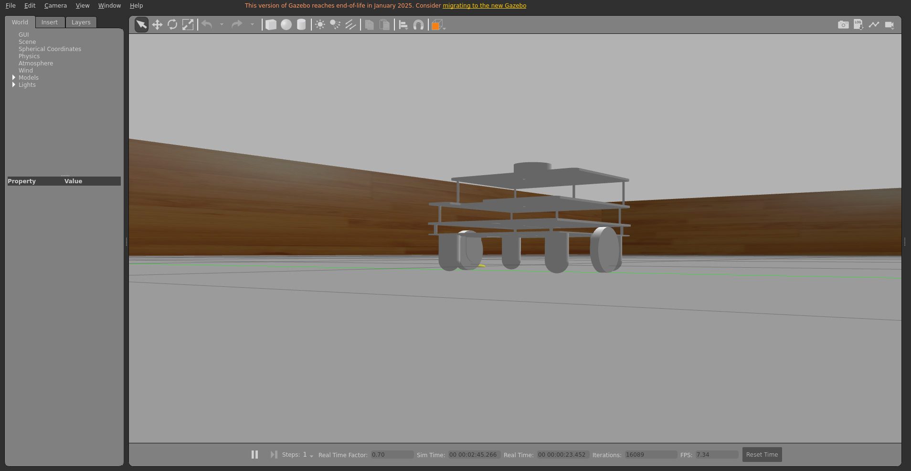
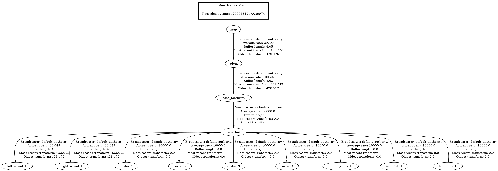

# testbed_navigation

Nav2 navigation for the Testbed-T1.0.0 on ROS 2 Humble, built from individual Nav2 nodes without
`nav2_bringup`. Three launch stages, map loading (`map_server`), localization (`amcl`) and navigation
(planner, controller, BT navigator, behaviors, waypoint follower, velocity smoother, collision
monitor), each have their own lifecycle manager and parameter file. A fourth launch file starts the
whole demo in one command.

Starter-package bugs that blocked localization and navigation are fixed and documented with evidence
in [`../BUGS.md`](../BUGS.md).

## Package layout

```
testbed_navigation/
├── CMakeLists.txt               # installs launch/ config/ rviz/ and scripts/send_goals.py
├── package.xml                  # exec_depends on every Nav2 server and plugin used
├── config/
│   ├── map_server_params.yaml   # map_server: yaml_filename, topic_name "map", frame_id "map"
│   ├── amcl_params.yaml         # AMCL: frames, initial pose, particle filter, motion + sensor model
│   └── nav2_params.yaml         # bt_navigator, controller (RPP), planner (NavFn), costmaps,
│                                #   behaviors, waypoint follower, velocity smoother, collision monitor
├── launch/
│   ├── map_loader.launch.py     # stage 1: map_server + lifecycle_manager_map
│   ├── localization.launch.py   # stage 2: amcl + lifecycle_manager_localization
│   ├── navigation.launch.py     # stage 3: 7 Nav2 servers + lifecycle_manager_navigation
│   └── bringup_all.launch.py    # Gazebo + robot + stages 1-3 + RViz in one command
├── rviz/
│   └── nav2.rviz                # fixed frame map; map, particles, costmaps, plans, RPP carrot, collision monitor zones
├── scripts/
│   └── send_goals.py            # nav2_simple_commander test tour, single goal, unmapped-obstacle spawn
└── docs/media/                  # screenshots, trajectory plot and demo video used in Results (not installed)
```

## Quick start

### Build

```bash
cd ~/assignment_ws
colcon build
source install/setup.bash
export RMW_IMPLEMENTATION=rmw_cyclonedds_cpp   # optional, recommended in help.md
```

### Stage by stage (one terminal per line)

```bash
ros2 launch testbed_bringup testbed_full_bringup.launch.py   # Gazebo + robot (its RViz uses fixed frame odom; can be closed)
ros2 launch testbed_navigation map_loader.launch.py           # 1. /map
ros2 launch testbed_navigation localization.launch.py         # 2. AMCL, TF map->odom
ros2 launch testbed_navigation navigation.launch.py           # 3. Nav2 servers
ros2 run rviz2 rviz2 -d $(ros2 pkg prefix testbed_navigation)/share/testbed_navigation/rviz/nav2.rviz \
  --ros-args -p use_sim_time:=true
ros2 run testbed_navigation send_goals.py                     # 5-goal tour of the map
```

Each stage needs only the earlier stages, so any stage can be stopped, retuned and restarted alone.

### One command

```bash
ros2 launch testbed_navigation bringup_all.launch.py
ros2 launch testbed_navigation bringup_all.launch.py launch_sim:=false   # simulation already running
```

`bringup_all` starts the simulation (world, `robot_state_publisher`, spawn at (0, 5, yaw 0)),
`map_loader` and RViz immediately, and `localization` and `navigation` 5 s later
(`STACK_START_DELAY`), once Gazebo publishes `/clock`, `/scan` and odom TF. It includes the starter's
three building blocks instead of `testbed_full_bringup` to avoid a second RViz.

### Launch arguments

| Argument                                   | Default                                                                                 | Declared in                                        |
| ------------------------------------------ | --------------------------------------------------------------------------------------- | -------------------------------------------------- |
| `use_sim_time`                             | `true`                                                                                  | all four                                           |
| `autostart`                                | `true`                                                                                  | map_loader, localization, navigation               |
| `log_level`                                | `info`                                                                                  | map_loader, localization, navigation               |
| `map`                                      | `testbed_bringup/maps/testbed_world.yaml`                                               | map_loader, bringup_all                            |
| `params_file`                              | `config/map_server_params.yaml` / `config/amcl_params.yaml` / `config/nav2_params.yaml` | map_loader / localization / navigation             |
| `launch_sim`                               | `true`                                                                                  | bringup_all                                        |
| `rviz`, `rviz_config`                      | `true`, `rviz/nav2.rviz`                                                                | bringup_all                                        |
| `map_params`, `amcl_params`, `nav2_params` | `config/map_server_params.yaml`, `config/amcl_params.yaml`, `config/nav2_params.yaml`   | bringup_all (passed as each stage's `params_file`) |

In `map_loader`, `map` overrides `yaml_filename` in `map_server_params.yaml` via `RewrittenYaml`,
so the default always points at the installed `testbed_world.yaml`.

### send_goals.py

| Option               | Effect                                                                                                                        |
| -------------------- | ----------------------------------------------------------------------------------------------------------------------------- |
| (none)               | Tour: (6, 6, 0) → (8.8, -8.8, -π/2) → (-6, -6, π) → (-6.5, 3.6, π/2) → home (0, 5, 0)                                         |
| `--goal X Y YAW`     | One goal in the `map` frame                                                                                                   |
| `--spawn-obstacle`   | Before the tour, spawns a 0.4 × 0.4 × 0.5 m box at (3.0, 5.5) on the first leg via `/spawn_entity`; the box is not in the map |
| `--set-initial-pose` | Publishes `/initialpose` at the spawn pose (0, 5, 0) first                                                                    |

Goals come from an analysis of `testbed_world.pgm`; each is at least 0.85 m from the nearest
occupied cell. The tour crosses both north/south doorways (x ≈ 3.7 and x ≈ -6.7, at y ≈ -0.45),
a 0.85 m gap in the vertical wall and its 3.95 m opening.

## Architecture

### Stages and lifecycle managers

```
 Gazebo Classic ── /clock, /scan, /odom, TF odom->base_footprint ──┐        ▲ /cmd_vel
                                                                   ▼        │
 [1] lifecycle_manager_map           -> map_server ──── /map (transient local)
 [2] lifecycle_manager_localization  -> amcl ────────── TF map->odom, /amcl_pose, /particle_cloud
 [3] lifecycle_manager_navigation    -> controller_server, planner_server, behavior_server,
                                        bt_navigator, waypoint_follower, velocity_smoother,
                                        collision_monitor  (configured/activated in this order)
```

Three lifecycle managers instead of one give:

- Independent start: each launch file runs alone, as the assignment requires. A single manager would
  block on nodes from a launch file that is not running.
- Fault isolation: a broken bond in navigation shuts down only that group; AMCL and the map keep
  running.
- Single-stage restart: e.g. AMCL can be retuned and restarted without reloading the map or Nav2.

Node names, `RewrittenYaml` (the `use_sim_time` launch argument overrides the YAML), `ParameterFile`
and the `/tf` remaps (no-ops without a namespace) follow Humble's `localization_launch.py` /
`navigation_launch.py`. Deliberate differences:

- map_server and AMCL each have their own lifecycle manager.
- `collision_monitor` is added (Humble's bringup does not include it).
- `behavior_server` output is remapped through the velocity smoother and collision monitor; Humble's
  bringup sends recovery motions straight to `cmd_vel`.
- No `smoother_server` (see [Not included](#not-included)).

### TF tree

```
map ──(amcl)──> odom ──(ekf_filter_node)──> base_footprint ──(robot_state_publisher)──> base_link
                                                                ──> lidar_link_1, imu_link_1, dummy_link_1, wheels, casters
```

`base_footprint` lies on the ground at the drive-axle center ([BUGS.md](../BUGS.md) #9) and is the
`robot_base_frame` for AMCL, the costmaps, the BT navigator, the behaviors and the collision monitor.
Wheel TF comes from `/joint_states` via `robot_state_publisher` (BUGS.md #7).

### Odometry

| Source                   | Topic                | Rate   | Fused by the EKF                        |
| ------------------------ | -------------------- | ------ | --------------------------------------- |
| Wheel encoders           | `/odom`              | 100 Hz | `vx`, `vy` (= 0), `vyaw`                |
| IMU gyro                 | `/imu`               | 100 Hz | `vyaw`                                  |
| EKF (robot_localization) | `/odometry/filtered` | 50 Hz  | output; also TF `odom → base_footprint` |

- The Gazebo diff-drive plugin integrates the wheel joints (`odometry_source` 0). Its default (1)
  reads the model pose from Gazebo, which is ground truth and never drifts; the starter used that default.
- The EKF fuses velocities only. Wheel odometry pose drifts, and the simulated IMU's absolute yaw is
  close to ground truth, so fusing either as an absolute pose would follow the drift or hide it.
- The EKF runs with the robot (`testbed_bringup/config/ekf.yaml`, started by `testbed_full_bringup`
  and by `bringup_all`), so the simulation alone provides a complete TF tree, as before.
- `/clock` is published at 100 Hz (`testbed_gazebo/config/gazebo_params.yaml`). At the Gazebo default
  of 10 Hz, every sim-time timer, including the 50 Hz EKF, ran at 10 Hz.
- `bt_navigator`, `controller_server` and `velocity_smoother` read `odometry/filtered`.

### Velocity chain

```
controller_server ─┐  (cmd_vel remapped to cmd_vel_nav)
behavior_server   ─┴─> /cmd_vel_nav ─> velocity_smoother ─> /cmd_vel_smoothed
                       ─> collision_monitor ─> /cmd_vel ─> gazebo_ros_diff_drive
```

The `controller_server`, `behavior_server` and `velocity_smoother` remaps are in
`navigation.launch.py`; the collision monitor's topics are parameters (`cmd_vel_in_topic`,
`cmd_vel_out_topic`). Because the collision monitor is last, no command bypasses it.

## Plugin choices and key parameters

All keys were checked against Nav2 Humble 1.1.20 (`nav2_bringup/params/nav2_params.yaml` at that
tag and the plugin sources); several differ in Jazzy.

### Map analysis behind the numbers

`testbed_world.pgm` is 405 × 400 px at 0.05 m/px. A distance transform and reachability check show:

- The narrowest required passages are 0.85 m doorways (wall to wall): two in the horizontal wall at
  y ≈ -0.45 and three in the vertical west/east wall, which also has one 3.95 m opening.
- The 0.44 m footprint (with margin) leaves about 0.2 m per side in a doorway, so inflation must keep
  the doorway center below the inscribed cost (253).
- The world obstacles described as unmapped (box, cylinder, two spheres) are in the map as outlines.

### AMCL (`amcl_params.yaml`)

| Parameter                             | Value                                | Reason                                                                                                           |
| ------------------------------------- | ------------------------------------ | ---------------------------------------------------------------------------------------------------------------- |
| `robot_model_type`                    | `nav2_amcl::DifferentialMotionModel` | diff-drive base                                                                                                  |
| `laser_model_type`                    | `likelihood_field`                   | smooth, cheap distance-to-wall lookup; no per-beam ray casting                                                   |
| `set_initial_pose`, `initial_pose`    | `true`, (0.0, 5.0, yaw 0.0)          | spawn pose; the `map` frame matches the Gazebo world within about 0.1 m, so no manual 2D Pose Estimate is needed |
| `laser_min_range` / `laser_max_range` | 0.12 / 12.0 m                        | fixed Gazebo lidar (was 1.5 m, BUGS.md #5)                                                                       |
| `max_beams`                           | 60                                   | every 6th of 360; neighboring beams are correlated                                                               |
| `min_particles` / `max_particles`     | 500 / 2000                           | Humble defaults; enough for a ~20 × 20 m map with a known start                                                  |
| `alpha1`..`alpha4`                    | 0.2                                  | moderate odometry noise to absorb wheel slip                                                                     |
| `update_min_d` / `update_min_a`       | 0.2 m / 0.2 rad                      | update only after real motion; the cloud does not collapse at standstill                                         |
| `recovery_alpha_slow` / `_fast`       | 0.0 / 0.0                            | no random-particle injection; the start is known and similar rooms could pull the estimate into the wrong one    |
| `transform_tolerance`                 | 1.0 s                                | post-dates map->odom so consumers do not extrapolate                                                             |

### BT navigator

- Humble default trees (`default_nav_to_pose_bt_xml` unset):
  `navigate_to_pose_w_replanning_and_recovery.xml` and its through-poses counterpart, which replan at
  1 Hz and recover with clear costmaps, spin, wait and back up.
- Plugin IDs match those trees: planner `GridBased`, controller `FollowPath`.
- `plugin_lib_names` is the Humble list (it only registers node types).
- `bt_navigator_navigate_to_pose_rclcpp_node` and `bt_navigator_navigate_through_poses_rclcpp_node`
  each set `use_sim_time`; in Humble every navigator spins its own internal node.

### Planner: NavFn (`GridBased`)

`nav2_navfn_planner/NavfnPlanner` with `use_astar: false`, `tolerance: 0.5`, `allow_unknown: true`.
The diff-drive robot turns in place, so kinematically feasible paths (Smac Hybrid-A*/Lattice) are
unnecessary, and on a ~160k-cell map a full Dijkstra expansion is cheap at 1 Hz replanning.

### Controller: Regulated Pure Pursuit (`FollowPath`)

`nav2_regulated_pure_pursuit_controller::RegulatedPurePursuitController` at `controller_frequency: 20.0`.

| Parameter                 | Value                                                                         | Note                                                                                                |
| ------------------------- | ----------------------------------------------------------------------------- | --------------------------------------------------------------------------------------------------- |
| `desired_linear_vel`      | 0.4 m/s                                                                       | matches the velocity smoother's `max_velocity[0]`                                                   |
| lookahead                 | `use_velocity_scaled_lookahead_dist`, `lookahead_time` 1.5, clamped 0.3-0.9 m | short in doorways, smooth at speed                                                                  |
| `use_rotate_to_heading`   | true, 1.0 rad/s, above 0.785 rad                                              | rotates in place when the path points away; `allow_reversing: false` (mutually exclusive with this) |
| curvature regulation      | min radius 0.9 m, min speed 0.15 m/s                                          | slows down in tight turns                                                                           |
| cost regulation           | `cost_scaling_dist` 0.3, `inflation_cost_scaling_factor` 3.0                  | must equal the local costmap's `cost_scaling_factor`                                                |
| `use_collision_detection` | true, 1.0 s to the carrot                                                     | stops instead of driving into lethal cost                                                           |
| goal checker              | `SimpleGoalChecker`, xy 0.20 m, yaw 0.20 rad, `stateful: true`                | latches xy, then only rotates                                                                       |
| progress checker          | `SimpleProgressChecker`, 0.5 m in 10 s                                        | otherwise the BT runs recoveries                                                                    |

DWB and MPPI were not used. DWB scores trajectories with about seven weighted critics, which are
many coupled weights to tune, and the robot can drift from the global path. MPPI is heavier, with even
more critics. For basic
navigation, Regulated Pure Pursuit tracks the planner's path predictably with few parameters. It does
not steer around obstacles itself; avoidance comes from 1 Hz replanning on a global costmap with an
obstacle layer.

### Costmaps

|                                   | Local                               | Global                                              |
| --------------------------------- | ----------------------------------- | --------------------------------------------------- |
| Frame                             | `odom`, rolling 3 × 3 m             | `map`, size from the static map                     |
| Resolution                        | 0.05 m                              | 0.05 m (same as the map)                            |
| Update / publish                  | 5.0 / 2.0 Hz                        | 1.0 / 1.0 Hz                                        |
| Layers                            | `obstacle_layer`, `inflation_layer` | `static_layer`, `obstacle_layer`, `inflation_layer` |
| Obstacle marking / raytrace range | 2.5 / 3.0 m                         | 5.0 / 6.0 m                                         |

- Footprint: polygon `[[0.19, 0.22], [0.19, -0.22], [-0.19, -0.22], [-0.19, 0.22]]` with
  `footprint_padding: 0.0`, about 1.5 cm larger than the 0.35 × 0.41 m body. A `robot_radius`
  circle around it (0.29 m) would make the robot 0.58 m wide and raise the doorway-center cost from
  about 124 to about 168.
- Inflation: `inflation_radius: 0.55`, `cost_scaling_factor: 3.0` on both costmaps. At a doorway
  center (d = 0.425 m, inscribed radius 0.19 m), cost = 252·e^(−3·0.235) ≈ 124, well below 253.
  Doorways stay passable while the gradient keeps the robot centered and paths off the walls.
- Obstacle layer: ObstacleLayer on both costmaps, fed by `/scan` with `inf_is_valid: true`;
  VoxelLayer is unnecessary for a single-plane 2D lidar. The global one lets the planner route around
  objects that are not in the map.

### Behavior server, waypoint follower

- `behavior_plugins: ["spin", "backup", "drive_on_heading", "wait"]`; AssistedTeleop is not loaded.
- The behaviors collision-check against the local costmap (`local_costmap/costmap_raw`,
  `local_costmap/published_footprint`) in the `odom` frame with `simulate_ahead_time: 2.0`.
- Rotation limits are 1.0 / 0.4 rad/s with `rotational_acc_lim: 3.2`, matching the velocity smoother.
- The waypoint follower uses `WaitAtWaypoint` (200 ms) with `stop_on_failure: false`.

### Velocity smoother

| Parameter                       | Value                                                                        |
| ------------------------------- | ---------------------------------------------------------------------------- |
| `smoothing_frequency`           | 20.0 Hz (same rate as the controller)                                        |
| `feedback`                      | `OPEN_LOOP` (Gazebo's diff drive tracks commands closely; avoids odom noise) |
| `max_velocity` / `min_velocity` | [0.4, 0.0, 1.0] / [-0.2, 0.0, -1.0] (reverse only for BackUp)                |
| `max_accel` / `max_decel`       | [1.0, 0.0, 3.2] / [-1.5, 0.0, -3.2] (brakes harder than it accelerates)      |
| `velocity_timeout`              | 1.0 s (publishes zero if the controller stops publishing)                    |

Each limit is individually within the diff-drive plugin's `max_wheel_acceleration` of 2.0 m/s².

### Collision monitor

Raw `/scan` points are tested against polygons in `base_footprint` (no costmap), with
`base_shift_correction: true`. In Humble an action triggers when more than `max_points` points are
inside a polygon; polygon points are a flat `[x1, y1, x2, y2, ...]` list.

| Polygon       | Points (x, y)                                       | Action                            | `max_points` |
| ------------- | --------------------------------------------------- | --------------------------------- | ------------ |
| `PolygonStop` | x 0.0 to 0.27, y ±0.22 (footprint plus ~8 cm ahead) | `stop`                            | 3            |
| `PolygonSlow` | x 0.0 to 0.50, y ±0.30                              | `slowdown`, `slowdown_ratio: 0.5` | 3            |

The ±0.30 m slowdown zone stays inside a 0.85 m doorway's walls at ±0.425 m, so doorways do not
trigger a slowdown. `max_points: 3` ignores single noisy returns; a real obstacle gives tens of points
at about 1° per beam. Both polygons are published for RViz (`polygon_stop`, `polygon_slowdown`).

### Not included

| Left out                                                   | Reason                                                                           |
| ---------------------------------------------------------- | -------------------------------------------------------------------------------- |
| `smoother_server`                                          | serves only `SmoothPath`, which the default Humble NavigateToPose BT never calls |
| Docking, route server                                      | not in Humble Nav2; outside basic navigation                                     |
| AssistedTeleop behavior, VoxelLayer, keepout/speed filters | not needed for this robot or task                                                |
| Smac planners, DWB, MPPI                                   | see the planner and controller sections                                          |
| Composition, respawn, namespace arguments                  | optional; omitted to keep the launch files short                                 |

## Approach

1. Fixed the starter code first, since navigation depends on a correct robot model, TF tree, sim
   time and lidar. Most relevant to Nav2: lidar range (#5), `robot_state_publisher` sim time (#4),
   missing `/joint_states` and wheel TF (#7), `base_footprint` placement (#9) and `wheel_separation`
   (#10). Full list in [BUGS.md](../BUGS.md).
2. Analyzed the map (PGM distance transform and flood fill) for doorway widths, which set the
   footprint, inflation and collision-polygon sizes and the reachable test goals.
3. Checked every parameter key against the Humble 1.1.20 sources, because most online examples and
   current docs target Jazzy and Nav2 ignores unknown keys without an error.
4. Built and verified one stage at a time (map, AMCL, Nav2), each with its own launch file and
   lifecycle manager.

## Challenges

- **Humble vs Jazzy parameter differences.** The Humble collision monitor uses `max_points`
  (triggers above it), Jazzy `min_points` (triggers at or above it). Polygon `points` is a flat list,
  not pairs. `bt_navigator` has no `navigators:` list, and each navigator needs its own
  `*_rclcpp_node.use_sim_time`. A Jazzy YAML loads without errors and then misbehaves.
- **`BasicNavigator.waitUntilNav2Active()` overwrites the initial pose (Humble).** Until it has seen
  `/amcl_pose`, it publishes `navigator.initial_pose`, default (0, 0), which moves AMCL away from the
  real spawn at (0, 5). `send_goals.py` first spins until `/amcl_pose` (transient local) arrives,
  setting `initial_pose_received`, so the default is never published.
- **`IncludeLaunchDescription` does not scope launch configurations in Humble.** All three stages
  declare `params_file`, so in `bringup_all` values could leak between stages. Each include is
  wrapped in its own `GroupAction`.
- **The obstacles described as unmapped are in the map.** The lidar-built map shows the box,
  cylinder and spheres as outlines, so `send_goals.py --spawn-obstacle` places a new box on the first
  leg. Objects can also be added from Gazebo's Insert panel during a run.
- **Narrow doorways vs inflation.** With about 0.2 m per side in the 0.85 m doorways, a larger
  inflation radius or slower cost decay would push the doorway center towards inscribed cost and make
  RPP's cost regulation crawl. The values 0.55 m / 3.0 (as in Humble's reference file) were kept only
  after checking the doorway-center cost against the measured gap, with an exact polygon footprint
  instead of a circle (see Costmaps). RPP's `inflation_cost_scaling_factor` must match.
- **Rotation at standstill.** With zero `cmd_vel` the robot slowly rotated (about 0.9 rad/min after
  my first friction fix, about 1°/min in the untouched starter); `/joint_states` showed the stopped
  wheels creeping. ODE's default 50 solver iterations cannot hold 0.15 kg wheels under a ~7 kg body,
  and a `minDepth` I had added let the frictionless casters take the load. With 200 solver iterations
  in the world and no `minDepth`, idle drift is 0.0005 rad/min and speed tracking is within 2 %
  (BUGS.md #8).
- **Gazebo crashes from a measurement tool.** The first ground-truth recorder called `gz model -p`
  twice a second; the repeated transport connections crashed gzserver in 2 of 3 runs (gdb backtrace
  in `gazebo::transport::Connection::IsOpen`, not physics or the robot). Reading
  `/gazebo/model_states` over ROS gave 0 crashes in later runs. The submitted launch files do not use
  this recorder.
- **A 10 Hz simulation clock.** After switching to encoder odometry with an EKF, `/odometry/filtered`
  arrived at 10 Hz instead of the configured 50 Hz. Gazebo publishes `/clock` at 10 Hz by default, and
  sim-time timers cannot fire faster than the clock advances. Setting the gazebo_ros `publish_rate`
  to 100 Hz restored 50 Hz filter output and a 50 Hz `odom → base_footprint` TF.
- **Environment.** The development machine runs Ubuntu 24.04 with ROS 2 Jazzy, which has no Humble or
  Gazebo Classic packages. Humble (Nav2 1.1.20, Gazebo 11) ran in an isolated RoboStack/pixi
  environment with its own `ROS_DOMAIN_ID`. With `ROS_LOCALHOST_ONLY=1`, Cyclone DDS allows only
  about 10 participants per domain on loopback, so the full stack needed a higher
  `MaxAutoParticipantIndex`. This affects only the local setup, not the package.

## Results

All results use ROS 2 Humble, Gazebo 11.15, Nav2 1.1.20 and this package's launch files and
parameters unchanged. The test is `send_goals.py --spawn-obstacle`: a 0.4 m box not in the map is
spawned on the first leg, then the robot visits four goals, one per room, and returns to the
start (five goals in all).



Full-resolution video: [docs/media/demo_navigation_5x.mp4](docs/media/demo_navigation_5x.mp4) (47 s, 5x speed).

### Goal tour

| Configuration                                     | Runs | Goals reached | Recoveries             | Distance | Sim time per tour |
| ------------------------------------------------- | :--: | :-----------: | ---------------------- | -------- | ----------------- |
| Encoder odometry + IMU EKF (current), headless    |  2   |    10 / 10    | 0                      | 58 m     | ~164 s            |
| Encoder odometry + IMU EKF, README 4-terminal run |  1   |     2 / 2     | 0                      | –        | –                 |
| Ground-truth odometry (earlier), headless         |  4   |    20 / 20    | 0                      | 57.9 m   | ~160 s            |
| Ground-truth odometry (earlier), GUIs open        |  2   |    10 / 10    | 3, costmap clears only | 57.9 m   | ~160 s            |

The earlier runs used the starter's ground-truth odometry, before the switch to encoder odometry and
the EKF (see Odometry). Two further attempts in that phase ended in Gazebo crashes caused by the
ground-truth recorder, not the stack (see Challenges). With both GUIs open, Gazebo's real-time factor
dropped to about 0.7 and the behavior tree used its first recovery step (clear the costmap and
replan) near a wall; every goal still succeeded.

### Odometry drift

Raw wheel odometry and the EKF output, each compared with Gazebo ground truth in the odom frame:

| Test                                      | Raw wheel odometry   | EKF (wheels + IMU)   |
| ----------------------------------------- | -------------------- | -------------------- |
| 60 s at rest                              | 0.000 m, 0.000 rad   | 0.001 m, 0.000 rad   |
| Scripted drive: 4 m with a full 360° spin | 0.374 m, 0.259 rad   | 0.031 m, 0.013 rad   |
| Goal tour 1 (58 m): final / max position  | 2.25 m / 2.32 m      | 0.10 m / 0.13 m      |
| Goal tour 2 (58 m): final / max position  | 2.63 m / 2.93 m      | 0.02 m / 0.04 m      |
| Goal tours: max heading error             | 0.146 rad, 0.179 rad | 0.026 rad, 0.024 rad |

Wheel odometry drifts mainly through yaw during in-place turns (wheel slip). The gyro measures yaw
rate directly, so the EKF removes most of that drift. AMCL corrects what remains.

### Localization accuracy

A recorder script kept outside the package compared the TF estimate `map → base_footprint`
(AMCL + EKF odometry, the pose Nav2 uses) with Gazebo's ground-truth model pose over the two EKF
tours (330 samples each, 2 Hz):

|                | Mean            | p95         | Max       |
| -------------- | --------------- | ----------- | --------- |
| Position error | 0.107–0.108 m   | 0.17–0.19 m | 0.22 m    |
| Heading error  | 0.011–0.012 rad | 0.030 rad   | 0.045 rad |

Most of the position error is a constant offset of about (+0.08, +0.03) m, the same in every run.
The map image is shifted by that amount relative to the Gazebo world (the obstacle outlines in
`testbed_world.pgm` show it too), and AMCL aligns the robot with the map. Without the offset, the
error is 0.07–0.08 m mean and 0.13 m p95. These figures match the earlier ground-truth-odometry runs
(0.10–0.11 m mean), so AMCL holds the same accuracy with real odometry drift.



### Screenshots

Screenshots and the video were recorded before the switch to encoder odometry and the EKF; the
navigation behavior shown is unchanged.

|                                                                                                                                                                                                     |                                                        |
| --------------------------------------------------------------------------------------------------------------------------------------------------------------------------------------------------- | ------------------------------------------------------ |
| **1. Map loaded** (`map_loader.launch.py` only; the TF warning is expected until AMCL publishes `map → odom`)                                                                                       |                       |
| **2. Localization, wrong initial pose**: `/initialpose` published 0.3 m and 0.15 rad off with a wide covariance; the particle cloud is spread and the scan (red) misses the walls.                  |  |
| **3. Converged after a few meters of driving**: tight cloud, scan on the walls; the unmapped box (center) is in both costmaps and the global plan bends around it.                                  |  |
| **4. Navigation, full map**: global plan, costmaps, particle cloud                                                                                                                                  |              |
| **5. Robot in Gazebo**                                                                                                                                                                              |                     |
| **6. TF tree** (`view_frames`): `map → odom` from AMCL, `odom → base_footprint` from the diff-drive plugin (recorded before the EKF, which now publishes it), the rest from `robot_state_publisher` |                          |

## Verification and debugging

```bash
# Lifecycle state of every stage
ros2 lifecycle get /map_server            # expect: active [3]
ros2 lifecycle get /amcl
ros2 lifecycle get /bt_navigator
ros2 service call /lifecycle_manager_navigation/is_active std_srvs/srv/Trigger

# TF: map->odom from AMCL, full chain down to the robot
ros2 run tf2_ros tf2_echo map odom
ros2 run tf2_ros tf2_echo map base_footprint
ros2 run tf2_tools view_frames            # writes frames_<timestamp>.pdf

# Nav2 action servers
ros2 action list   # /navigate_to_pose /navigate_through_poses /follow_waypoints /compute_path_to_pose
                   # /compute_path_through_poses
                   # /follow_path /spin /backup /drive_on_heading /wait

# Data flow
ros2 topic hz /scan
ros2 topic echo /amcl_pose --once
ros2 topic hz /cmd_vel_nav                 # controller output (while a goal runs)
ros2 topic hz /cmd_vel                     # after smoother + collision monitor
ros2 param get /controller_server FollowPath.desired_linear_vel
```

In RViz (`rviz/nav2.rviz`, fixed frame `map`), these displays show whether each stage works:

- Map display on `/map` (Transient Local)
- AMCL Particle Cloud converging around the robot
- LaserScan lining up with the map walls
- global and local costmaps
- `/plan` and `/lookahead_point`
- collision monitor Stop and Slowdown zones

Goals can be sent with the Nav2 Goal tool; the 2D Pose Estimate tool re-seeds AMCL.
