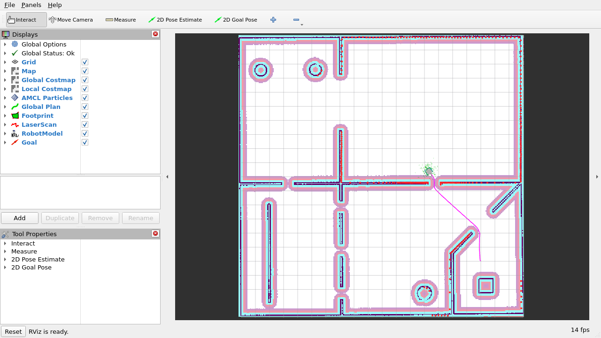
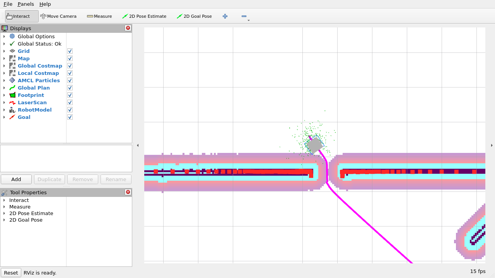
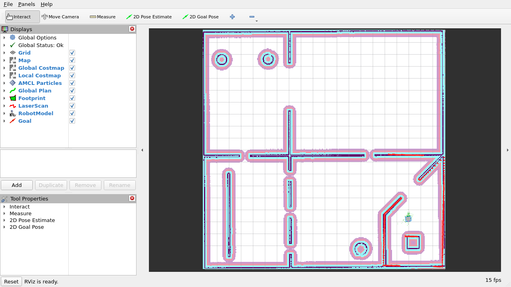
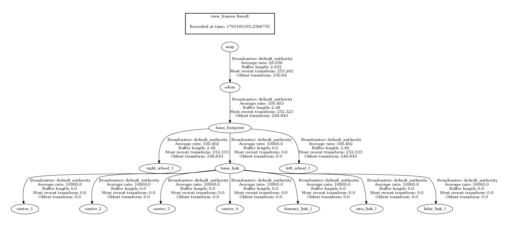

# testbed_navigation

Manual Nav2 setup for **Testbed-T1.0.0** (ROS 2 Humble, Gazebo Classic 11) - no `nav2_bringup`.
Every Nav2 node is started on its own in three small launch files, one per step of the workflow.

```
testbed_navigation/
|-- launch/
|   |-- map_loader.launch.py     # step 1: map_server
|   |-- localization.launch.py   # step 2: amcl            (includes step 1)
|   `-- navigation.launch.py     # step 3: planner, controller, behaviors, bt_navigator
|-- config/
|   |-- amcl_params.yaml
|   `-- nav2_params.yaml
|-- rviz/navigation.rviz         # map, costmaps, AMCL particles, plan, footprint, scan
`-- media/                       # screenshots
```

## How to run

```bash
cd ~/assignment_ws && colcon build && source install/setup.bash
export RMW_IMPLEMENTATION=rmw_cyclonedds_cpp      # recommended in help.md

# terminal 1 - simulation (Gazebo + robot)
ros2 launch testbed_bringup testbed_full_bringup.launch.py

# terminal 2 - map + localization + navigation (+ RViz)
ros2 launch testbed_navigation navigation.launch.py localization:=true
```

Then click **2D Goal Pose** in the navigation RViz window.
Every step can also be started alone:

```bash
ros2 launch testbed_navigation map_loader.launch.py        # only /map
ros2 launch testbed_navigation localization.launch.py      # /map + AMCL (map->odom)
ros2 launch testbed_navigation navigation.launch.py        # only the nav servers
```

## Approach

| Step | Node(s) | What it does |
|---|---|---|
| 1. Map loading | `nav2_map_server/map_server` + `lifecycle_manager_map` | Loads `testbed_bringup/maps/testbed_world.yaml`, publishes `/map` |
| 2. Localization | `nav2_amcl/amcl` + `lifecycle_manager_localization` | Particle filter: `/scan` + `/map` + odom -> publishes TF `map -> odom` and `/amcl_pose` |
| 3. Navigation | `planner_server`, `controller_server`, `behavior_server`, `bt_navigator` + `lifecycle_manager_navigation` | Goal -> behaviour tree -> global path -> velocity commands -> `/cmd_vel` |

All Nav2 nodes are **lifecycle nodes**; each launch file has its own `lifecycle_manager` (`autostart: true`)
that configures and activates them, so every step can be started/stopped independently.

Plugins chosen (only basic navigation is needed):

* **Global planner:** `nav2_navfn_planner/NavfnPlanner` (Dijkstra on the global costmap).
* **Controller:** `RegulatedPurePursuitController` - simple path follower for a differential-drive
  robot; `use_rotate_to_heading` makes it turn in place first.
* **Costmaps:** global = static layer (map) + obstacle layer (lidar) + inflation;
  local = 3 m x 3 m rolling window with obstacle + inflation layers.
  Footprint 0.36 m x 0.42 m taken from the URDF mesh sizes.
* **Behaviour tree:** Nav2 default `navigate_to_pose_w_replanning_and_recovery.xml`
  (replans at 1 Hz, recoveries = clear costmaps, spin, wait, backup -> `behavior_server`).
* **AMCL:** differential motion model, likelihood-field laser model, initial pose = Gazebo spawn pose
  `(0, 5, 0)` (the map frame matches the Gazebo world frame, checked by ray-casting the map against `/scan`).

TF tree: `map -> odom` (AMCL) `-> base_footprint` (Gazebo diff_drive) `-> base_link -> lidar_link_1 ...` (robot_state_publisher).

## Results

* Map, AMCL and all navigation servers come up with no errors.
* Goals across rooms succeed, e.g. spawn `(0, 5)` -> `(7, -6)` through the doorway in ~54 s with no recoveries.
* AMCL started from a wrong initial pose (~0.8 m off) converges back to < 0.1 m error after driving.

| Gazebo | Navigation in RViz |
|---|---|
|  |  |
| **Laser scan matches the map (localized)** | **Goal reached** |
|  |  |

TF tree: 

## Challenges / bugs fixed in the starter code

The full list is in [`../BUGS.txt`](../BUGS.txt). In short: build error (`ament_package`), maps not installed,
wrong map image name, lidar range only 1.5 m (no valid scan in a 20 m room), wrong wheel separation,
`base_footprint` not at the rotation centre, a ROS 1 Gazebo plugin, and a stray `>` in the IMU block.

Other things learned along the way:
* `ros2 topic echo` cuts arrays at 128 values - use `--full-length` when checking `/scan`.
* Nav2 rejects an `/initialpose` whose quaternion is not normalised to within 1e-4.
* Publishing on `/goal_pose` while a `NavigateToPose` action is running preempts that goal.
