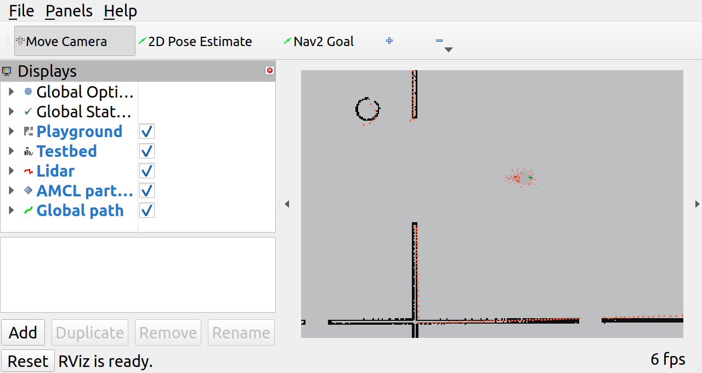

# Testbed navigation on ROS 2 Humble

The simulator supplies the laser scan, odometry and robot transforms. Three independent launch files load the supplied map, estimate the robot pose, and drive to a goal. Each stage starts its own lifecycle manager, so its nodes configure and activate automatically.

## Build

On Ubuntu 22.04 with ROS 2 Humble, Gazebo Classic and rosdep configured, run the following from the workspace containing this repository under `src`.

```bash
cd ~/assignment_ws
source /opt/ros/humble/setup.bash
rosdep install --from-paths src --ignore-src -r -y
colcon build --symlink-install
source install/setup.bash
```

## Run and verify

Open four terminals. Source `/opt/ros/humble/setup.bash` and `~/assignment_ws/install/setup.bash` in each one. Keep each launch running. Wait for Gazebo to report that the robot spawned, then wait for each lifecycle manager to report “Managed nodes are active” before starting the next stage.

1. Start Gazebo and RViz. Select the Testbed navigation view to see the map, scans, particles and path.

   ```bash
   ros2 launch testbed_bringup testbed_full_bringup.launch.py \
     rvizconfig:="$(ros2 pkg prefix --share testbed_navigation)/config/testbed.rviz"
   ```

2. Load the occupancy grid. The map server resolves the installed YAML and its sibling PGM. The map should appear in RViz with the fixed frame set to `map`.

   ```bash
   ros2 launch testbed_navigation map_loader.launch.py
   ```

3. Start AMCL. The initial estimate uses the simulator spawn at (0, 5) facing +x. AMCL compares laser returns against the map and publishes the map-to-odom transform. Look for the scan endpoints along walls and the particle cloud around the robot. Use **2D Pose Estimate** to reset the estimate if needed.

   ```bash
   ros2 launch testbed_navigation localization.launch.py
   ```

4. Start the navigation servers. NavFn computes a path through the global costmap. DWB samples differential-drive velocities against the rolling local costmap and publishes commands on /cmd_vel. The behavior-tree navigator coordinates planning, control and recovery through ROS actions.

   ```bash
   ros2 launch testbed_navigation navigation.launch.py
   ```

5. In a fifth sourced terminal, check stage readiness and send a goal. Each lifecycle query should report `active`. The map is 405 × 400 cells at 0.05 m per cell.

   ```bash
   ros2 lifecycle get /map_server
   ros2 lifecycle get /amcl
   ros2 lifecycle get /bt_navigator
   ros2 topic echo /map --once --field info --qos-durability transient_local
   ros2 action send_goal /navigate_to_pose nav2_msgs/action/NavigateToPose \
     '{pose: {header: {frame_id: map}, pose: {position: {x: 1.5, y: 5.0}, orientation: {w: 1.0}}}}' --feedback
   ```

   Watch the path appear and the robot follow it. Check the terminal for the final action status. To try another destination, use the Nav2 goal tool in RViz and drag an arrow in free space. Stop launches in reverse order with Ctrl+C.

## Troubleshooting

If the map is blank, check the map server lifecycle state and the installed map path. If the robot or scans are missing, inspect /clock, /scan and the transform from map to base_footprint (`ros2 run tf2_ros tf2_echo map base_footprint`). If navigation accepts a goal but the robot stays still, watch /cmd_vel and /odom while the goal is active. The repository's BUG_FIXES.txt records starter defects and the simulator changes.

## Configuration decisions

- Map loading uses the installed package share directory. To test another map, pass `map:=/absolute/path/to/map.yaml` to the map loader.
- AMCL uses the differential motion model and the lidar mounted on the robot. Gazebo publishes odom → base_footprint, the description supplies the fixed sensor transforms, and AMCL supplies map → odom.
- The global costmap combines the static map, laser obstacles and inflation. The local costmap tracks laser obstacles around the robot in odom. Both reserve a 0.35 m radius around the base.
- The controller runs at 10 Hz and samples forward and angular velocity. The behavior tree can clear a costmap, spin, wait or back up if planning or control fails.
- For testing on a VM, the world advances in 5 ms physics steps. The drive publishes at 30 Hz and the lidar at 10 Hz. Use `gui:=false` on the simulation launch to omit the Gazebo window. Adding `rviz:=false` runs the simulation headlessly.

## Verified run

All four packages built with colcon on ROS 2 Humble. Gazebo spawned Testbed, the map server loaded the installed 405 × 400 map, and all three lifecycle managers reported active nodes. AMCL published the starting pose at (0.00, 5.00) in the map frame.

The goal in step 5 returned **SUCCEEDED**. The last feedback sample placed the robot at (1.267, 4.993) m, about 0.233 m from the requested point and inside the configured 0.25 m tolerance. Feedback reported one recovery. The screenshots below come from that run.

**1. Localization.** The red laser returns follow the black wall segments and the circular obstacle to the left of the robot.


**2. Planning.** The green line extends to the right of the robot after the goal is accepted.


**3. Arrival.** With the camera in the same position, the robot is now near the right end of the original path. The action client reported `SUCCEEDED`.



## Repeatability check

The final test started from a clean build and ran Gazebo headlessly. Both goals were sent in the same session. The second destination required a change in heading. Positions below are the last feedback samples in the map frame.

| Requested (x, y) in m | Last feedback (x, y) in m | Recoveries | Action result |
| --- | --- | --- | --- |
| (1.50, 5.00) | (1.273, 4.993) | 0 | SUCCEEDED |
| (2.50, 5.50) | (2.386, 5.413) | 0 | SUCCEEDED |

The [terminal excerpt](evidence/goal-results.txt) records the lifecycle states and final feedback for both goals.

An earlier test repeatedly entered recovery near the goal. The drive commanded a turn, but odometry showed little rotation. The fixes changed wheel and caster friction, wheel spacing and the controller's progress settings. The VM also logged occasional missed loop rates during successful runs. See the [before-and-after notes](../BUG_FIXES.txt) for the values.
