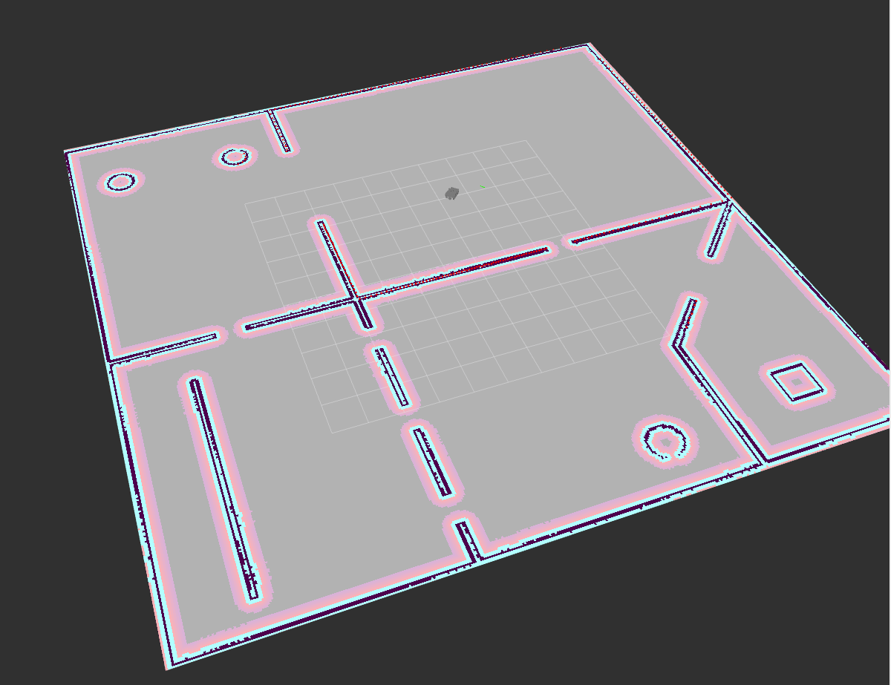

# Testbed navigation

The first build failed because `ament_package` was missing its `()` in `testbed_description/CMakeLists.txt`. I changed it to `ament_package()` and built the workspace again. Once the robot could spawn in Gazebo, I set up map loading, localization, and navigation in separate launch files so I could check each stage on its own.

[Navigation video](../navigation_video.mp4) · [Starter code fixes](../errors.txt)

## How I built it

### Get the map working first

I made `map_loader.launch.py` load the supplied map from the installed `testbed_bringup` package. The first map load exposed two separate problems. The install rule skipped the map directory, and the YAML pointed to a `.pgm` file that did not exist. Once both were fixed, I could check `/map` on its own before adding AMCL. The [bug list](../errors.txt) has the details.

### Match the robot's scan to the map

I checked the robot's TF tree and used `base_footprint` for the robot, `odom` for its local motion, and `map` for its position in the room. `localization.launch.py` starts AMCL with these frames and the `/scan` topic. The initial pose tells AMCL where to start matching the laser readings to the map.

When the initial pose seemed to do nothing, the AMCL log showed that RViz had sent it in `odom`. Setting RViz's fixed frame to `map` fixed that. I also corrected the AMCL parameter filename and the `ros__parameters` key so AMCL would load its settings and use the same clock as Gazebo. At spawn, the original 1.5 m lidar scan returned no obstacles. Increasing the range to 10 m gave AMCL wall readings to work with from the start.

### Plan a route and follow it

I started the servers directly in `navigation.launch.py` and used the [Nav2 Humble example](https://github.com/ros-navigation/navigation2/blob/humble/nav2_bringup/params/nav2_params.yaml) as a reference for the plugin settings. Each stage has its own lifecycle manager. This made it possible to bring up the map, check localization, and then start navigation once `map` and `odom` were connected.

I chose NavFn because a grid planner is enough for this indoor map. I used DWB because it can score short movements against nearby obstacles. I set its sideways velocity to zero to match the robot's differential drive. NavFn plans on the global costmap in `map`, and DWB follows the route using the local costmap in `odom` and sends commands to `/cmd_vel`. The behavior tree coordinates planning, path following, and recovery.

### Tune for doorways

I first considered a circular footprint. Measuring the collision meshes showed that the body is offset from `base_footprint`, so I used a rectangle that covers the body and wheels. For doorways, I reduced the global inflation radius from 0.55 m to 0.35 m to shorten the planner's obstacle buffer. I kept the same footprint and left the local inflation radius at 0.55 m. The final test checked that the robot could cross the same opening in both directions with those settings.

## Build and run

The setup was tested with ROS 2 Humble, Gazebo Classic 11, and RViz. Install the Gazebo ROS packages and Nav2 components in your Humble environment:

```bash
sudo apt install ros-humble-gazebo-ros-pkgs ros-humble-navigation2
```

Put this repository under `src/` in a ROS 2 workspace. From the workspace root, build the packages:

```bash
source /opt/ros/humble/setup.bash
colcon build --symlink-install
```

Open a separate terminal for each launch. In each terminal, go to the workspace root and source both `/opt/ros/humble/setup.bash` and `install/setup.bash`.

| Terminal | Command |
| --- | --- |
| 1 | `ros2 launch testbed_bringup testbed_full_bringup.launch.py` |
| 2 | `ros2 launch testbed_navigation map_loader.launch.py` |
| 3 | `ros2 launch testbed_navigation localization.launch.py` |
| 4 | `ros2 launch testbed_navigation navigation.launch.py` |

Before starting terminal 4, set the RViz fixed frame to `map`. Use **2D Pose Estimate** near the Gazebo spawn point at about `(0, 5)`, facing along positive X. Check that the laser scan lines up with the walls. Then start terminal 4 and wait for the navigation lifecycle manager to report that its nodes are active.

To send a short test goal from another sourced terminal, run:

```bash
ros2 action send_goal /navigate_to_pose nav2_msgs/action/NavigateToPose \
  '{pose: {header: {frame_id: map}, pose: {position: {x: 1.0, y: 5.0}, orientation: {w: 1.0}}}}' \
  --feedback
```

I added RViz displays for the map, the global and local costmaps, and both paths. The map shows the room, the costmaps show the buffers around obstacles, `/plan` shows the route, and `/local_plan` shows the controller's chosen trajectory. The map display uses **Reliable** and **Transient Local** so RViz can receive the map even if it subscribes after the map server starts.

## Test results



In the final Gazebo run, the robot reached the approach point and crossed the same doorway in both directions. All three goals returned `SUCCEEDED`. The robot stopped 20 to 25 cm from the requested positions in Gazebo, and the AMCL estimate was within 7 cm of the Gazebo position at those stops.

I also canceled a goal while the robot was moving. Nav2 returned `CANCELED`, and no more nonzero velocity commands arrived during the next two seconds. A planning request outside the map returned `ABORTED`.
