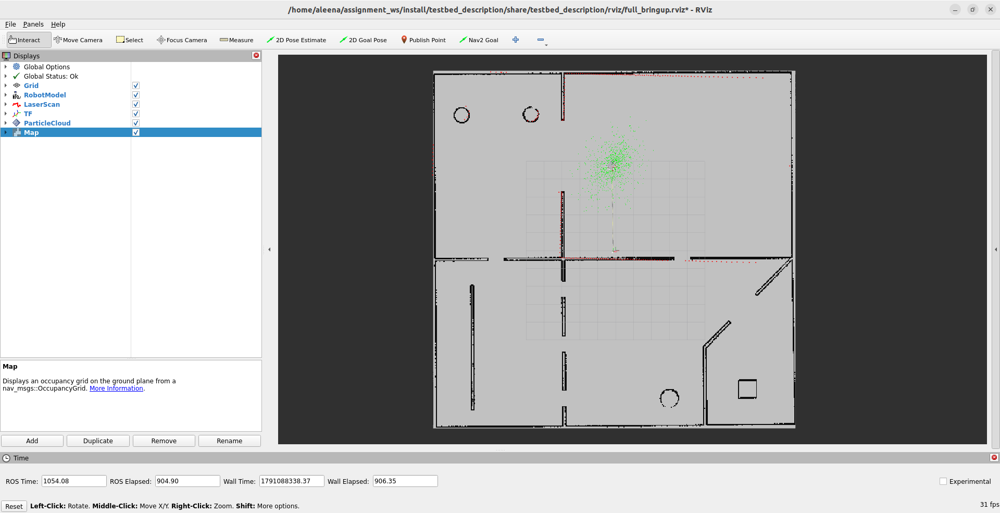

# testbed_navigation

Manual Nav2 setup for the Testbed-T1.0.0 robot. Instead of calling `nav2_bringup`,
each Nav2 component is launched on its own with its own parameter file.

## Layout

| File | Purpose |
|---|---|
| `launch/map_loader.launch.py` | `nav2_map_server` + lifecycle manager; loads `testbed_bringup/maps/testbed_world.yaml` |
| `launch/localization.launch.py` | `nav2_amcl` + lifecycle manager |
| `launch/navigation.launch.py` | `controller_server` (DWB), `planner_server` (NavFn), `behavior_server`, `bt_navigator` + lifecycle manager |
| `launch/nav_all.launch.py` | Convenience: all three above (`rviz:=true` also opens RViz) |
| `config/map_server_params.yaml` | map_server parameters |
| `config/amcl_params.yaml` | AMCL parameters |
| `config/nav2_params.yaml` | planner, controller, costmaps, behaviors, BT navigator |
| `rviz/navigation.rviz` | RViz config (map, costmaps, scan, plan, particles) |

## Approach

* **Map**: map_server is a lifecycle node, so a dedicated `lifecycle_manager_map` configures and activates it. The map path is a launch argument.
* **Localization**: AMCL with the differential motion model and likelihood-field laser model. Frames follow the robot: `odom -> base_footprint` is published by the Gazebo diff-drive plugin, AMCL publishes `map -> odom`. Lidar settings match the sim sensor (`/scan`, 300 beams, 0.1-12 m).
* **Navigation**: only basic plugins - NavFn global planner, DWB local controller, spin/backup/wait behaviors, and the default BT (`navigate_to_pose_w_replanning_and_recovery`). Costmaps use the static map + lidar obstacle layer + inflation. The controller publishes straight to `/cmd_vel`, which the Gazebo plugin listens to, so no velocity smoother is needed.
* Each component has its own lifecycle manager so they can be started, tested and restarted independently.

## Running

Start the simulation first (in one terminal):

```bash
ros2 launch testbed_bringup testbed_full_bringup.launch.py
```

Then, in a second terminal, either everything at once:

```bash
ros2 launch testbed_navigation nav_all.launch.py rviz:=true
```

or one component at a time:

```bash
ros2 launch testbed_navigation map_loader.launch.py
ros2 launch testbed_navigation localization.launch.py
ros2 launch testbed_navigation navigation.launch.py
```

AMCL starts from the robot's spawn pose (x=0, y=5, yaw=0, `set_initial_pose: true` in `config/amcl_params.yaml`),
so the `map -> odom` transform exists immediately. Without it the global costmap waits for the `map` frame and
`planner_server` stays stuck in activation. To use RViz instead, set `set_initial_pose: false` and use
**2D Pose Estimate**. Then use **2D Goal Pose** to send a navigation goal, or from a shell:

```bash
ros2 action send_goal /navigate_to_pose nav2_msgs/action/NavigateToPose \
  "{pose: {header: {frame_id: map}, pose: {position: {x: 3.0, y: 5.0, z: 0.0}, orientation: {w: 1.0}}}}"
```

Tested: all six nodes (`map_server`, `amcl`, `controller_server`, `planner_server`, `behavior_server`,
`bt_navigator`) reach `active`, and the goal above finishes with status `SUCCEEDED` (robot drove from x~-0.3 to x~2.7).

Useful checks: `ros2 lifecycle get /map_server`, `ros2 topic echo /amcl_pose`,
`ros2 run tf2_tools view_frames`, `ros2 action list`.

## Challenges / notes

* Several bugs in the starter code had to be fixed first - see `BUGS.txt` in the repository root.
* The lidar's original 1.5 m range was too short for AMCL and the costmaps; it was raised to 12 m.
* The launch arguments for the parameter files have different names in each launch file
  (`map_params_file`, `amcl_params_file`, `nav2_params_file`). Launch arguments are global, so a shared name made
  `nav_all.launch.py` pass the map-server file to every node.
* If goals time out, switch the DDS implementation (`export RMW_IMPLEMENTATION=rmw_cyclonedds_cpp`).

## Results

Localization (AMCL particles and scan aligned with the map):



Navigation to a goal:


Demo video: [navigation_demo.webm](../docs/navigation_demo.webm)
