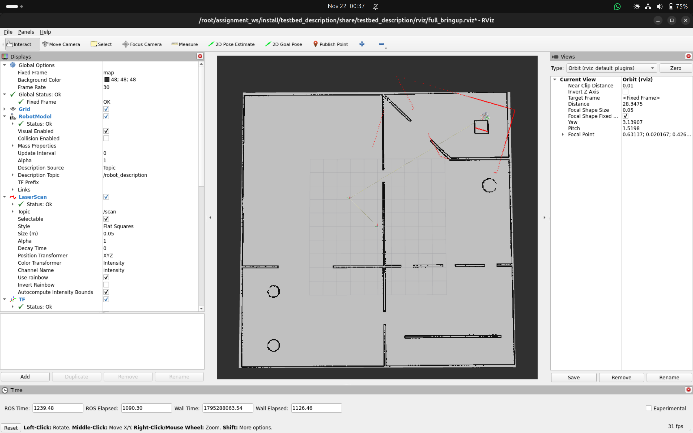
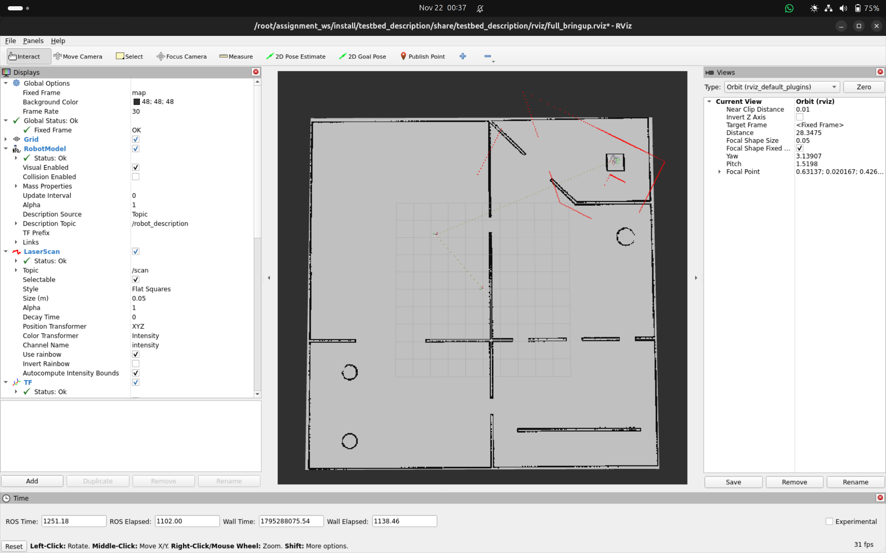

# testbed_navigation

Navigation setup for the Testbed-T1.0.0 robot, built from individual Nav2 nodes instead of `nav2_bringup`. There is one launch file each for map loading, localization and navigation.

Author: Ansh Srivastava

## What is in the package

The map is not copied into this package. `map_loader.launch.py` uses `testbed_bringup/maps/testbed_world.yaml`.

## Approach

I did it in the order the assignment lists, and tested each layer before adding the next.

1. **Map loading.** `nav2_map_server` plus a `nav2_lifecycle_manager` that configures and activates it. I checked the map showed up in RViz before moving on.
2. **Localization.** `nav2_amcl` with its own lifecycle manager. The initial pose is set in `amcl_params.yaml` to (0, 5, 0), which is where the robot spawns. I confirmed the laser scan lines up with the walls in RViz and that `map -> base_link` stays steady.
3. **Navigation.** The nodes are started one by one in `navigation.launch.py`:
   - `planner_server` with NavfnPlanner (`GridBased`)
   - `controller_server` with the DWB local planner
   - `behavior_server` with spin, backup and wait
   - `bt_navigator` using the default behavior trees
   - a separate `lifecycle_manager_navigation` for those four nodes

   Both costmaps use an obstacle layer on `/scan` and an inflation layer, and the global one also has a static layer. I kept speeds low (0.3 m/s max) and left out the optional velocity smoother and collision monitor, since the assignment only asks for basic navigation.

Everything uses `use_sim_time: true`.

## How to run

Build:

```bash
cd ~/assignment_ws
colcon build --symlink-install
source install/setup.bash
```

Then use three terminals, in this order:

```bash
# 1. simulation (Gazebo + RViz), wait until the robot has spawned
ros2 launch testbed_bringup testbed_full_bringup.launch.py

# 2. map + localization, check that /amcl is active
ros2 launch testbed_navigation localization.launch.py

# 3. navigation, wait for "Managed nodes are active"
ros2 launch testbed_navigation navigation.launch.py
```

In RViz set the fixed frame to `map`. The initial pose is already applied; if the scan is off, use 2D Pose Estimate at the robot's position. Then send a goal with 2D Goal Pose, or from the command line:

```bash
ros2 action send_goal /navigate_to_pose nav2_msgs/action/NavigateToPose \
"{pose: {header: {frame_id: map}, pose: {position: {x: 3.0, y: 5.0}, orientation: {w: 1.0}}}}" --feedback
```

Pick a goal in free space. If you restart the simulation, restart all three layers.

## Bugs in the starter code

Seven bugs are written up in `bugs_fixed.txt` in the repo root. Short version:

1. `ament_package` missing `()` in `testbed_description/CMakeLists.txt`
2. `robot_state_publisher` had no `use_sim_time`
3. Wrong image path in `testbed_world.yaml`
4. Lidar max range was 1.5 m, changed to 12 m
5. Stray `>` in the IMU plugin XML
6. `maps` directory was not installed by `testbed_bringup`
7. `libgazebo_ros_control.so` is a ROS 1 plugin and does not exist in Humble, so I removed it

I also added `models` to the `testbed_gazebo` install rules and `gazebo_ros` to its `package.xml`. Those are small cleanups, not bugs that stopped anything from working.

## Challenges

- **Jazzy on the host.** My machine runs Ubuntu 24.04 with Jazzy, but the assignment is for Humble. I ran everything in the `osrf/ros:humble-desktop-full` Docker image, with the display shared through `xhost`. Following the hint in `help.md`, I switched to Cyclone DDS (`rmw_cyclonedds_cpp`).
- **Launch file not found.** `ros2 launch` said `navigation.launch.py` was not in the share directory. The file had never been saved in the package, so I created it and rebuilt.
- **Startup order.** If localization is started before the simulation is running, both lifecycle managers fail to configure their nodes (no clock or TF yet). Starting the simulation first fixes it.
- **Robot jumping around in RViz.** After restarting only some of the terminals, the old localization and navigation processes were still alive and `ros2 node list` showed every node twice. Two AMCLs were publishing `map -> odom`. Restarting the container and launching each layer once fixed it. Now I check `ros2 node list | sort | uniq -c` before sending a goal.
- **Goals that finish instantly.** The first goal I sent was inside the 0.25 m goal tolerance, so the controller only rotated and stopped. Goals a few metres away work fine.
- **File ownership.** The workspace is shared with the container, so files created as root there could not be edited from the host. `chown` on the host fixed it.

## Demo

- Video: [`media/nav_demo.mp4`](media/nav_demo.mp4) (localization and a full navigation run)
- Localization: 
- Path planned: 
- Navigating: 
