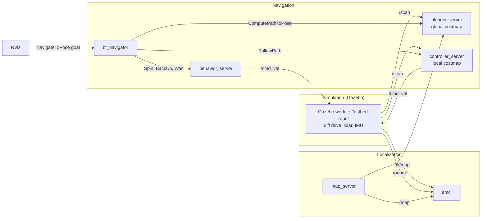

# testbed_navigation

A ROS 2 Humble package that gives the Testbed-T1.0.0 robot autonomous navigation in Gazebo. It loads a prebuilt map, localizes the robot with AMCL, and navigates to goals with the Nav2 stack. Every Nav2 node is started from its own launch file, without `nav2_bringup`.

- Demo video: `<paste video link here>`
- Starter-code bugs I found and fixed: [`BUGS.md`](../BUGS.md)

## Package layout

```
testbed_navigation/
├── config/
│   ├── amcl_params.yaml        # AMCL settings (frames, particles, initial pose)
│   └── nav2_params.yaml        # planner, controller, behaviors, BT navigator, costmaps
├── launch/
│   ├── map_loader.launch.py    # map_server + lifecycle manager
│   ├── localization.launch.py  # map loader + AMCL + lifecycle manager
│   ├── navigation.launch.py    # planner, controller, behaviors, BT navigator + lifecycle manager
│   └── bringup_all.launch.py   # simulation + localization + navigation + RViz in one command
├── rviz/
│   └── navigation.rviz         # saved RViz layout
├── docs/
│   └── tf_tree.pdf             # TF tree from view_frames
├── CMakeLists.txt
└── package.xml
```

## Requirements

- Ubuntu 22.04, ROS 2 Humble, Gazebo Classic 11
- Nav2 and the Gazebo ROS packages:

```bash
sudo apt install ros-humble-navigation2 ros-humble-nav2-bringup \
  ros-humble-gazebo-ros-pkgs ros-humble-xacro
```

## Build

```bash
cd ~/assignment_ws
rosdep check --from-paths src --ignore-src
colcon build --symlink-install
source install/setup.bash
```

## Run

### Everything with one command

```bash
ros2 launch testbed_navigation bringup_all.launch.py
```

This starts the robot description, the Gazebo playground world and the robot spawn. After 10 seconds it starts localization, after 17 seconds navigation, and after 20 seconds RViz with the saved layout. Then send a goal with the **2D Goal Pose** tool in RViz.

The delays are fixed timers. They give AMCL time to publish `map → odom` before Nav2 starts, because Nav2's global costmap needs that transform when it activates.

### Layer by layer

Start the simulation first, then each layer in its own terminal:

```bash
ros2 launch testbed_bringup testbed_full_bringup.launch.py   # simulation (opens its own RViz)
ros2 launch testbed_navigation localization.launch.py        # map + AMCL
ros2 launch testbed_navigation navigation.launch.py          # Nav2 servers
```

`map_loader.launch.py` can also be run on its own to check that the map loads.

### Launch arguments

| Launch file | Argument | Default | Purpose |
|---|---|---|---|
| all four | `use_sim_time` | `true` | Use the Gazebo clock |
| `map_loader` | `map` | `testbed_bringup/maps/testbed_world.yaml` | Map file to load |
| `localization` | `amcl_params_file` | `config/amcl_params.yaml` | AMCL parameters |
| `navigation` | `nav2_params_file` | `config/nav2_params.yaml` | Nav2 parameters |
| `bringup_all` | `rviz_config` | `rviz/navigation.rviz` | RViz layout |

## Architecture



Each layer has its own lifecycle manager (`lifecycle_manager_map`, `lifecycle_manager_localization`, `lifecycle_manager_navigation`). They configure and activate the nodes automatically on startup.

### TF tree

```
map → odom → base_footprint → base_link → lidar_link_1, imu_link_1, casters, dummy_link_1
                            → left_wheel_1, right_wheel_1
```

- `odom → base_footprint` comes from the Gazebo diff-drive plugin.
- `map → odom` comes from AMCL.
- The rest comes from `robot_state_publisher`.

The full tree is in [`docs/tf_tree.pdf`](docs/tf_tree.pdf).

## Key parameters and why

### AMCL (`config/amcl_params.yaml`)

| Parameter | Value | Reason |
|---|---|---|
| `base_frame_id` / `odom_frame_id` / `global_frame_id` | `base_footprint` / `odom` / `map` | Match the robot's TF tree |
| `scan_topic` | `scan` | Lidar topic from Gazebo |
| `robot_model_type` | `DifferentialMotionModel` | The robot is a differential drive |
| `laser_max_range` | 12.0 | Matches the lidar range after the starter-code fix |
| `max_beams` | 60 | Uses 60 of the 300 beams to keep the filter fast |
| `min_particles` / `max_particles` | 500 / 2000 | Good coverage on a 20 m × 20 m map without heavy CPU use |
| `set_initial_pose`, `initial_pose` | true, (0, 5, yaw 0) | The robot spawns here, so localization works without a manual pose |
| `tf_broadcast`, `transform_tolerance` | true, 1.0 | Publishes `map → odom` and tolerates small timestamp gaps |

### Navigation (`config/nav2_params.yaml`)

| Component | Choice | Reason |
|---|---|---|
| Global planner | `NavfnPlanner` (`GridBased`), `allow_unknown: true` | Simple and reliable. The map has unknown cells inside furniture. |
| Local controller | `DWBLocalPlanner` at 20 Hz | Standard sampling planner for a differential drive |
| Speed limits | 0.26 m/s linear, 1.0 rad/s angular | Safe values for a small robot in narrow rooms |
| Goal tolerance | 0.25 m, 0.25 rad | Stops reliably without chasing tiny errors |
| Local costmap | 3 m × 3 m rolling window in `odom`, lidar range 2.5 to 3 m | Reacts to nearby obstacles |
| Global costmap | Static layer from `/map` plus a lidar layer in `map`, lidar range 11.5 to 12 m | Plans over the whole map and adds obstacles not in it |
| `robot_radius`, `inflation_radius` | 0.30 m, 0.55 m | Keeps paths clear of walls. Tuned against the doorway widths. |
| Recoveries | `spin`, `backup`, `drive_on_heading`, `wait` | Used by the behavior tree when the robot is stuck |

## Test results

I tested these scenarios in the playground world, starting from the spawn pose, with goals sent from RViz.

| # | Scenario | Result | Time (s) | Recoveries used |
|---|---|---|---|---|
| 1 | Goal in the same room | Success | `<fill in>` | `<fill in>` |
| 2 | Goal through a doorway | Success | `<fill in>` | `<fill in>` |
| 3 | Goal in a different room | Success | `<fill in>` | `<fill in>` |
| 4 | Goal on a wall or inside an obstacle | `<fill in: refused / aborted>` | n/a | `<fill in>` |
| 5 | Obstacle placed in the path while moving | Success, path replanned | `<fill in>` | `<fill in>` |

<!--
Uncomment these lines once the image files exist in docs/:


-->

## Challenges and how I solved them

**1. Launch arguments are shared between included files.**
When I combined everything in `bringup_all.launch.py`, AMCL and the Nav2 nodes started with default settings and ignored my parameter files. The log said `Parameter file path is not a file`. `gazebo_ros` declares its own `params_file` argument with an empty default, and launch arguments are shared across included launch files, so that empty value won. I renamed my arguments to `amcl_params_file` and `nav2_params_file`.

**2. Goals sent in the wrong frame.**
Nav2 reported `Extrapolation into the past` and aborted plans. RViz was stamping goals in its Fixed Frame, which was still `odom`, and the planner had to transform them to `map` using an old timestamp. Setting the Fixed Frame to `map` fixed it.

**3. Nav2 started before localization was ready.**
The global costmap timed out waiting for the `map → base_footprint` transform. Starting localization first and Nav2 about 7 seconds later with launch timers avoids it.

**4. RViz QoS settings.**
The `/particle_cloud` display only receives data with the Best Effort reliability policy, to match AMCL. The `/map` display needs Transient Local durability, because `map_server` publishes the map once. I saved both settings in `rviz/navigation.rviz`.

## Troubleshooting

- **Map or particles missing in RViz:** check that the Fixed Frame is `map`, and the QoS settings above.
- **Robot not localized after a wrong 2D Pose Estimate:** set the pose again at the robot's true position (check it with `gz model -m testbed -p`), or restart `bringup_all`. The robot respawns at (0, 5), which matches the AMCL initial pose.
- **Gazebo prints `Network is unreachable` messages:** these are harmless. `export GAZEBO_IP=127.0.0.1` silences them.
- **DDS timeouts:** `help.md` recommends Cyclone DDS: `sudo apt install ros-humble-rmw-cyclonedds-cpp` and `export RMW_IMPLEMENTATION=rmw_cyclonedds_cpp`.

## Possible improvements

- A script that sends goals and waypoint patrols through the Nav2 action interface
- A velocity smoother and a collision monitor between the controller and the robot
- Replacing the fixed launch timers with event-based startup